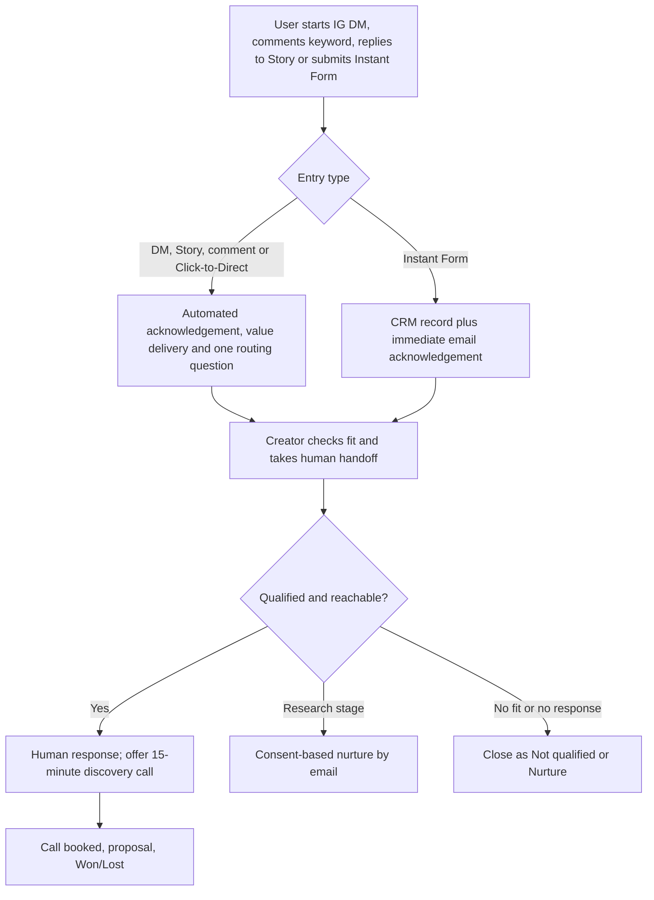

This roadmap is feasible within a ₹40,000 monthly all-in cap if Meta media, 18% GST, tools and contractor production are controlled as one budget, with no external media-buying retainer.

Start at ₹20,000 paid and ₹20,000 organic operations in Month 1, then increase paid allocation to ₹24,000 and ₹28,000 only when lead-quality gates are met. The paid forecast uses pre-GST media budgets of ₹16,949, ₹20,339 and ₹23,729 and assumes paid-media CPLs of ₹300, ₹250 and ₹240, yielding operational follow-up capacity for 56, 81 and 98 paid leads respectively.

Use Ads Manager lead campaigns with Higher Intent Instant Forms as the principal route, with a limited click-to-Instagram-Direct test for prospects who need a conversation before submitting details. Treat these as conditional operating projections rather than promised results, and hold or reallocate the next month’s incremental media if qualification and booked-call performance do not hold.

This three-month roadmap is for a digital marketing service provider targeting small-to-medium businesses and emerging brands in India. It assumes the creator has basic video-editing and graphic-design skills, handles content creation and posting, uses paid ads, and has a maximum all-in budget of ₹40,000 per month.

## Measurable goals

A lead target controls performance only when the team counts the same event every time. This roadmap separates paid and organic acquisition, counts a captured contact rather than a follower or a conversation start, and uses the first three months for test-and-scale optimisation. A conversation start is not necessarily a lead, and Meta lead results can represent an instant-form submission, website event, messaging outcome, or other lead-related action according to campaign setup and tracking.[1][2]

One cited Indian SMB benchmark puts the share of leads that become qualified at 20%–40% and distinguishes message leads from sales-ready leads.[171]

### target leads/month

An **inquiry** is an Indian SMB or emerging-brand prospect’s DM start, offer-comment response, link click, form submission, or other expression of interest; it is not counted as a lead. A **qualified lead** is one distinct, contactable Indian business prospect whose business identity, service need, serviceable location, contact role, and buying capacity pass the written CRM qualification rule. A follower alone is not normally a lead, and a meeting booking is an outcome after qualification rather than a prerequisite for lead counting. Qualification is an advertiser-defined downstream stage.[3][4][1]

Judgment — **Count each qualified lead once when the CRM qualification rule is passed, and record every inquiry separately.** Do not recast DM starts, unqualified form submissions, or meeting bookings as leads.[1]

| Month | Paid qualified-lead target | Organic qualified-lead target | Total qualified-lead target | Status |
|---|---:|---:|---:|---|
| Month 1 | 30 | 5 | 35 | Judgment — operating target |
| Month 2 | 40 | 8 | 48 | Judgment — operating target |
| Month 3 | 50 | 10 | 60 | Judgment — operating target |

An alternative raw-lead plan targets 45 total leads in Month 1, 55 in Month 2 and 65 in Month 3; these are contact-level leads, not the qualified-lead targets in the table above.[171][172]

This source split makes the target actionable: paid delivery is managed against pre-GST paid cost per qualified lead, while Content pillars, posting cadence, and post templates produce the smaller organic qualified-lead contribution. GST is recorded separately as an Indian advertising cash cost.[2][5][6]

**Decision frame — Feasible with conditions.** This is a three-month Instagram lead-generation plan for India-based SMBs and emerging brands in serviceable locations, with ₹40,000 cash available each month, creator-owned basic content production, and mandatory paid Meta advertising. Meta lead ads can use calling, instant forms, or click-to-message destinations including Instagram Direct; this roadmap selects instant forms and a qualifying Instagram DM flow so that the same captured-contact event is counted across paid and organic acquisition.[7][1]

The decision criteria are one consistent qualified-lead event, paid cost per qualified lead calculated from GST-inclusive paid allocation, contact quality in the CRM, and monthly cash capacity including 18% GST on Indian Meta ad charges.[8][1][2][5] Eligible evidence is Meta lead-ad and cost-per-result documentation, India-specific Meta/Instagram cost guidance, and CRM/CPL measurement guidance available through 19 November 2026.[7][8][2][9]

For a contact to pass qualification, require the person to be an owner, decision-maker, or emerging-brand marketer and capture business name, category, city or service area, approximate monthly marketing budget, requirement, and timeline in the CRM.

### cost-per-lead

Paid-media cost per lead (paid CPL) is pre-GST Meta/Instagram media spend divided by new paid captured-contact leads in the selected reporting period. Meta calculates cost per result as amount spent divided by results; this is CPL when the selected result is the defined captured-contact event.[8][10]

| Month | Paid-ad spend (₹/month) | Paid-lead target | Paid-CPL ceiling (₹/paid lead) | Calculation |
|---|---:|---:|---:|---|
| Month 1 | 12,000 | 30 | 400 | Derived — ₹12,000 ÷ 30 = ₹400 |
| Month 2 | 14,000 | 40 | 350 | Derived — ₹14,000 ÷ 40 = ₹350 |
| Month 3 | 15,000 | 50 | 300 | Derived — ₹15,000 ÷ 50 = ₹300 |

Judgment — **Use the ₹400 → ₹350 → ₹300 path as a provisional paid-CPL ceiling, not as a promised outcome.** It begins at the upper end of VGraple’s stated ₹100–₹400 India digital-services range, which notes that B2B targeting is less efficient, and requires improvement before larger month-three volume is accepted.[11]

Meta’s cost per result changes with bid, audience, optimisation, creative and schedule; results also depend on the selected objective and attribution setting. Meta’s definitions provide no average CTR, CPM or ROAS benchmark, and quoted CTR can refer to different metrics while some figures are estimates.[12] Cost per qualified lead changes with audience, offer, creative, optimisation, schedule, attribution and the selected result definition; comparisons remain valid only when result type, attribution model, attribution setting, period, reporting level and qualification stage match.[1][12][13][6] The figures above decide whether to retain, revise, or stop paid variants in the Paid-ad strategy.

One India high-ticket form-lead estimate is ₹400–₹1,500 per lead, while a separate Click-to-WhatsApp estimate is ₹40–₹450 per enquiry; the two measure different capture events.[171][172]

Published India benchmark ranges cited for different lead types are ₹300–₹800 per India SMB B2B lead, ₹500–₹2,000 and ₹750–₹1,900 per B2B-service lead, ₹150–₹700 per services WhatsApp lead, and ₹400–₹1,500 per high-ticket form lead; these ranges do not use one common lead definition.[172][173][174]

**Target-setting method —** Work backward from the provider’s economics: apply average deal value and close rate to establish target customer-acquisition cost, then apply the historical lead-to-customer rate to establish the CPL ceiling.[14] Set targets from the provider’s conversion and revenue data, use published benchmarks as range checks, agree the monthly lead count or target CPA with the client, and record the agreed figures in writing before reporting begins.[6][15]

### Lead definition and uncertainty

A low-cost captured contact is not necessarily a commercially valuable prospect. Salesforce advises that paying more for a prospect ready to purchase can be preferable to paying little for one who never buys, while Meta lead-generation guidance recommends assessing whether enquiries become worthwhile conversations.[9][16]

Judgment — **Apply a two-level scorecard: paid cost per qualified lead controls media efficiency; worthwhile-conversation rate controls commercial quality.** Report full-campaign cost per qualified lead separately, because total marketing cost can include content production, software subscriptions, staff time and contractor or agency fees, unlike the paid-allocation measure above.[1][9][17][6]

GST also affects cash planning: Meta advertising billed in India carries 18% GST on top of the set ad budget, subject to the business’s tax treatment.[2] This means the Paid-ad strategy must reserve tax or explicitly define the ₹40,000 cap as media-and-operations excluding recoverable GST.

Cheap enquiries need not become customers.[18][19][9][16]

Month 1 validates one offer and one primary audience segment; Month 2 improves qualification and creative from Month 1 results; Month 3 scales only the winning audience-and-creative combination.

The recommended three-month goal is 35, 48 and 60 qualified inquiries, with paid CPL ceilings of ₹400, ₹350 and ₹300 respectively. The declining CPL target is a controlled test-and-scale expectation, not an industry promise: set lead and allowable-CPL targets, test for two to four weeks, and scale only what works.[2][10] Quality remains decisive because cheap enquiries can fail to become customers.[9][20][19]

1. Start Month 1 with the stated qualified-lead definition and ₹1,200 paid cost-per-qualified-lead target.
2. Keep paid and organic qualified leads separate in reporting.
3. Scale Month 2 and Month 3 only where worthwhile-conversation outcomes hold. [2][16]

## Content pillars, posting cadence, and post templates

Judgment — This publishing system is designed to make a small Indian business prospect recognise a marketing problem, see credible evidence that the provider can solve it, understand what engagement looks like, and take a low-friction inquiry action. Content pillars are recurring themes rather than individual posts; four is within the commonly recommended three-to-five-pillar range.[21][22][23]

### Four content pillars

- **SMB Growth Diagnostics:** Diagnostics of growth and Instagram lead-generation problems faced by Indian SMBs and emerging brands. [24]

- **Proof and Client Outcomes:** Case studies, testimonials, annotated before-and-afters, campaign lessons and concrete client metrics where permission exists. Its job is to reduce perceived risk through a problem, approach and measurable outcome. [23][25][26]

- **Process, People and Local Context:** Behind-the-scenes delivery, team expertise, audit snippets, working methods and observations from serving Indian SMBs and emerging brands. Its job is transparency: process content helps a prospect understand what working together looks like and can reduce uncertainty around a complex service. [26]

- **Service Process and Trust:** The provider’s delivery process, team and answers to purchase objections. [26]

**SMB Growth Diagnostics, Practical Instagram and Meta Advertising Instruction, and Proof and Client Outcomes should lead the mix** because they demonstrate immediate usefulness and credible delivery; Service Process, Team and Purchase-Objection Answers should humanise that expertise and give qualified viewers a route to inquire.[21][27]

Across several weeks, keep roughly 80% of feed posts useful or entertaining and 20% directly promotional. SMB Growth Diagnostics, Practical Instagram and Meta Advertising Instruction, Proof and Client Outcomes, and Service Process, Team and Purchase-Objection Answers supply practical value, credibility, transparency and direct conversion opportunities.[28][21]

A B2B-service guide uses five example pillars: Expertise and Education; Proof and Client Outcomes; People and Culture; Process and Behind the Scenes; and Perspective and Commentary.[29]

For the recurring mix, allocate 40 percent educational content, 25 percent social proof or community, 20 percent behind-the-scenes content, and 15 percent offers and product posts.[21] A separate starting framework places most posts in education or proof, then culture, and limits direct promotion to roughly one in ten posts.[29]

Buffer found that Reels delivered 36% more reach than carousels and 125% more reach than images, while median engagement by reach was 6.90% for carousels, 4.44% for images and 3.31% for Reels.[175][176]

Socialinsider reported follower engagement of 0.55% for carousels, 0.52% for Reels and 0.37% for images, as well as higher carousel views across follower bands.[177]

Within the Practical Instagram and Meta Advertising Instruction pillar, include brand-demand and creative playbooks covering Reels, carousels, offers, landing pages, WhatsApp or DM conversion paths, and ad creative for emerging brands. Include founder decision-support content on budget allocation, agency-versus-in-house choices, ad readiness, lead quality, and other purchase decisions.

### Weekly posting cadence

Use this cadence in each of the three months: **three feed posts per week, two Story sequences per week, and Sunday review/no-feed-post time.** Three solid posts per week is a sustainable solo-creator starting point; Reels support discovery, carousels suit tutorials and comparisons, and single-image posts suit testimonials or announcements.[30][31] This reduced publishing load protects the human response time required for lead generation. High-intent inquiries receive contact within one hour and warm inquiries within 24 hours.[32]

An alternative publishing cadence is five feed posts—three Reels, one carousel and one static or interactive post—plus daily Stories each week; a cited India business-account range is four to seven posts per week.[178]

| Day | Publishing slot and pillar purpose |
|---|---|
| **Monday** | SMB Growth Diagnostics Reel: quick audit, myth, mistake or framework; CTA: DM **AUDIT** for a free Instagram Lead Audit. [31][30][25] |
| **Tuesday** | Practical Instagram and Meta Advertising Instruction carousel: checklist, comparison, FAQ, myth-versus-fact or process; CTA: DM **AUDIT** for a free Instagram Lead Audit. [31][26][25] |
| **Wednesday** | Short interactive Story sequence: poll or question → explanation → proof or process frame → DM **AUDIT** or booking CTA; respond to resulting DMs and comments. [31][21][22][25] |
| **Thursday** | Proof and Client Outcomes Reel: permissioned result, testimonial, before-and-after or case lesson; CTA: DM **AUDIT** for a free Instagram Lead Audit. [21][29][25] |
| **Friday** | Service Process, Team and Purchase-Objection Answers carousel: workflow, founder insight, local-market observation, audit process or consultation offer; CTA: DM **AUDIT** for a free Instagram Lead Audit. [21][23][31][33][25] |
| **Daily Stories** | One to three low-production frames: poll, question box, behind-the-scenes update, reminder or DM prompt; where a lead magnet or signup page is available, use a link sticker for responses or signups. [31][3] |
| **Saturday** | Short Process, People and Local Context Story sequence: behind-the-scenes update → process lesson → DM **AUDIT** CTA. [31][25] |
| **Weekdays** | Monitor inquiry notifications during business hours and complete the assigned CRM and follow-up actions: high-intent leads within one hour and warm leads within 24 hours. [32] |
| **Sunday** | Short Service Solutions and Next Steps Story sequence: audit reminder or consultation opening → proof frame → DM **AUDIT** or booking CTA; then review results and schedule the coming week. [31][33][25][34][35] |

An alternative daily Story treatment uses three to five frames showing work in progress, a poll or question, a proof point and a CTA; it shares each Reel to Stories within one hour.[179][180]

Meta Business Suite schedules posts, Stories and Reels and suggests active times from follower activity in the previous seven days.[35][36] If response obligations or deadlines tighten capacity, keep the four-post rhythm but shrink the asset: turn a tutorial into a short clip, a carousel into three slides, a case study into a simple update, or use a quote-style post.[30]

Use the following repeatable production and response timetable. **Monday or Tuesday:** reserve one two-to-four-hour anchor session to batch-write captions, record video, outline carousels and capture clips for the following week. **Later in the week:** reserve a separate editing and distribution session to finish assets and schedule the next week’s posts and Stories in Meta Business Suite.[30][35] **Every weekday:** prioritise inbox monitoring and lead routing during business hours before discretionary content work; contact high-intent leads within one hour and warm leads within 24 hours, with fallback rules for unassigned leads.[32] **Sunday:** review results, clear remaining comments and DMs, and schedule the coming week.[34][35]

A second India-specific solo-owner cadence option is two to three feed posts per week, two Reels per week, and Stories on three to four days per week.[28]

An alternative five-feed-post cadence amounts to approximately 20–22 posts per month; Buffer reported an 18-post monthly average, while Socialinsider reported a brand average of eight Reels, five carousels and seven images per month.[177][181]

One reported brand-content benchmark is eight Reels, five carousels and seven images per month; a separate small-team recommendation is three Reels, one carousel, one image and daily Stories.[178][177]

Use Tuesday–Thursday, 9–11 a.m. or 6–8 p.m., and Saturday, 10 a.m.–noon, as local-time test slots; then refine scheduling with Active times, which uses follower activity from the previous seven days.[37][38]

Additional posting windows to test are Monday 10 a.m.–noon IST for a lesson Reel and Thursday 7–9 p.m. IST for an offer post; cited weekday digital-marketing windows also include 1–3 p.m. IST.[179][180] Buffer identifies Friday 3–6 p.m. as a broadly strong weekday window.[176]

Maintain a shared content calendar for every post’s format, publish date and time, owner, status, and linked campaign goal; pair it with saved task templates so recurring posts follow the same preparation and review steps.[39]

A professional Instagram account can use an `ig.me` link that opens a conversation with the account.[182]

Prioritise Reel watch time over polish. Increase frequency only after quality remains steady.[40]

Add one 30–45-minute weekly interaction block for replying to comments, reviewing qualified DMs and, when capacity permits, a 15-minute Live, audit recap or question-box response. Each feed post should use one primary keyword CTA tied to a relevant checklist, scorecard or consultation-fit review; repurpose a strong organic Reel into paid creative only after checking that its engagement produced relevant profile visits, DMs or qualified inquiries.

### Six reusable post templates

1. **Audit carousel:** `[recurring SMB symptom] → [diagnostic checklist] → [quick fix] → DM AUDIT for a business-specific Instagram Lead Audit.` [26][25]
2. **Tutorial Reel:** `[problem hook] → [screen or talking-head demonstration] → [one actionable takeaway] → DM AUDIT for a free Instagram Lead Audit.` [25]
3. **Permissioned case-study carousel:** `[client context] → [starting problem] → [intervention] → [dated result or clearly labelled qualitative outcome] → DM AUDIT to book a business-specific Instagram Lead Audit.` [29][25]
4. **Myth-versus-check carousel:** `[common SMB belief] → [corrective explanation] → [practical check] → DM AUDIT for a free Instagram Lead Audit.` [26][25]
5. **FAQ or objection Reel:** `[prospect question] → [concise answer] → [service-fit condition] → DM AUDIT to discuss the prospect’s business.` [34][25]
6. **Interactive Story sequence:** `[poll or question] → [explanation] → [proof or process frame] → DM AUDIT for a free Instagram Lead Audit or booking CTA.` [31][22][25]
- **Comment-to-DM lead-magnet template:** Offer a practical checklist, campaign brief or content calendar, request one keyword comment, send one relevant private reply inviting a DM conversation, and qualify prospects who respond. Meta permits one relevant private reply within seven days; the ordinary messaging window generally lasts 24 hours.[101][183][71]

A case-study Reel can follow the client problem, two or three intervention steps and an approved numerical or qualitative result in 30–45 seconds, with a request for a relevant example as its CTA.[179]

Build the carousel variants as branded layouts with a strong first slide, one focused idea per following slide, each following slide adding something new, and an explicit final CTA. Reusable templates avoid starting from a blank canvas and maintain visual consistency.[41][26]

Rotate the six reusable structures across the four pillars to deliver the four-feed-post weekly workload without bespoke production for every publication. Branded carousel layouts, a weekly batch-production session and saved recurring task templates make this repeatable within basic editing and design capacity.[41][30][39]

For permissioned or anonymised mini-audit and proof posts, show the current friction point, priority fix, measurement to watch and a clear statement that results vary; rotate the scenario by sector and funnel stage. Use 20–35 seconds for symptom-diagnostic Reels, 15–30 seconds for offer-led Reels, 15–25 seconds for proof cards, and five to eight slides for checklist, swipe-file or founder-FAQ carousels. Map every CTA keyword to a distinct DM-automation entry point and CRM campaign/source label so lead quality can be compared by post template.

For vertical Reels and Stories, keep essential text and logos outside approximately the top 14%, bottom 35% and outer 6% on each side so Instagram’s interface does not obscure them.[184][185]

### Local relevance and iteration

Judgment — Localise examples by business model, language comfort, city or regional market, seasonal trading cycle, and common constraints such as lean teams or uneven lead quality; do not assume that one region’s buyer behaviour represents India. Use real client evidence only with approval, and replace unavailable metrics with a transparent process lesson rather than invented results.

Review weekly by pillar and compare like formats with like formats. Track per-post reach, saves, shares, meaningful comments, profile actions, keyword DMs and qualified inquiries; higher frequency can lower engagement per post while increasing total weekly engagement, so judge both measures separately.[31] Keep the cadence stable for the initial 8–12-week comparison unless quality, deadlines or audience response show that volume is overtaking substance.[42][31]

The recommended 8–12-week content comparison period equals two to three months of this roadmap, so the complete three-month run is the appropriate first cadence-evaluation window rather than a basis for frequent weekly resets.[42]

Rotate examples across local-service businesses, e-commerce brands and other emerging-brand categories, rather than repeating one sector’s problems. Compare qualified inquiries and booked-fit conversations by keyword, template, pillar and industry scenario, not engagement alone.

The recommended system combines attraction, trust, transparency and conversion rather than treating Instagram as a stream of promotional posts. Education and proof should receive most feed slots, while process content makes a service less abstract and direct offers give the audience a next step.[21][23] The four-feed-post rhythm is more ambitious than the two-post solo-creator starting point, but remains within the three-to-five-post range used for small-business discovery; daily Stories are low-production support rather than additional polished feed work.[31] Over the three months, retain the four pillars but shift slots toward the formats and themes producing qualified keyword DMs and inquiries.

## Paid-ad strategy

Instagram paid activity should create a measurable pipeline rather than simply amplify posts. For this India-focused SMB and emerging-brand plan, the recommended route is a Meta Ads Manager Leads campaign that opens Instagram Direct, offers a free 15-minute business audit, and qualifies the DM inquiry before booking the audit.[42][7][43] Meta supports lead ads with Instant Forms, calling and click-to-message routes, including Instagram Direct, Messenger and WhatsApp.[7][44]

**Recommendation: use Ads Manager, not boosted-post activity, as the core paid mechanism.** Ads Manager gives the provider lead-oriented objectives, targeting, conversion locations and reporting; boosted posts may produce engagement without producing an enquiry event. Meta ads are auction-based, and delivery cost varies with the objective, audience, ad quality, bid conditions and competition.[2][45][46]

The plan is feasible within ₹40,000 per month only if the cap is treated as an all-in operating cap: Meta media charges, 18% GST, content-production support and essential lead-handling tools must all fit inside it. Meta advertising transactions billed in India are subject to 18% GST, so a ₹30,000 pre-tax media budget becomes ₹35,400 after GST.[2][19]

### monthly budget allocation (organic vs. paid split)

The table below separates paid media delivery from GST and from organic operating costs. “Organic operations” means the cash costs of making, distributing and handling organic Instagram content: limited freelance production assistance, DM/CRM tools and minor stock or template assets. It does not treat the creator’s own content creation, posting or first-line lead handling as an additional cash cost because those activities are assumed to be handled in-house under the brief.

| Month | Paid media delivery, pre-GST | GST on Meta media, 18% | Paid total, incl. GST | Organic operations | Monthly total | Paid / organic split | Basis |
|---|---:|---:|---:|---:|---:|---:|---|
| **Month 1: setup and learning** | ₹16,949 | ₹3,051 | ₹20,000 | ₹20,000: ₹12,000 contractor production, ₹4,000 DM/CRM tools, ₹4,000 assets | **₹40,000** | 50% / 50% | Derived — ₹16,949 × 18% = ₹3,051 after rounding; paid total plus organic operations equals the ₹40,000 cap. GST treatment follows Indian Meta billing guidance. [2][19] |
| **Month 2: optimise winners** | ₹20,339 | ₹3,661 | ₹24,000 | ₹16,000: ₹10,000 contractor production, ₹4,000 tools, ₹2,000 assets | **₹40,000** | 60% / 40% | Derived — ₹20,339 × 18% = ₹3,661 after rounding; paid total plus organic operations equals the ₹40,000 cap. [2][19] |
| **Month 3: controlled scale decision** | ₹23,729 | ₹4,271 | ₹28,000 | ₹12,000: ₹8,000 contractor production, ₹4,000 tools | **₹40,000** | 70% / 30% | Derived — ₹23,729 × 18% = ₹4,271 after rounding; paid total plus organic operations equals the ₹40,000 cap. [2][19] |

**The decision is to begin with a 50:50 paid-to-organic split, then move to 70:30 by Month 3 only if qualified-lead evidence supports it.** This preserves enough content and operational capacity to make the paid offer credible in Month 1, then shifts funds toward demonstrably effective acquisition rather than assuming that more media spend will automatically improve results. Paid campaigns are useful for acquiring new audiences and testing messages; organic content supports trust, relationships and nurture.[47][48]

Judgment — The ₹10,000, ₹8,000 and ₹6,000 contractor-production lines are subsets of the respective ₹16,000, ₹12,000 and ₹10,000 organic-operations allocations, not additional expenditure. They fund batch editing of paid Reels, motion treatment for proof assets and conversion-oriented carousel layouts that exceed the creator’s basic editing and design capacity.[23][49]

The budget shift is deliberately conditional because published allocation frameworks point in different directions. One funding-stage framework assigns pre-seed and seed businesses 70–80% of social budget to organic and 20–30% to paid, but calls these starting points rather than mandates. Another social-budget framework allocates 60% to paid placements, 25% to content creation and 15% to management and tools; a separate testing-and-learning model proposes 70% media and 30% management and tools. These are alternative planning models, not a common benchmark.[48][50][51]

The roadmap’s paid-media delivery ceilings—₹16,949, ₹20,339 and ₹23,729 before GST—remain above the ₹15,000-per-month practical threshold. Bizeract states that Meta allows campaigns from ₹100 per day and recommends at least ₹500 per day, or ₹15,000 per month, for the algorithm to gather enough data to optimise within seven days. Concentrate this spend in one lead-generation campaign with limited ad sets rather than fragmenting it across numerous audiences and formats.[52][2][53]

Use a 30-day lifetime budget or a campaign spending limit for each monthly paid-media ceiling. Meta says a lifetime budget caps total campaign spend across its run, whereas a daily budget is an average and may spend up to 75% above the daily amount on a given day while remaining within seven times the daily amount over a Sunday-to-Saturday week. Campaign spending limits stop delivery when the limit is reached.[46][54][55]

Judgment — Configure a ₹16,949 lifetime media budget in Month 1, ₹20,339 in Month 2 and ₹23,729 in Month 3, excluding GST from the entered Meta media budget but including it in the financial ledger. Check actual billed GST and total spend every week. This prevents a nominal ₹40,000 plan from silently becoming a higher cash commitment.

This allocation makes one operational choice: do not add an external media-buying retainer in the three-month test. Agency management fees are normally separate from media spend, and a typical fee range of 10–20% of monthly media spend would consume funds needed for creative, lead response and delivery. Native Ads Manager provides campaign management, reporting and basic controls at this spend level.[56][57]

Monthly execution card. Month 1 uses ₹20,339 pre-GST paid media, ₹3,661 GST and ₹16,000 organic operations for a ₹40,000 total. Its illustrative target is 20 paid qualified DM leads, zero organic-lead target and ₹1,200 paid cash cost per qualified lead.

Month 2 uses ₹23,729 pre-GST paid media, ₹4,271 GST and ₹12,000 organic operations for a ₹40,000 total. Its illustrative target is 28 paid qualified DM leads, zero organic-lead target and ₹1,000 paid cash cost per qualified lead. Retain the better DM offer and creative; release Month 3’s larger allocation only when the qualification, booking-quality and response-capacity gates hold.[2][19][43][13]

Month 3 uses ₹25,424 pre-GST paid media, ₹4,576 GST and ₹10,000 organic operations for a ₹40,000 total. Its illustrative target is 40 paid qualified DM leads, zero organic-lead target and ₹750 paid cash cost per qualified lead. Concentrate spend on the route with the stronger cost per qualified lead and booked-call rate, then decide whether Instagram remains a scalable acquisition channel, a credibility-and-retargeting channel, or a secondary channel.[2][19][43][29]

Month 3 allocates ₹30,000 to paid advertising and ₹10,000 to organic production and operations, with no contractor expense assumed.

### expected reach

Reach is the estimated number of accounts that saw an ad at least once. Impressions count total displays, including repeat displays. Frequency is impressions divided by reach, and CPM is the cost per 1,000 impressions; these delivery measures do not prove interest, intent, enquiries or purchases. Meta labels reach and frequency as estimated metrics.[12][13]

The forecast below is **paid Instagram reach only**. It deliberately excludes organic reach because organic distribution is not bought at a fixed CPM, varies sharply by account and post, and would make a paid-media forecast look more certain than it is. The calculation uses the India lead-campaign CPM range of ₹60–₹120 and an assumed monthly average frequency of 1.6 impressions per reached account. The CPM range is a planning input, not an account-specific forecast.[52][50]

For initial delivery planning, cited Indian-metro estimates are ₹150–₹350 CPM and ₹5–₹25 per link click; broader India estimates are ₹50–₹120 CPM and ₹8–₹25 CPC.[172][173]

Cited India CPM ranges differ by audience: ₹150–₹350 for metro reach, ₹280–₹550 for B2B services, ₹180–₹400 for B2B job-title targeting and ₹15–₹35 for broad-India targeting.[172][174]

| Month | Pre-GST paid-media spend | Assumed CPM | Estimated impressions | Assumed frequency | Estimated paid reach, unique accounts | Calculation basis |
|---|---:|---:|---:|---:|---:|---|
| **Month 1** | ₹16,949 | ₹60–₹120 per 1,000 impressions [52] [58]; ₹240 per 1,000 impressions [52] [58] | 282,483–141,242 | 1.6; 2.5 | **88,276–176,552** | Derived — impressions = spend ÷ CPM × 1,000; reach = impressions ÷ 1.6. [52][58] |
| **Month 2** | ₹20,339 | ₹240 per 1,000 impressions; ₹60–₹120 per 1,000 impressions [52] [58] | 338,983–169,492 | 2.5 | **105,932–211,865** | Derived — impressions = spend ÷ CPM × 1,000; reach = impressions ÷ 1.6. [52][58] |
| **Month 3** | ₹23,729 | ₹240 per 1,000 impressions; ₹60–₹120 per 1,000 impressions [52] [58] | 395,483–197,742 | 2.5 | **123,589–247,177** | Derived — impressions = spend ÷ CPM × 1,000; reach = impressions ÷ 1.6. [52][58] |

The expected reach rises each month because pre-GST media delivery rises while the ₹240 CPM and 2.5-frequency assumptions are held constant. Meta delivery uses an auction, and auction cost responds to campaign objective, audience demand, metro competition, seasonality, creative relevance and placement.[45][2]

Do not add ad-set reach values together and describe the result as campaign reach. Meta deduplicates campaign reach: a person reached in two ad sets counts once at campaign level, so total campaign reach is usually lower than the sum of ad-set reach.[12]

**The reach forecast decides delivery expectations, not lead quality: report weekly actual spend, CPM, impressions, frequency and campaign-level reach against these ranges.** If actual CPM exceeds ₹120 or prospecting frequency rises while lead performance softens, refresh creative or adjust the audience before increasing the budget. There is no universal frequency threshold for fatigue: assess frequency against campaign type, audience size, sales cycle, creative response and cost per result.[59][60]

If a roadmap month falls in October or November, the stated ₹60–₹120 lead-campaign CPM planning range becomes ₹78–₹180 after applying the cited 30–50% festive-season uplift. Use that seasonal range when reviewing whether apparent reach under-delivery is caused by auction cost rather than campaign execution.[52]

Non-India B2B benchmarks suggest 0.6%–1.2% cold-audience CTR, 1.2%–1.8% retargeting CTR and 40%–60% lower CPL for retargeting; these are test hypotheses, not Indian campaign projections.[186]

Month 1 uses ₹24,000 paid spend. At an assumed ₹240 CPM and frequency of 2.5, this implies 100,000 paid impressions and approximately 40,000 reached accounts per month.

Month 2 uses ₹28,000 paid spend. At an assumed ₹240 CPM and frequency of 2.5, this implies approximately 116,667 paid impressions and approximately 46,667 reached accounts per month.

Month 3 uses ₹30,000 paid spend. At an assumed ₹240 CPM and frequency of 2.5, this implies 125,000 paid impressions and approximately 50,000 reached accounts per month.

The planning model uses an assumed ₹240 CPM and average monthly frequency of 2.5. Estimated paid reach equals paid spend divided by ₹240, multiplied by 1,000, then divided by frequency; these are planning assumptions rather than measured Indian-market reach benchmarks.

### lead volume projections

A lead must have one fixed definition for the three months. For this paid-ad forecast, a **paid lead** is a completed Higher Intent Instant Form from an Instagram placement that contains a reachable contact detail and answers the required qualification fields. A messaging conversation is not counted as a paid lead until the prospect supplies the agreed qualification information or books the specified audit/discovery call. Ads Manager can report conversations, leads and other outcomes depending on the campaign’s objective and optimisation setup, so “Results” is not a universal lead measure.[1][43][61][13]

The model uses pre-GST media delivery to calculate paid CPL. GST, contractor spend, tools and assets are excluded from paid-media CPL because they do not buy impressions from Meta. They are included separately in the all-in operating cost per lead. This distinction prevents media efficiency from being confused with the full cost of running the programme. Channel-specific CPL is channel spend divided by leads from that channel.[4][10][19]

| Month | Pre-GST paid media | Assumed paid-media CPL | Projected paid leads | Forecast organic leads | Projected total leads | Paid-media CPL | All-in monthly cost per projected lead |
|---|---:|---:|---:|---:|---:|---:|---:|
| **Month 1: learning target** | ₹16,949 | ₹300 | **56.5** | 0 | **56.5** | ₹300 | ₹707.96 |
| **Month 2: optimisation target** | ₹20,339 | ₹250 | **81.36** | 0 | **81.36** | ₹250 | ₹491.63 |
| **Month 3: scale-decision target** | ₹23,729 | ₹240 | **98.87** | 0 | **98.87** | ₹240 | ₹404.59 |

Derived — Paid cash cost per qualified lead = GST-inclusive paid allocation ÷ paid qualified DM leads: ₹24,000 ÷ 20 = ₹1,200; ₹28,000 ÷ 28 = ₹1,000; and ₹30,000 ÷ 40 = ₹750. All-in monthly cost per projected lead = ₹40,000 ÷ total projected leads: ₹2,000, ₹1,428.57 and ₹1,000 respectively. The organic-lead target is zero, so paid activity fully funds every lead target.[2][8][19]

Plan follow-up capacity for **20 paid qualified DM leads in Month 1, 28 in Month 2 and 40 in Month 3**, plus 85, 99 and 106 respective paid DM inquiries requiring initial automated acknowledgement and creator qualification.[1][43]

The paid-media CPL assumptions of ₹300, ₹250 and ₹240 are deliberately within, but not identical to, a broad India estimator’s ₹80–₹300 typical CPL range. They are planning assumptions, not observed performance for this provider, audience or offer. Another India guide estimates 80–300 leads for campaigns spending ₹15,000–₹50,000 monthly; the present model forecasts fewer leads because it budgets for a higher-intent B2B-service form, includes only pre-GST media spend in the formula and does not credit organic leads before they occur.[52][11][62]

Published international lead benchmarks include $27.39 all-industry CPL, 2.70% CTR, $1.80 CPC and 8.54% form conversion; an industrial/commercial proxy reports $35.87 CPL, 4.50% conversion and $1.55 CPC. A separate Lead Gen Form estimate is $21.80 CPL for Q1 2023–Q4 2024 data that includes modelled and US-metro data; none is an India forecast.[187][188]

In a paid-lead sensitivity scenario, a ₹1,200 raw CPL yields approximately 22, 24 and 27 raw leads in Months 1–3 respectively; a ₹500 raw CPL yields 52, 58 and 64 raw leads respectively.[171]

**The projection rules out claiming leads from organic content before the account has produced them; paid media fully funds the lead forecast.** Organic activity may later generate enquiries through profile visits, Stories, comments and DMs, but those leads should be reported separately by source rather than used to conceal paid-media underperformance. Organic content costs time and production resources rather than media spend, and comments are not reliable evidence of qualified buyer intent.[63]

A low CPL is not proof of useful pipeline. Meta reports platform actions, not whether a contact is valid, qualified, reachable, booked or converted; those downstream outcomes require CRM and sales records. A cheaper lead can produce a worse customer-acquisition outcome if it does not progress.[13][64][20]

Judgment — Use the following quality check before releasing the next month’s larger media budget: at least 35% of paid form submissions should meet the provider’s stated SMB/emerging-brand qualification rule, and at least 15% of qualified leads should book a discovery call within 14 days. These are operating gates, not published India benchmarks. If the gates fail, retain the existing paid total and move the following month’s incremental media budget back into creative, offer refinement or lead handling.

A cited lead-qualification range is 20%–40%; a planning assumption within that range still requires measurement against the provider’s own qualification rule.[171]

Response-and-completion scenario used for the integer targets. At the ₹90 midpoint CPM within the stated ₹60–₹120 planning range, Month 1 produces 188,322 estimated impressions; a 0.10% response rate and 29.74% completion-to-counted-lead rate produce 56 leads. Month 2 produces 225,989 estimated impressions; a 0.12% response rate and 29.87% completion-to-counted-lead rate produce 81 leads. Month 3 produces 263,656 estimated impressions; a 0.13% response rate and 28.59% completion-to-counted-lead rate produce 98 leads. Calculations are impressions = pre-GST media spend ÷ ₹90 × 1,000; counted leads = impressions × response rate × completion-to-counted-lead rate.[52][58][19]

For the Direct route, an inquiry means an ad-driven conversation start; a qualified lead means the prospect provides the required qualification information and meets the stated fit rule. Direct success is measured as messaging leads and cost per qualified lead rather than conversations started. A Higher Intent Instant Form submission is a separate structured-fallback event and does not itself open an Instagram Direct conversation.[1][65][43]

### Ad options and decision rule

Meta lead ads offer three primary response routes relevant to this plan: calling, Instant Forms and ads that click to message. Meta documents click-to-message destinations including Instagram Direct, Messenger and WhatsApp. Instant Forms collect information inside Facebook or Instagram without requiring the person to leave the app; click-to-Instagram-Direct opens an Instagram conversation when the person taps the ad.[7][66][43]

The table compares the two routes selected for the roadmap’s controlled test. The comparison is about how each captures and qualifies an enquiry, not a claim that one must always produce lower CPL.

| Route | What the prospect does | Main strength | Main trade-off | Roadmap role | Evidence |
|---|---|---|---|---|---|
| **Higher Intent Instant Form** | Completes an in-app form after tapping a Leads ad. | It captures name, phone or email and structured qualification answers without website friction. Meta says Higher Intent features add a review step and help prevent marginally interested submissions. | It may produce fewer submissions than a volume-focused form, and submission alone does not open an Instagram messaging window. | **Structured fallback if messaging delivery or creator response capacity fails.** | [67][68][65] |
| **Click-to-Instagram-Direct** | Taps the ad, opens a Direct chat and sends the first message. | It lets the business answer questions, qualify in conversation and hand off to a human within the app. | It requires staffed conversation handling and should not count every conversation as a lead. Standard messaging is normally time-limited. | **Primary paid capture route in Months 1–3, with native initial reply and creator qualification during staffed hours.** **10–15% controlled test inside paid media after Week 2, if staffing can respond promptly.** [69] | [43][70][71] |

Meta recommends Instant Forms for most advertisers because they are mobile-first, load quickly and can auto-populate information already shared with Meta. In Meta’s cited 15 global three-cell tests conducted from November 2022 to February 2023, Instant Forms had an average 20% lower cost per qualified lead than comparable website forms. This is a reason to start with an in-app form, not a forecast for Indian marketing-service leads.[44]

The core campaign should use the **Leads objective**, Instagram Feed, Stories, Reels and Explore placements where eligible, and a Higher Intent Instant Form made in Ads Manager. Ads Manager is necessary because Meta Business Suite’s simpler form creator does not provide the additional Instant Form features available in Ads Manager.[68][70][66]

The form should include:

- **Contact fields:** full name, phone number and business email where relevant. Meta’s form flow can collect full name, phone and email. [72]

- **Qualification field one:** business type—SMB, emerging D2C/e-commerce brand, local service, creator-led brand or other. Instant Forms can include custom questions and help qualify leads. [7][73]

- **Qualification field two:** monthly marketing budget range or campaign-start timeline. Meta guidance for Instagram lead ads recommends one or two multiple-choice qualifiers such as budget, timeline or city, while warning that added questions reduce completion. [42]

- **Consent and expectation:** privacy-policy link, a short explanation of what the prospect will receive, and a thank-you screen that offers a booking link or prompts the person to initiate an Instagram DM. Meta requires a privacy policy for Instant Forms and allows introductory and ending content. [66][42]

The qualification-first Instant Form can open with a context card and collect business name, category, monthly marketing-budget band, primary problem, contact details and meeting preference, using conditional logic where appropriate. A cited case study reported a 62% improvement in lead-to-customer conversion using conditional logic versus Instant Forms alone; YES BANK reported 40% more leads over six months using context cards, neither of which is a general effect size.[189][190]

A Standard or More Volume form maximises raw submissions. A Higher Intent form adds a review step and is intended to reduce submissions from people who are only marginally interested; Meta says it may make more sense when each lead needs human follow-up or further qualification. For this ₹40,000 cap, follow-up capacity is limited and lead quality matters more than maximum form volume, so Higher Intent is the default.[68][42]

A cited comparison puts Instant Form completion at 9%–12% versus 2%–4% for landing pages, while noting the greater risk of automated or low-intent submissions from pre-filled forms.[186][190]

**The form decision is clear: accept fewer but more intentional submissions before committing scarce human follow-up time.** Run one controlled More Volume comparison only if Month 1 generates too few leads to assess form quality; judge it by cost per qualified lead and booked-call rate, not by form CPL alone.[10][42]

For targeting, begin with India-wide prospecting only if the provider can serve clients remotely across India. If service delivery is city- or region-specific, restrict geography accordingly; Meta warns that location signals do not guarantee complete geographic accuracy, so inspect lead location in the CRM. Meta supports targeting by demographics, interests, behaviours and custom audiences, including website visitors, customer lists, Instagram profile engagers and video viewers.[74][43][11][75]

Judgment — Use one broad prospecting ad set at launch, not a stack of narrow interests. Define guardrails—India, serviceable languages, age bands appropriate to owner/founder decision-makers, relevant business/marketing interests where available—and exclude existing clients, recent leads and form submitters. Add a separate warm retargeting ad set only after enough video viewers, profile engagers or site visitors accumulate. This resolves the apparent conflict between advice to begin broad enough for delivery and advice to test narrow segments: use broad prospecting for learning, then use CRM-derived evidence to create narrower tests or lookalikes.[2][17][43]

A two-ad-set test can compare guided business-owner and marketing signals with Advantage+ audience under geography, age and language guardrails, using one offer and three or four angles: founder pain point, mini case study, myth-busting education and proof-led offer. Meta reports 8% lower CPL for sampled small-business Instant Form ad sets using Advantage+ audience and 9.7% lower cost per result across Traffic, Engagement and Leads objectives.[189][191]

Paid creative should be adapted for Instagram Reels, Stories and Feed, using mobile-readable vertical video or carousel assets and one explicit audit-to-DM CTA. State the intended audience and offer in the first line and first frame, use one message and one CTA, show authentic work or client-approved proof, include captions, and test hooks rather than merely changing colours.[2][70][43] Meta and practitioner guidance identify Reels, Stories and Feed as placements whose pricing and results may differ; short vertical video, real photos and several hooks are recommended creative test inputs.[2][76][11]

A cited India placement comparison puts Reels CPC at ₹8–₹18 and Feed CPC at ₹14–₹28, while identifying cheaper Audience Network traffic as lower quality.[173][184]

Meta’s cited Reels image-ad format uses JPG or PNG at 9:16 and 1440 × 2560 pixels, with a suggested 44-character primary text; Reels carousels can contain two to ten linked cards.[184][192]

The cited Stories format is 9:16 at 1440 × 2560 pixels, with important content kept clear of safe areas.[185]

The cited Feed specifications support image aspect ratios from 1.91:1 to 9:16, with possible cropping toward 4:5 and images of at least 1080 × 1080 pixels; Feed video should be at least 1080 × 1920 pixels.[193]

Run no more than two creative variables at a time: for example, test the hook while holding audience, offer, form and CTA constant. Small-budget testing guidance recommends three to four variants at most per cycle and one variable at a time; Meta’s own messaging A/B-test guidance suggests two weeks and a budget supporting 50 conversations for more reliable comparison. This roadmap will not necessarily reach that conversation volume, so make weekly directional decisions and reserve formal A/B declarations for tests with adequate volume.[57][43][61]

The paid-media allocation within each month should follow this sequence:

1. **First, launch one Higher Intent Instant Form prospecting campaign** using two creative angles: a founder-led problem/solution Reel and a proof-led carousel or static asset. Use lowest-cost delivery during the initial learning period. [53]

2. **Second, after the first 7–10 days, inspect spend, CPL, qualified-lead rate, form completion quality and placement-level results.** Do not make large daily edits; significant creative, targeting or budget changes can restart learning. [77][76][59]

3. **Third, reserve up to 20% of the paid-media budget for click-to-Instagram-Direct only when the creator can answer inbound conversations during stated staffed hours.** A Click-to-Direct prospect must send the first message before the messaging window opens; the business cannot use automation to initiate cold DMs. [71][78]

4. **Fourth, create a warm retargeting layer only once there is a usable engaged audience.** Retarget video viewers, profile engagers, site visitors and form openers with proof, FAQ or booking-oriented creative; exclude those already converted. [2][17][47]

One retargeting test allocation reserves 15% of Month 2 paid media, about ₹4,350, while retaining 85% for cold traffic; for Month 3 it reserves 20%, about ₹6,400, while retaining 80% for cold traffic. Its proposed audiences include 50% video viewers, Instagram engagers, form openers, site visitors and consented CRM lists; the cited 40%–60% reduction in retargeting CPL is a B2B hypothesis to test, not an India forecast.[186]

The click-to-Direct test needs a short, disclosed automated greeting, followed by no more than six easy qualification questions before a human handoff. Meta’s lead-generation guidance advises continuing the ad’s promise in the greeting, starting with simple qualifying questions, asking sensitive questions later and stating who will contact the lead, through which channel and when.[44][71]

Judgment — The messaging test is a quality test, not a volume substitute. Count a conversation as qualified only after it supplies the required fit information or books an audit call. If it produces a lower raw CPL but fewer qualified leads or bookings than the form route, reduce it to an organic DM-capture tool and retain the Instant Form as the paid default.

Meta offers Advantage+ leads campaigns and Advantage+ automation for audience, placements, budget and creative. These are available options, but they should not be assumed to outperform controlled manual delivery: one large incrementality dataset reported manual campaigns winning more often than Advantage+ Shopping campaigns, although that comparison involved mid-market and enterprise brands with far larger budgets.[7][70][79]

Meta reports 8% lower CPL for sampled small-business Instant Form ad sets using Advantage+ audience and 9.7% lower cost per result across Traffic, Engagement and Leads objectives; these platform-reported comparisons are not guarantees for this campaign.[189][191]

Judgment — Use manual campaign construction in Month 1 so the provider can observe route, placement and audience quality. In Month 2, test Advantage+ campaign budget only if the two ad sets pursue the same lead definition and the provider is willing to let Meta move budget toward the stronger set. Use ad-set budgets instead if the form-versus-DM comparison needs protected spend. Meta says campaign budget distributes spend across ad sets in real time, while ad-set budgets provide more delivery control when goals or audiences differ.[54][80]

The decision rule is therefore:

- **Keep and cautiously scale** an ad set if its paid-media CPL is at or below the month’s target **and** its qualified-lead rate meets the provider’s operating gate.
- **Refresh creative first** if frequency is climbing and CTR or response quality is falling; auction cost can rise when creative tires or response weakens. [2][59]
- **Change the form or offer** if form submissions are plentiful but qualified-lead rate is weak. Higher Intent forms and one or two qualifiers are available levers. [68][42][10]
- **Change targeting or reduce the DM test** if the audience produces irrelevant conversations, even where cost per conversation appears low. Meta messaging metrics distinguish cost per conversation from cost per lead. [43][61]
- **Pause an ad set with zero leads only after it spends two to three times the target CPL without a lead.** That is a cautious probability-based heuristic, not a Meta rule. [81]

Stop scaling if source, campaign and CRM status cannot be reconciled.[194]

A cold-audience frequency above 2.5 alongside declining CTR for seven days is another creative-refresh trigger.[195]

If fewer than 20% of form leads qualify, review form qualification; when completion is weak, remove only nonessential questions while retaining business type, budget and need.[171][189][174]

Expressed as lead volume at the same media budget, the cited 20% lower cost per qualified lead for Instant Forms is equivalent to 25% more qualified leads than the comparable website-form route. That equivalence supports using the Instant Form as the initial paid capture route, while still treating the underlying global test result as a route-selection input rather than this provider’s forecast.[44]

Messaging route configuration. In a Leads-objective campaign, select Instagram as the message destination and create a chat template; the ad then sends an interested person to the selected messaging app, where the provider can collect preferences and prioritise qualified leads. Meta provides three relevant template routes: **Start conversations**, with FAQs or icebreakers and instant responses before direct chat; **Automated chat**, with a series of qualification, demographic and contact questions followed by Messenger continuation or CRM/CSV follow-up; and **Partner app**, which connects the ad to a third-party messaging-app flow. Use Automated chat for the controlled Direct test because Meta recommends it to collect and qualify leads with less effort and it supports the stated service, budget, timeline and city qualification pattern. Use Start conversations only where the provider expects low message volume and will answer enquiries personally. Partner app is for advanced advertisers that rely on third-party messaging applications.[82]

For an Instagram Direct messaging campaign that must write leads to a third-party CRM, select the **Automated chat** template: Meta makes the CRM download-and-integration feature available for Instagram Direct and Messenger only with that template.[83] Start conversations and Partner app require eligibility for the performance goal **Maximise number of leads through messaging**.[82]

Use Meta Business Suite Inbox for the Month-1 shared DM desk. It can display and send replies to Instagram profile messages after the profile is added to the business portfolio and the operator has full Instagram-profile access. The provider can grant or change Page-manager access to Instagram messages, and Inbox combines Messenger, Instagram and WhatsApp messages with Facebook and Instagram comments, customer details, labels and private notes. Business Suite also provides instant replies, away messages, FAQs, location, contact-information, hours, custom-keyword and comment-to-message automations; custom-keyword and comment-to-message automations are desktop-only.[84][38]

For higher conversation volume, use an API-connected workflow product that supports chatbot qualification, agent handoff and CRM integration. The Messenger API for Instagram supports chatbots, automation and CRM integration for business profiles, including instant automated replies, human handoff, suggested quick replies and automated away messages.[85][86]

Messaging permissions and timing. Trigger DM automation only after the prospect has opted in through an inbound message, Story reply, qualifying ad interaction or comment-response flow; do not send cold DMs to followers. For an Instagram comment, send one private reply within seven days, then require the recipient to respond before sending follow-ups; a button tap can supply that response. Story replies and inbound DMs already start the conversation. Promotional booking messages may be sent during the standard messaging window.[87][88]

For Instagram private replies, replies to Live comments apply during the broadcast; only one initial private reply is allowed, and further messages require the person to respond.[108]

The standard Instagram business messaging window lasts 24 hours after most qualifying actions and can last up to seven days after a person first messages from a Click-to-Direct ad. After the standard window closes, do not schedule promotional automation: a scheduled DM sends only while the recipient’s window remains open. A human agent can reply within seven days of the user’s message through the Human Agent feature when the issue cannot be resolved in the standard window, including weekends, holidays and complex enquiries. Meta’s Developer documentation, updated 1 July 2026, requires App Review, business verification and potentially additional contracts for live Human Agent feature access.[89][87][90]

One-Time Notifications are unavailable for the Instagram Messaging API, and Human Agent manual-response rules are not a workaround for promotional messages after the messaging window closes.[101][71]

Where legally required, disclose automated-chat status at the beginning of a conversation, after a significant lapse of time and when a conversation transfers from a human back to automation.[85]

A website conversion or lead campaign is also available once the provider has a fast mobile landing page, clear service positioning and reliable conversion tracking. Do not make it the Month-1 primary route: native Instant Forms or Instagram Direct remove an extra page step while the offer and qualification flow are still being validated.

### Three-month paid-ad execution

Month 1 is the setup-and-learning phase. Connect the professional Instagram account, Facebook Page, payment method and Meta Business Suite access; verify the privacy policy; build the Higher Intent form; test lead delivery into the CRM; and launch two creatives against one prospecting audience. Professional accounts provide insights and support advertising; most Meta-tool ad setups need a linked Facebook Page and a working payment method.[2][65][91][92]

Month 1 should not be treated as a performance verdict. Meta and practitioner guidance both indicate that lead campaigns require continuity, and frequent substantial edits can restart learning. Run the main configuration for at least seven days, review at the end of Week 1 for delivery failures and at the end of Week 2 for directional differences.[43][61][76][53]

Month 2 is the optimisation-and-benchmark phase. Retain the better offer and creative angle, shift only controlled amounts of budget from losing variants, introduce the limited click-to-Direct or retargeting test where sufficient engagement data exists, and compare form leads with messaging leads by qualification and booking outcomes. Meta supports sending CRM events back for lead-quality and lower-funnel reporting; Leads Center can record stages such as Intake, Qualified, Converted, Lost and Not qualified.[1][93][44][94]

Month 3 is the scale-decision phase. Increase paid delivery only within the pre-set ₹25,424 pre-GST media ceiling and ₹30,000 GST-inclusive paid allocation, concentrate on the Direct route when it has the better cost per qualified lead and booked-call rate, and determine whether Instagram should remain a scalable acquisition channel, a credibility-and-retargeting channel, or a secondary channel supported by search, referrals and LinkedIn. Instagram can support B2B service trust and familiarity, but sources describe it as a supporting channel for many service brands rather than an automatic primary conversion source.[2][19][29][95][74]

For Month 3 cold prospecting, sustained CTR below 0.6% is a practical trigger to replace the hook or audience.[173][196]

**The three-month result should be a decision-quality benchmark, not a claim that profitability must be stable by Month 3.** A new service offer, new account, limited budget and long B2B buying cycle can require further testing; the evidence supports using Month 3 to decide whether qualified-lead economics justify continued allocation.[2][76][13]

The plan uses a defensible sequence: Month 1 funds credible content, tracking and a Leads-to-Instagram-Direct test; Month 2 shifts controlled budget into the Direct creative and audience combination that produces qualified leads; Month 3 raises paid delivery only if quality, booking results and creator response capacity hold. The all-in cap remains ₹40,000 each month, including 18% GST, contractor allowances and tools. Paid reach is modelled from stated CPM and frequency assumptions, while paid qualified leads are calculated from the Direct inquiry and qualification assumptions and paid cash cost per qualified lead uses GST-inclusive paid allocation. This prevents organic enquiries, Direct conversation starts or engagement from being reported as paid qualified leads.[2][19][1][8][12][13]

The central trade-off is volume versus qualification. Instant Forms provide structured, low-friction capture; Higher Intent forms reduce marginal submissions; click-to-Instagram-Direct supports conversational qualification but needs human response capacity and must be judged by qualified leads, not conversations.[44][68][70][43]

1. Set the Month 1 Meta lifetime media budget to ₹16,949 and retain ₹20,000 for organic operations and support costs.
2. Launch a Leads campaign with a Higher Intent Instant Form, two creative angles and Instagram placements.
3. Measure actual CPM, reach, CPL, qualified-lead rate and booked-call rate weekly against the stated model.
4. Test click-to-Instagram-Direct only after the creator can guarantee timely human follow-up.
5. Release Month 2 and Month 3 paid-budget increases only when paid CPL and downstream lead quality meet the decision rule.

## Lead-capture and nurturing workflow

Instagram should function as the front door to a tracked sales process, not as an unstructured inbox. The operating rule for this roadmap is: an Instagram conversation becomes a counted qualified lead when the prospect fits the target audience, has stated a business need and budget or timing, and has supplied a permitted, usable contact route; a booked discovery call is a later pipeline outcome. A message start, comment or form submission alone is an inquiry, not a qualified lead. A conversation start is not necessarily a lead, and the provider must define the counting milestone before reporting CPL.[1][96]

Judgment — Use a hybrid process: native Meta tools automate acknowledgement, simple routing and inbox hygiene; the creator handles diagnosis, offer discussion and call booking. This is feasible within the roadmap because it avoids funding a custom Instagram Messaging API build during the first three months.

### DM automation

Use an Instagram Professional account connected to Meta Business Suite. Meta Business Suite Inbox can manage Instagram messages and comments, assign conversations, apply labels, create follow-up flags and run automations. Its automation templates include first-message auto replies, FAQs, custom keywords, comment-to-message responses, unanswered-message identification and automatic conversation assignment.[97]

Configure three permitted entry routes:

- **Click-to-Instagram-Direct ad:** A person clicks an Instagram ad and starts a conversation with the business. Meta describes click-to-message ads as sending prospects into Messenger, Instagram or WhatsApp conversations. [7] [73]
- **DM keyword:** A person sends a keyword such as `AUDIT`, `LEADS` or `QUOTE` after seeing a Reel, Story or profile CTA. User-triggered keyword replies are a documented automation use case. [98] [98]
- **Comment keyword:** A person comments one specified word on a Reel or post, such as `AUDIT`, and receives a private reply or comment-to-message response. Meta Business Suite supports comment-to-message automation for comments containing chosen keywords or phrases. [97] [99]

Click-to-Direct ads can also use `ig.me` links with a referral parameter identifying the campaign, offer or channel that initiated the conversation.[182][108]

A private reply to a checklist request can first ask whether the person wants leads for their own brand or for clients; a subsequent user DM or form submission then begins the lead conversation.[101][183][71]

For a keyword-comment entry, the initial private reply can ask whether the requested resource is for the prospect’s own brand or for clients; the keyword is recorded as an attribution field.[108]

Do not use automated cold DMs. Instagram messaging automation must start from a user action, such as a message, comment, Story reply or click-to-DM ad click.[78][98]

**A DM keyword or Click-to-Instagram-Direct ad click triggers an immediate automated Instagram reply that identifies the audit offer, delivers it, and asks for the prospect’s business type and main lead-generation goal.** Meta Business Suite Inbox supports automated replies to messages and comments, and the first reply should provide the requested value before asking one qualifying question.[97] The reply should disclose that it is automated.[98][100][71][101]

Recommended first DM automation

> Hi — this is the automated Instagram assistant for [Provider]. Here is the requested Instagram Lead Audit Checklist: [link/PDF].
>
> To point you to the most useful recommendation, what type of business or brand are you marketing?

The resource should be delivered before requesting detailed information. The first reply should not lead with a sales pitch; it should provide the requested value and open a conversation with one question.[98]

Use one ordered exchange of four prompts after the audit is delivered: (1) business type and city/service area; (2) main marketing need; (3) monthly marketing-budget band or timing; and (4) whether the respondent is the decision-maker plus their preferred permitted contact route. Then present a 15-minute discovery-call booking option and assign [Creator name] for a personal reply within two business hours during staffed hours. This stays within Meta’s usual maximum of six chat questions and puts easy qualification before budget and contact-route questions.[70][44][96]

| Qualification question | Purpose and resulting CRM field |
|---|---|
| Business type or industry? | Tests ICP fit; record `business_category`.Judgment — Prioritise SMBs, emerging consumer brands, local-service businesses and ecommerce brands. |
| Business name and type or industry? | Tests ICP fit and identifies the account; record `company/brand` and `business_category`. [99] |
| **1. Business and city:** What type of business or brand are you marketing, and which city/service area do you serve? **2. Need:** What is the main goal: more leads, sales, launch or awareness? **3. Readiness:** Which monthly marketing-budget band or start timing applies? **4. Decision and contact route:** Are you the owner or decision-maker, and may [Provider] use your selected email, phone or explicitly opted-in WhatsApp route? | Deliver the promised audit before these prompts. Record `business_category`, `city/state`, `primary_goal`, `budget_band` or `timeline`, `decision_role`, `preferred_next_step`, usable `email` or `phone`, and `whatsapp_opt_in` where selected. When fit and contactability are established, set CRM status to `Qualified`, present a 15-minute discovery-call booking option, and assign [Creator name] for a personal response within two business hours during staffed hours.Judgment — Prioritise SMBs, emerging consumer brands, local-service businesses and ecommerce brands. [70] [44] [96] [65] |
| City/service area? | Confirms India-market relevance and delivery context; record `city/state`. [42] |
| Main goal? More leads / sales / launches / awareness | Routes the prospect to the right proof asset and service offer; record `primary_goal`. [100] |
| What is the main growth problem: more leads, sales, launches or awareness? | Routes the prospect to the right proof asset and service offer; record `primary_goal`. [100] [99] |
| Current status? Not running ads / testing / actively spending | Separates education-stage prospects from campaign-management prospects; record `current_ads_status`.Judgment — This is a routing field, not a disqualification by itself. |
| Monthly marketing budget band? | Establishes commercial fit; record `budget_band`. Meta recommends beginning with easy qualifying questions before more sensitive ones. [70] [44] |
| Are you the owner or decision-maker, and would you prefer a 15-minute call or a written audit? | Determines buying authority and next action; record `decision_role` and `preferred_next_step`. [102] [103] |
| Are you the owner or decision-maker? Choose a next step: 15-minute call, email audit, or WhatsApp. If WhatsApp is selected, may [Provider] contact you there? | Determines buying authority, captures the usable contact route and records permission before WhatsApp contact; record `decision_role`, `preferred_next_step`, `email`, `phone`, `whatsapp_opt_in`, consent timestamp and consent channel. A phone number alone is not WhatsApp permission. [65] |

Use labels that make the inbox actionable: `New inquiry`, `Paid—IG Direct`, `Organic—keyword`, `Comment trigger`, `Form lead`, `Qualified—human handoff`, `Call booked`, `Nurture`, `Not qualified`, and `Closed`. Meta Inbox supports custom labels, follow-up flags, lead stages and filters for ad responses, unread conversations and follow-up items.[104][105][106]

The automation must immediately hand off when the person asks for a human, requests pricing or a custom proposal, expresses strong purchase intent, shares sensitive details, becomes frustrated, or asks a question the automation cannot answer reliably. Meta requires an escalation path to a human agent for Instagram Messaging API experiences, and practical handoff guidance identifies these as appropriate human-intervention triggers.[101][107]

At handoff, stop automation and send a transition message: “Thanks — [Creator name] will review this and reply here within one business hour.” A useful handoff record includes the Instagram identity, source and offer, answers provided, unanswered question, last customer message, escalation reason, assigned owner, next action and link to the full conversation.[107]

The creator must check both **Primary** and **Requests** at the beginning, middle and end of each staffed workday. Non-follower conversations enter Requests, and a private reply to a non-follower also appears there rather than in the ordinary Inbox.[43][101][108]

This design makes the DM channel a permissioned qualification path rather than an automated sales monologue.

For a click-to-Instagram-Direct lead ad, use the Instagram Direct automated template: its custom questions and answers can route each answer to another question, Completion or Disqualification, with separate completion and disqualification messages. The template can also carry a privacy-policy URL and Website or Promo code attachments.[109]

Use no more than one typed-response question and two or three multiple-choice qualification questions, then use conditional logic so later questions follow the first answer. Each added question reduces completion, so tell the prospect plainly what happens after submission.[110]

Also trigger the same entry automation when a prospect taps the profile Message or Contact button, or replies to a lead-generation Story. Use `AUDIT` as the single keyword across Reels, Stories and ads so the source CTA and automation remain consistent.

Use native tools according to their role. Saved replies are assisted-manual shortcuts: the creator must select and send them. FAQs can display up to four questions with optional automated answers, and a conversation created when a person selects an FAQ lands in Requests for acceptance.[111][112]

Use a third-party chatbot tool only when comment-to-DM delivery, Story-reply automation, conditional questions, tags, branching logic, lead segmentation, controlled human escalation or Story-trigger flows are required.[112]

When an approved third-party automation provider is used, its connection can support professional-account messaging, keyword routing, private replies, webhooks, human handoff and CRM connection; a contractor configures the connection once, while the creator owns scripts, keywords, inbox monitoring and escalation.[101][197][108]

Use a rule-based flow for this structured capture path: triggers, actions and conditions make the sequence predictable and auditable. Keep each message short, ask one question per message, and offer a human exit such as `type agent anytime`; keep pricing, scoping, commitments and other consequential client-facing statements with the human.[113][110]

Run only one first-reply automation on the Instagram account; if an AI responder is enabled, switch off the Meta Business Suite instant reply and away message to prevent duplicate replies.[99]

### CRM integration

Use the CRM as the system of record for qualified inquiries and form leads. Meta supports direct CRM integration for lead ads; after integration, completed Instant Form leads can be sent automatically to the CRM, provided the CRM has the required leads-access permission.[91] Meta also states that messaging leads flow into a connected CRM automatically, while a spreadsheet download remains an alternative if no CRM is connected.[91][70]

HubSpot’s free CRM option supports up to two users and 1,000 contacts without a time limit, including contacts, deals, tasks, activity history and reports.[198]

Judgment — For this three-month plan, keep the separately tested Instant Form-to-CRM route as the form-lead route and fallback. For a qualifying DM, use a tested eligible Direct-to-CRM route where available; Meta makes the third-party CRM connection for Instagram Direct available only with the Automated chat message template. Otherwise, [Creator name] creates or updates the CRM record on the same working day at qualification, rather than waiting for a batch import.[82][91][96]

For HubSpot lead-form syncing, webhook updates notify HubSpot of a new submission, which it then retrieves and logs as a CRM form submission; setup can sync only new leads or include leads from the preceding 90 days, with sync errors reviewed.[199]

The recommended route is: first, use a direct CRM connector if the selected CRM appears in Meta Business Suite; second, use a no-code connection such as Zapier or LeadsBridge if a direct connector is unavailable; third, use a custom Webhooks and Graph API build only if the provider needs bespoke routing or system integration. Meta identifies direct, third-party and custom integration as distinct options, and characterises the third-party route as no-code onboarding.[92][91][114]

HubSpot is one named CRM option for recording each lead’s source, consent, qualification and sales stage.[194][199]

Do not commission a custom messaging API integration in Months 1–3. Meta Business Suite already offers message and comment management, labels, tasks, assignments and basic automations, while API use introduces account-linkage, app-permission, webhook-server and access-review requirements.[104][115][101]

An API-based private-reply integration requires relevant Graph API and professional-account permissions, including `instagram_manage_comments`, `pages_messaging` and applicable MESSAGING access; Human Agent requirements also apply if that feature is used. Unified Login is recommended for new integrations, with Instagram Login and Facebook Login available according to account setup.[101][197][200]

Create one CRM contact per completed Instant Form and each qualifying DM, and deduplicate using phone number first, then email, then company plus Instagram handle. Meta lead records can retain contact details, form answers, source, owner, stage, notes and reminders; campaign and ad identity should also be preserved because it connects later quality outcomes to acquisition activity.[96][65][116]

Use the following field map.

| CRM field group | Required fields | Operating purpose |
|---|---|---|
| **Identity** | Name, company/brand, Instagram handle, email, phone, city/state. | Makes the prospect reachable and prevents duplicate contacts. Meta Inbox allows businesses to add contact details and notes to a contact record. [105] |
| **Acquisition context** | Inquiry date/time, source (`IG Direct`, `Comment`, `Story`, `Instant Form`), paid/organic, source post, campaign, ad set, ad name, form name, keyword and promised asset. | Preserves which message, creative and offer created the inquiry. [98] [117] |
| **Instagram messaging referral** | Preserve `ig.me` referral data and, where available, `ad_id` and `ad_title` alongside the campaign, ad set, ad, post or Reel and keyword. | Identifies the specific messaging entry point and ad that produced an inquiry. [182][200] |
| **Qualification** | Business category, main goal, current ads status, budget band, decision-maker status, timeline, service needed and preferred next step. | Enables fit assessment, prioritisation and relevant follow-up. [100] [100] |
| **Compliance and contact preference** | Email permission, WhatsApp opt-in status, consent timestamp, consent channel and privacy-notice version. | Prevents treating a phone number or DM exchange as unrestricted marketing permission. [65] [118] |
| **Sales control** | Owner, lead stage, last-contact date, notes, next action, next-action due date, call date, proposal value and outcome. | Ensures no inquiry sits without accountability. [93] [96] |

The creator owns every new DM inquiry and moves the deduplicated CRM record through `New` → `Contacted` → `Qualified` → `Call booked` → `Proposal sent` → `Won`, `Lost` or `Closed—non-responsive`, retaining one primary attribution source for each distinct prospect. Each record has an owner, current stage, campaign and ad identity, and next action.[96][65][98]

Use the pipeline: **Intake → Contacted → Qualified → Call booked → Proposal sent → Won / Lost / Not qualified.** Meta’s default stages include Intake, Qualified, Converted, Lost and Not qualified, while custom stages can be created to match the service provider’s selling process.[94][96]

Create a deal record only when a prospect reaches MQL status or enters commercial evaluation; measure conversion between lifecycle stages rather than treating form fills as a commercial outcome.[201][202]

If the CRM and Meta Conversions API are connected later, update `lead_status` whenever the record moves through the pipeline. Meta states that CRM stage updates can generate Conversions API events, enabling later optimisation around quality rather than raw lead volume.[75][114]

Test the CRM connection before ads go live using a test lead. Meta permits CRM integration testing, and access permissions matter: a CRM without leads access will not receive real-time updates.[91] Form leads remain downloadable through Ads Manager, Instant Forms and Leads Center; regular export is the fallback because Meta says lead information expires after 90 days.[119][75]

This CRM-first design centralises paid lead capture while retaining enough context for human follow-up and later quality-based optimisation.

### follow-up sequence

Lead response time means the interval between an inquiry and the first meaningful human outreach; an automated acknowledgement does not count as human response.[120]Judgment — During stated staffed hours, every eligible inbound interaction receives an immediate automated acknowledgement and [Creator name] sends the first meaningful personal reply within two business hours; inquiries received outside staffed hours receive the same personal response on the next business day. The CRM owner, stage and next action make that service level measurable.[96][32][120]

An alternative follow-up SLA is a first personal response within five minutes during working hours and by 10:00 a.m. the next business day for inquiries received outside working hours.[188][101][71]

Use the following timed sequence across the three-month roadmap. A form submission follows the email/CRM route in the table and does not itself initiate an Instagram Direct conversation.[65][3]

- **0–5 minutes:** Send the automated acknowledgement for user-initiated Instagram conversations. Deliver the checklist, audit request or booking link promised in the CTA; apply `New inquiry`; assign the creator; and ask one routing question. Meta’s bot policy requires automated bots to respond to user input within 30 seconds, while the roadmap’s five-minute operational target allows for inbox and CRM processing. [71] [97] [98]

- **Within two business hours during staffed hours:** The creator sends the first meaningful personal response. For a qualified prospect, reference the business type and stated goal, provide one relevant observation, and offer two discovery-call slots or a scheduling link. [107] [32] [3]

- **Within the applicable Instagram messaging window:** If the person does not reply, send one context-specific nudge after several hours and one final prompt before the ordinary 24-hour window closes, asking a simple question such as “Would a 15-minute audit call this week be useful?” Stop the DM sequence immediately if the person replies, books, declines or asks not to be contacted. Most Instagram interactions have a 24-hour messaging window; the first message after a Click-to-Direct ad may open a window of up to seven days. [78] [99]

- **Day 1 for Instant Form leads:** Do not auto-DM merely because a person submitted an Instant Form. Form submission does not open an Instagram DM messaging window. Instead, send the promised email immediately, create the CRM task and make the human call or email follow-up within the stated service level. [65] [3]

- **Day 3:** For an unbooked prospect, [Creator name] sends a DM addressing the likely objection and offers a discovery call, only while the applicable Instagram messaging window remains open. Use phone, email or WhatsApp only where the prospect supplied that route and the required consent was recorded. [96] [65] [78]

- **Day 7:** For an unbooked prospect, [Creator name] sends the final booking prompt by DM only while the applicable messaging window remains open; otherwise use phone, email or WhatsApp only where the prospect supplied that route and the required consent was recorded. Set the CRM outcome to `Call booked`, `Lost`, or `Closed—non-responsive`. [96] [65] [78]

At the Day 7 permitted contact, offer the prospect a choice to book, enter nurture, revisit the discussion later or opt out; do not send promotional Instagram messages outside the applicable messaging window.[101][71]

- **WhatsApp only after explicit opt-in:** A phone number in a lead form is not WhatsApp permission. Record explicit consent naming the business and WhatsApp; business-initiated first messages require an approved template. [65]

The 24–48-hour DM follow-up recommendation sometimes given for Instagram must not be treated as a default. The ordinary Instagram messaging window is generally 24 hours, so a 48-hour DM is permissible only if a new user action or an applicable exception reopens or extends the allowed window.[25][71][78]

This sequence preserves fast human response while moving longer nurturing to consented channels that do not depend on a short Instagram messaging window.

| Timing / trigger | Channel | Owner | Purpose | Next CRM status | Next due date |
|---|---|---|---|---|---|
| 0–5 minutes after an inbound DM, Story reply, comment-keyword interaction or Click-to-Direct response | Instagram Direct | Automation; creator assigned | Disclose automation, deliver the promised resource, ask the first routing question, label `New inquiry`, and create or update the record. | `Intake` | Creator review within one business hour for hot intent or 24 business hours for warm intent. [70] [71] [97] [96] [32] |
| Immediately after an inbound DM, Story reply, comment-keyword interaction or Click-to-Direct response | Instagram Direct | Automation; [Creator name] assigned | Disclose automation, deliver the promised resource, ask the first routing question and label `New inquiry`. | `Intake` | [Creator name] personal reply within two business hours during staffed hours. [70] [71] [97] [96] |
| Immediately after minimum qualification answers, contact-route selection and permission are supplied, or immediately when human help, pricing or a proposal is requested | Instagram Direct | Creator | Stop automation; personalise the reply; confirm the usable route; offer two call slots or a booking link; assign the creator; and create the call-booking task. | `Qualified—human handoff` | One business hour for hot intent or 24 business hours for warm intent. [107] [96] [65] [32] |
| Immediately after fit, business need, budget or timing, and a usable permitted contact route are established, or immediately when human help, pricing or a proposal is requested | Instagram Direct | [Creator name] | Stop automation; personalise the reply; confirm the usable route; offer two call slots or a booking link; assign [Creator name]; and create the call-booking task. | `Qualified` | [Creator name] personal reply within two business hours during staffed hours. [107] [96] [65] |
| 0–5 minutes after Instant Form submission | Email and CRM; not Instagram Direct | CRM automation; creator assigned | Send the promised email, create or update the CRM record, assign the creator and create the personal-follow-up task. | `Intake` | Creator outreach within one business hour for hot intent or 24 business hours for warm intent. [65] [3] [96] [32] |
| Immediately after Instant Form submission | Email and CRM; not Instagram Direct | CRM automation; [Creator name] assigned | Send the promised email, create or update the CRM record through the tested form route, assign [Creator name] and create the personal-follow-up task. | `Intake` | [Creator name] personal reply within two business hours during staffed hours. [65] [91] [91] [96] |
| At the assigned SLA deadline | Instagram Direct for a DM-originated inquiry; email or call through the permitted form-lead route | Creator | Send the first meaningful personal response, refer to the stated business goal and offer a 15-minute discovery call. | `Contacted` | If no reply, first DM nudge at 6 hours after the last user message where the Instagram messaging window remains open; otherwise Day 2 email only where consent was captured. [120] [78] [96] |
| Day 1: within two business hours during staffed hours | Instagram Direct for a DM-originated inquiry while the applicable messaging window remains open; email or call through the permitted form-lead route | [Creator name] | Send the first meaningful personal response, refer to the stated business goal and offer a 15-minute discovery call. | `Contacted` or `Call booked` | If unbooked, first Direct nudge at 6 hours after the last user message only where the messaging window remains open; otherwise Day 3 through a supplied permitted contact route. [120] [78] [96] |
| 6 hours after the last user message, if no reply and the messaging window remains open | Instagram Direct | Creator | Send one context-specific nudge with one simple call-booking question. | `Follow up scheduled` | Final Direct prompt at 20 hours after the last user message, only if the window remains open. [78] [96] |
| Day 1, if there is no reply or booking and the messaging window remains open | Instagram Direct | Creator | Send a contextual DM with a relevant observation or example; record the attempt and retain `Contacted` or `Qualified` as applicable. | `Contacted` or `Qualified` | Day 3 objection-response DM only where the applicable messaging window remains open; otherwise use a supplied, permitted contact route. [96] [78] [25] |
| 20 hours after the last user message, if no reply and the messaging window remains open | Instagram Direct | Creator | Send the final Direct prompt and stop the DM sequence. | `Nurture` | Day 2 consented email, or close as non-responsive if no email permission exists. [78] [96] |
| Day 2 after consented email capture | Email | Creator | Send a personalised proof asset or diagnostic point and invite a discovery call. | `Nurture` | Day 5 email follow-up. [96] |
| Day 3 after a qualified but unbooked prospect supplies a permitted contact route | Email, phone, or WhatsApp only after explicit WhatsApp opt-in; Instagram Direct only while the applicable messaging window remains open | [Creator name] | Send one personalised proof asset or diagnostic point and invite a discovery call. | `Follow up scheduled` or `Call booked` | Day 7 final permitted attempt if still unbooked. [96] [78] [65] |
| Day 3 after a qualified prospect remains unbooked | Instagram Direct only while the applicable messaging window remains open; otherwise phone, email, or WhatsApp only after the prospect supplied that route and explicit WhatsApp opt-in where applicable | [Creator name] | Send a DM addressing the likely objection and invite a discovery call. | `Follow up scheduled` or `Call booked` | Day 7 final booking prompt through the same permitted route if still unbooked. [96] [65] [78] |
| Day 5 after consented email capture | Email | Creator | Send the final initial-nurture follow-up and invite a discovery call. | `Nurture` | Monthly educational email only if explicit consent exists; otherwise close as non-responsive. [96] |
| Prospect books | Calendar confirmation by the selected route | Creator | Confirm the appointment and prepare the discovery-call brief. | `Call booked` | Call date/time. [96] |
| Prospect declines | Selected reply channel | Creator | Acknowledge the decision and stop the active sequence. | `Lost` | No further task. [96] |
| Prospect opts out | Channel on which the opt-out was received | Creator | Record the opt-out and stop contact through that channel. | `Closed—opted out` | No further task. [65] [96] |
| No response after the final permitted attempt and no consented nurture route | None | Creator | Record the non-response and close the active sequence. | `Closed—non-responsive` | No further task. [96] |

For messages received outside staffed hours or on holidays, send an automatic reply stating the service hours and when service resumes, provide the FAQ link and emergency contact email or website, and state that [Creator name] will follow up on the next business day.[121]

Create the CRM record, assign its owner and start an aging alert at inquiry creation. Measure actual first human touch against the response-time ceiling and review median time to first touch; the alert catches leads that exceed the ceiling.[6]

Use a fixed number of follow-up touches over a fixed period, with a defined endpoint: qualified, nurture or closed out. Leads not qualified today enter nurture with the timing, steps and return-to-sales trigger defined in advance; a role change or a return visit to a pricing page can trigger reassignment to sales.[6]

The evidence supports a simple operating model: use Instagram to start permissioned conversations, use automation only for acknowledgement and lightweight qualification, use a CRM to preserve source and sales context, and use a human to diagnose needs and book calls. Native Meta Business Suite is sufficient for the initial three-month workflow because it supports Instagram automations, labels, assignment and follow-up management; a custom API build adds technical requirements without being necessary at this lead volume.[104][97][115]

1. **Before launch:** Connect the Professional Instagram account, Meta Business Suite, CRM and calendar; submit a test form lead and test each DM keyword from a secondary account. [98] [91]
2. **Every working day:** Review Requests, ad responses, unread and follow-up queues; [Creator name] responds personally within two business hours during staffed hours and updates owner, stage and next action. [43] [105] [96]
3. **Every week:** Audit duplicate records, overdue follow-ups, consent fields, source attribution and the share of inquiries that became qualified chats and booked calls. [1] [75]

## KPIs and a weekly reporting template

A weekly scorecard is the operating control for this roadmap. It must show whether Instagram activity is creating commercially usable opportunities, not merely whether content was viewed or ads spent money. The report therefore connects content delivery, paid delivery, inquiries, qualification, follow-up, bookings and sales outcomes in one fixed seven-day view.

**The core rule is to use the roadmap-goal definitions throughout the three months:** a lead is a completed form or completed DM/contact flow with required contact details and stated interest in the provider’s service. A qualified lead is a deduplicated Valid lead that meets the written India serviceability, business-type, decision-maker, stated-need, budget-fit and intended-start-timeframe criteria, and is accepted as an MQL. The roadmap’s lead target and cost target use qualified leads. A DM start, a comment, a follower, a form submission, or a Meta-reported conversation is an inquiry or raw-capture signal, not automatically a qualified lead. Meta itself notes that what counts as a lead depends on the conversion location, campaign setup and tracking method, and that a conversation start is not necessarily a lead.[1][4]

### Funnel and financial KPIs

Use six KPI groups. The first three diagnose where interest is gained or lost; the final three establish whether the work produces pipeline.

| KPI group | Weekly KPIs and definitions | Decision use |
|---|---|---|
| **1. Content delivery** | Posts/Reels/Stories published versus planned; organic reach; views; interactions; saves; shares; comments; profile visits; bio-link or Story-link taps; organic DMs; content pillar; format. Instagram defines interactions as actions including likes, comments, saves and shares; Accounts engaged is the number of unique accounts that interacted. [122] | Confirms that the planned publishing system ran and identifies formats and pillars that produce discovery, value signals and inquiries. |
| **2. Paid delivery and spend** | Paid spend; reach; impressions; frequency; CPM; link clicks; link CTR; CPC; landing-page views or Instant Form opens; paid leads; paid CPL. Reach is the number of Meta Accounts seeing an ad at least once; impressions include repeat displays. [123][124] | Diagnoses delivery cost, creative response and leakage before the lead action. |
| **3. Inquiries and capture** | DM conversations started; DM automation workflow entries; form submissions; calls; valid contact records; lead capture rate; source split: paid Instagram, organic Reel, carousel, Story, comment keyword, profile link, referral or other. Meta Business Suite can report profiles messaging the business, new and returning contacts, conversation-generated leads, response rate and response time. [125][100] | Separates raw conversation volume from identifiable contacts that can enter follow-up. |
| **4. Lead quality** | Valid leads; marketing-qualified leads (MQLs); sales-qualified leads (SQLs); qualification rate; raw cost per form submission; raw cost per conversation; paid cost per qualified lead (paid CPQL); all-in cost per qualified lead; disqualified, duplicate, invalid and unreachable records. MQLs show serious interest and fit the target customer profile; SQLs show clear buying signals and are ready for Sales. [4][13] | Prevents the team from treating low-cost, poor-fit form submissions as success. |
| **5. Follow-up and appointments** | Human first-response time; response rate; contact attempts; contacts reached; qualification completion; owner acceptance; booked calls; calls held; no-shows; overdue tasks; unresponsive leads. Lead response time begins with the prospect’s qualifying action and ends with the first meaningful human outreach; an automated acknowledgement does not count. [120][107] | Identifies whether lead handling, rather than acquisition, is the bottleneck. |
| **6. Sales outcomes** | SQLs; proposals or quotations; opportunities; customers won; customers lost; pipeline value where reliably recorded; closed revenue; lead-to-customer rate; cost per customer/converted lead; customer acquisition cost. A useful lead-generation report connects leads, MQLs, SQLs, opportunities and customer-acquisition performance rather than ending at form fills. [126] | Establishes whether Instagram is generating a viable service-sales pipeline. |

**The KPI system must connect delivery to commercial outcomes: reach, interactions and clicks diagnose attention and intent, but inquiries, qualified leads, booked calls and customers determine whether Instagram produces a viable pipeline.** Instagram and Meta provide awareness, engagement and conversion measures, while CRM records are required to verify qualification, opportunity and customer outcomes.[74][1][95][9]

#### Definitions and calculation rules

Use the following fixed definitions in every weekly report:

- **Reach:** unique Meta Accounts that saw the paid ad at least once. Treat it as an estimated measure, not an exact unique-person count. [123]
- **Impressions:** total times an ad was on screen. The same account can create multiple impressions on different occasions. [124]
- **Frequency:** impressions divided by reach for the stated date range. Always label it as a seven-day frequency in this report. [127]
- **CPM:** paid spend divided by impressions, multiplied by 1,000. Adop.Tools defines ROAS as conversion value divided by spend and states that lead-based businesses use CPA, or cost per result, instead of ROAS. [59]
- **Link CTR:** link clicks divided by impressions, multiplied by 100. Do not use CTR (all) in place of link CTR, because clicks (all) also include reactions, comments, shares and profile interactions. [12][13]
- **India CTR reference points:** The candidate’s cited India guidance describes 1.0%–1.5% link CTR as good, above 1.5% as excellent, and below 0.6% as warranting investigation; its placement indications are 1%–2% for Feed and 2%–5% for Reels with good creative. [172][173]
- **CPC:** paid spend divided by link clicks. [59]
- **Lead conversion rate:** use one explicitly labelled denominator. For a website route, use leads divided by landing-page views; for an Instant Form route, use submissions divided by form opens. Do not describe either figure simply as conversion rate without naming the denominator. [1]
- **Landing-page conversion rate:** form submissions divided by page visits, multiplied by 100; label page visits as the denominator rather than treating this as interchangeable with a rate based on landing-page views. [202]
- **DM-to-lead rate:** unique DM conversations that yield usable contact details and consent divided by DM starts, multiplied by 100. This capture measure is distinct from the inquiry-to-qualified-lead rate. [202]
- **Paid Instagram CPL:** total paid Instagram media charge plus GST divided by deduplicated paid Instagram leads. This is the CPL definition for the monthly roadmap goal and the weekly cash-control report. [9][4][50][2]
- **Blended CPL:** all direct, consistently tracked lead-generation cash costs divided by all deduplicated leads. Include paid-media charges, GST, tools/assets, content-production costs and attributable contractor costs consistently month to month. [9][4][2]
- **Qualification rate:** qualified leads divided by valid leads. Meta’s qualified-lead rate is a platform metric for CRM-connected lead campaigns, while the operational scorecard should use the provider’s own written qualification rule. [67][1]
- **MQL-to-SQL rate:** SQLs divided by MQLs, multiplied by 100; bottom-of-funnel actions such as audit or consultation requests can help identify prospects with stronger interest. [203][204]
- **CPQL:** total paid Instagram media charge plus GST divided by qualified paid Instagram leads. A practical equivalent is paid Instagram CPL divided by the qualification rate when both measures use the same paid-lead population and the same cash-cost scope. [53][2]
- **Lead-to-customer rate:** new customers divided by total leads, multiplied by 100. [126]
- **Sales-stage rates:** lead-to-meeting rate is meetings booked divided by leads; show rate is meetings attended divided by meetings booked; opportunity rate is opportunities divided by SQLs; and close rate is closed-won customers divided by opportunities, with each result multiplied by 100. Keep stalled, lost and disqualified records in the applicable denominators rather than removing them to inflate conversion rates. [201]
- **Cost per customer:** total relevant marketing spend divided by new customers. Keep it distinct from CPL; CPL measures acquisition of interest, while customer cost measures acquisition of a paying client. [20][51]
- **Full customer-acquisition cost:** total acquisition expense divided by new customers in the same period; that expense includes marketing, advertising, sales salaries and related overhead. Paid ROAS is Instagram-paid-attributed revenue divided by paid advertising cost. [205][206]

Raw lead volume and low CPL are insufficient success measures because a lead’s meaning depends on conversion setup and a cheaper lead can reduce quality; qualification rate, CPQL and lead-to-customer rate therefore belong beside CPL. A Meta platform Lead event does not distinguish an accidental submission, duplicate, unreachable contact or commercially suitable prospect.[1][13][20]

There is an important terminology difference to preserve. Meta defines qualified leads in CRM-connected conversion-lead reporting as leads that converted and are attributed to the ad. The provider’s CRM qualification should instead be based on its own criteria: India serviceability, business type, decision-maker role, stated need, budget fit, intended start timeframe and sales acceptance. Document both if both are shown; do not substitute one for the other.[67][1][4]

Judgment — Use these CRM stages: Intake → Valid → Contacted → MQL → SQL/Booked Call → Proposal → Won / Lost / Nurture. A lead is Valid only when contact data works, the business is in scope and the request concerns a relevant marketing service. MQL requires fit plus a stated problem or active interest; SQL requires sales acceptance or a booked discovery call.

#### Primary versus diagnostic KPIs

Commercial KPIs are qualified leads, qualification rate, booked calls, opportunities, customers, paid CPQL, all-in cost per qualified lead and cost per customer. Raw form submissions and messaging conversations are diagnostic capture measures. Content and paid-media KPIs are diagnostic: they explain why commercial results move, but they do not replace those outcomes.[1][9][128]

One school of Instagram lead generation treats follower and like counts as vanity metrics and prioritises conversations started and calls booked. Another includes follower growth, reach and engagement as awareness measures. Retain followers, likes, saves, shares and engagement in the report as content diagnostics, but do not make them primary success criteria for this service-sales roadmap.[95][74]

Track content performance at two levels:

1. **Weekly output:** total reach, total interactions, follower movement, successful posts published, organic inquiries and organic leads.
2. **Per-post efficiency:** reach per post, saves and shares per post, meaningful comments/replies, profile actions, DMs, link taps and leads per post.

Higher publishing frequency can lower average engagement per post while increasing total weekly engagement. The report must therefore retain both views before the provider alters cadence or concludes that a content format failed.[31]

This KPI structure makes weekly optimisation possible without confusing visibility with pipeline: content and ad metrics identify the weak funnel stage, while CRM outcomes determine whether the spend is commercially justified.

Add a compliance-and-data-control check to the weekly scorecard: record whether the Instant Form privacy-policy link is current, whether its collection purpose is stated, whether each contractor or service provider with lead access is acting on the advertiser’s behalf, and whether access remains limited to the people who need it. Meta requires advertisers to ensure service providers protect, limit use of, and keep Meta advertising data confidential and secure; Instant Form setup requires a privacy-policy link.[129][130]

- **Organic discovery and ranking signals:** record share of reach from non-followers, watch time, likes per reach and sends per reach alongside reach, saves, shares, profile visits, DMs, enquiries and Instagram-attributed sales. Creative Line identifies non-follower reach as discovery, while Maison Digital identifies watch time, likes per reach and sends per reach as Instagram ranking signals; sends can reach people who do not already follow the account. [28][40]

Add lead-contactability and disposition measures to Group 4: contact rate; share contacted within 24 hours; share with a valid work email; and disqualification counts for accidental, low-intent, mismatch, unreachable and spam records. Classify each remaining record as relevant and contactable, relevant but not ready, wrong location, outside service scope, duplicate, unreachable, spam or incomplete, or converted. These fields show whether low CPL represents usable Indian SMB prospects and identify the source of quality loss.[131][132][133]

Add creative and destination diagnostics to Groups 1 and 2: video thumb-stop ratio, hold rate, landing-page-view rate, form-completion rate, placement-level CPA/CPL, and mobile landing-page load time on 4G. Compare Reels, Feed and Story placement CPA separately, verify whether active ad sets received new creative variations in the preceding 14 days, and test whether the mobile landing page loads in under 2.5 seconds.[134]

Cited India creative benchmarks indicate 1%–2% Feed CTR and 2%–5% Reels CTR with good creative; broader India guidance calls 1.0%–1.5% good, above 1.5% excellent and below 0.6% a warning level.[172][173]

Refine Labs reported a 0.20% Meta B2B awareness CTR for Q1 2026; it measures a different campaign objective from the India placement CTR indications.[196]

Add retargeting-pool and re-engagement measures where those campaigns are live: pool growth, retargeting frequency, cost per opportunity and reopened deals. Retargeting frequency that climbs is a signal to move budget back to prospecting, which replenishes the pool.[135]

Add a **lead-quality and contactability row** to the CRM funnel table for each source/campaign: leads contacted within 24 hours; contact rate; valid-work-email share; accidental; low intent; mismatch; unreachable; spam; wrong location; outside service scope; duplicate; relevant but not ready; and converted. Review good and bad leads with sales each week, then use the source, campaign, ad, audience and placement fields to cut ads, audiences and placements producing bad leads.[131][132][133]

Add a **website and placement diagnostic row** where a landing page is used: mobile-4G load time; landing-page views; landing-page-view rate; form opens; form-completion rate; and CPA/CPL by Reels, Feed and Story. Generic-homepage traffic and slow mobile load are recorded as conversion-path failures, not creative failures.[136][134][132]

Add video-delivery KPIs for every Reel and video ad: thumb-stop ratio, hold rate, landing-page-view rate, ROAS and CPA, alongside CPC, CPL and engagement rate.[134]

 For retargeting, report frequency separately and move budget back to prospecting when retargeting frequency climbs, because prospecting refills the pool.[135]

For click-to-Instagram-Direct ads and sponsored messages, record new messaging connections and blocked messaging connections alongside messaging conversations started, cost per messaging conversation started, ROAS, CPL and conversion-quality metrics.[61]

Use the following disqualification categories consistently: relevant and contactable; relevant but not ready; wrong location; outside service scope; duplicate; unreachable; spam or incomplete; and converted.[132]

Classify poor-quality Instant Form records as accidental, low intent, mismatch, unreachable or spam. Accidental submissions arise from more-volume forms, pre-filled details and mobile taps; low-intent submissions from an offer too soft for a sales call; mismatch from broad delivery or a vague creative promise; unreachable contacts from stale profile data and slow follow-up; and spam from bots or incentivised submissions.[131]

Report the share of leads contacted within 24 hours and the share with a valid work email, in addition to qualified rate and CPQL by form and destination.[131]

Use one or two qualifying questions in a lead form. A qualifying question can lift CPL slightly while cutting wasted sales time, and some form submitters will not answer when contacted.[137]

For CRM-to-Meta quality optimisation, connect the CRM through Conversions API (CAPI), map lead stages and send qualified, disqualified, SQL and closed-won outcomes to Meta. Keep the external CRM `lead_status` current as each lead progresses, because every `lead_status` update creates a Conversions API event for Meta.[102][75]

Exclude people already in the pipeline from lead campaigns so they are not paid for again.[138]

One family-run distributor account, read in Ads Manager on 15 August 2026, recorded ₹23,570.47 spend across 16 campaigns, 1,456,055 impressions, 1,086,178 reach, 12,287 clicks and 809 enquiries—431 calls, 245 Instant Form leads and 133 WhatsApp chats—at ₹29.14 per enquiry.[19]

The same account reported ₹16.19 CPM, ₹1.92 CPC, 0.84% CTR and 6.6% of clicks becoming an enquiry.[19]

Add watch time and completion to content delivery: qualified reach, watch time and profile visits are discovery signals; saves, shares and completion are education signals. Add Hook Rate (3-second video views) and Lead Form Completion Rate to the paid and form view.[34][53]

### Weekly reporting template

Create one Google Sheets tab, CRM report or dashboard page for each completed Monday-to-Sunday week. Freeze the reporting period, ad-account time zone, attribution setting and extraction time. Meta reports may mature for up to 48 hours, so prepare the weekly report on the first business day after week-end and treat the newest two days as provisional for close performance calls.[139][81][140]

Judgment — Name tabs in the format `M1-W1 | YYYY-MM-DD to YYYY-MM-DD`. Use one Summary tab, one Paid Raw Export tab, one Organic Content tab, one Lead Register tab and one Change Log tab. This structure keeps calculations traceable without requiring a paid reporting platform.

#### A. Control row and weekly headline

Record the following fields before entering performance data:

| Field | Required entry |
|---|---|
| Reporting period | Monday date through Sunday date; ad-account time zone |
| Report owner | Creator / account manager responsible for the report |
| Monthly roadmap month | Month 1, Month 2 or Month 3 |
| Campaign and objective | Campaign name; Leads objective; conversion location; selected result event |
| Audience and placements | Audience description; India geography; included Instagram placements; exclusions |
| Attribution and source systems | Meta attribution setting; Ads Manager; Instagram Insights; CRM; GA4 if website links are used |
| Budget control | Monthly paid budget; paid spend to date; weekly planned spend; actual spend; remaining paid budget |
| Organic/production control | Planned posts; actual posts; contractor or production expense; total monthly spend to date |
| Weekly verdict | On track / Watch / Corrective action required |
| Decision deadline | Named review meeting or next optimisation date |

Meta Ads Reporting supports time, campaign, ad set, ad, demographic, geography, delivery and action breakdowns. Confirm the correct ad account and date range before exporting; its default filter can show only ads that had delivery.[141]

#### B. Paid performance table

Use one row per campaign, ad set and creative where volume permits. Keep prospecting and retargeting separate; do not blend their results into one row.

| Campaign / ad set / creative | Spend ₹, 7 days | Reach, 7 days | Impressions, 7 days | Frequency, 7 days | CPM ₹ | Link clicks | Link CTR % | CPC ₹ | LP views or form opens | Leads | Paid CPL ₹ | Qualified leads | CPQL ₹ | Booked calls | Notes / next test |
|---|---:|---:|---:|---:|---:|---:|---:|---:|---:|---:|---:|---:|---:|---:|---|
| Derived — **required reporting row** | Actual amount spent in the completed week. | Campaign-level reach only; do not sum breakdown rows. | Total weekly impressions. | Impressions ÷ reach. | Spend ÷ impressions × 1,000. | Destination link clicks only. | Link clicks ÷ impressions × 100. | Spend ÷ link clicks. | State conversion route. | Defined paid leads. | Spend ÷ leads. | CRM-qualified paid leads. | Spend ÷ qualified leads. | CRM bookings attributable to this source. | State one controlled next change. |

Ads Manager can display qualified leads, cost per qualified lead and qualified-lead rate for applicable CRM-connected lead campaigns. It can also show creative-level results, reach, impressions, cost per result and spend.[67][142]

Do not average row-level CTR, CPC, CPM, frequency or CPL. Sum spend, impressions, clicks and conversion counts, then calculate rates from the totals. Do not sum reach across placement, demographic or ad-set breakdowns because duplicated exposure can overstate unique reach.[143][59][12]

For website routes, record landing-page views separately from link clicks. A click does not guarantee that the destination loaded, and the gap can expose page-load or destination problems.[12] For Instant Forms, record form opens, submissions and completion rate; form completion rate equals submissions divided by form opens.[1]

#### C. Organic, conversation and content table

Use one row per post, Reel, Story sequence or recurring template. Tag every item with one of the four pillars defined in the preceding Content pillars, posting cadence, and post templates section.

| Date | Content ID / pillar / format | Planned or published | Organic reach | Views | Saves | Shares | Comments | Profile visits | Link taps | Relevant DMs | Organic leads | Booked calls | Best audience question / objection | Next reuse decision |
|---|---|---|---:|---:|---:|---:|---:|---:|---:|---:|---:|---:|---|---|
| Derived — **required reporting row** | Use a unique content ID and one pillar tag. | Record planned, published, missed or rescheduled. | Weekly or post-level organic reach. | Post/Reel/Story views where available. | Count. | Count. | Count and flag high-intent questions. | Count. | Bio or Story-link taps. | Relevant inbound conversations only. | Defined valid contacts from organic activity. | CRM bookings. | Copy the prospect’s wording. | Repeat, revise, repurpose or stop. |

Instagram Insights provides Account and Content views, and content can be filtered by media type, reach, interactions and timeframe. It may show Views, Viewers, Interactions and Accounts engaged for individual content.[144][122] Save, share and reply patterns should be treated as signals of educational usefulness and conversation potential, not as evidence that the content generated qualified demand.[30][13]

Add a weekly conversation sub-table:

| Conversation source | Conversations started | Workflow entries | Completed qualification flows | Valid leads | Qualified leads | Human handoffs | Booked calls | Median human response time | Overdue follow-ups |
|---|---:|---:|---:|---:|---:|---:|---:|---:|---:|
| Derived — **required reporting row** | Separate paid click-to-DM, organic DM, Story reply, comment keyword and form follow-up. | Eligible user actions entering automation. | People who complete stated qualification questions. | Deduplicated valid contacts. | CRM-qualified records. | Conversations assigned to a human owner. | CRM appointments. | Use median, not only average. | Count with no completed next action. |

The workflow metrics should include lead capture rate, qualification completion rate, qualified-lead rate, human handoff rate and booking rate. These show where a DM or comment-trigger flow leaks: a high entry count with low completion indicates friction; high completion with low qualification indicates an audience, offer or entry-message mismatch.[100]

#### D. CRM funnel and follow-up table

The CRM is the source of truth for valid, qualified and sales outcomes. Meta leads and CRM leads should remain separate columns because attribution, definitions, reporting delays, deduplication, conversion location and offline qualification timing can make totals differ.[1][140]

| Source / campaign | Meta-reported leads | CRM unique valid leads | Invalid / duplicate / unreachable | MQLs | SQLs | Calls booked | Calls held | Proposals | Won | Lost | Open pipeline ₹ | Revenue ₹ | Lead-to-MQL % | Lead-to-customer % |
|---|---:|---:|---:|---:|---:|---:|---:|---:|---:|---:|---:|---:|---:|---:|
| Derived — **required reporting row** | Record the selected Meta result event. | Deduplicate by phone/email/account. | Use written disqualification reason. | CRM rule. | Sales-accepted rule. | Calendar booking. | Attended meeting. | Proposal issued. | New paying client. | Closed-lost or disqualified. | Reliably valued open opportunities only. | Closed-won revenue only. | MQLs ÷ valid leads × 100. | Customers ÷ total leads × 100. |

Each lead record needs date, source, campaign or ad ID where available, owner, stage, last contact, next action, contact details, stated service need and disqualification reason. Leads Center can filter and sort leads by date added, source, channel, stage, owner, campaign ID and ad ID; connected Google Sheets or Excel can also receive leads automatically with Lead ID and lead_status fields.[94][75]

#### E. Weekly narrative and action log

Close the report with five brief blocks:

- **Performance against target:** qualified leads, paid CPQL, all-in CPQL, bookings and spend pacing versus the month’s targets in Measurable goals. Report raw cost per form submission and raw cost per conversation separately. [2][1][9][4]
- **Best outcome:** identify the best content item and best paid creative by qualified leads or bookings, not engagement alone.
- **Primary bottleneck:** choose one: delivery cost, click response, form/landing-page conversion, qualification, response speed, booking or sales conversion.
- **Transcript evidence:** review a small sample of DMs for missing questions, unclear wording, premature handoffs, late owner acceptance and reasons high-scored conversations were rejected. [107]
- **Next actions:** record change, reason, owner, due date, expected metric and review date.

A weekly report is complete only when it states the movement, the reason, the named owner and the deadline for the next action.[139][145]

**This template produces a single operating view while keeping organic content, paid attribution and CRM outcomes distinct enough to diagnose the real source of performance change.**

Record every cost as a rupee amount. Monthly remaining cash equals ₹40,000 minus actual net paid media, actual GST, actual tools/assets and actual contractor costs recorded to date; planned monthly cash must not exceed ₹40,000. GST on Meta ads billed in India is 18% of the set ad budget.[9][4][2]

Add a billing-reconciliation field to the control row: `Meta delivery spend ₹; GST/TDS or other billed tax ₹; location fees ₹ if invoiced; total cash charge ₹; input-tax-credit treatment; receipt/invoice checked`. The weekly paid-media figures should continue to use media delivery spend, while cash-budget reconciliation compares enquiries with billing receipts including tax. Meta location fees, where applicable, appear in Billing & Payments and invoices rather than Ads Manager metrics.[146][147]

Fillable weekly scorecard row

Enter one row for each completed Monday-to-Sunday week. Keep paid and organic sources separate, record each lead’s owner, stage and next action, and distinguish automated acknowledgement from first meaningful human response.[96][125][141][120]

| Week / date range | Report owner | Reels planned / actual | Carousels planned / actual | Stories planned / actual | Paid spend ₹ incl. GST | Organic / production spend ₹ | Paid reach | Organic reach | Impressions | Frequency | CPM ₹ | Paid inquiries | Organic inquiries | Paid qualified leads, deduplicated | Organic qualified leads, deduplicated | Paid CPQL ₹ | All-in CPQL ₹ | Median first-human-response time | Overdue tasks | Calls booked | Calls held | Proposals | Wins | Observation | Next action | Owner | Due date |
|---|---|---|---|---|---:|---:|---:|---:|---:|---:|---:|---:|---:|---:|---:|---:|---:|---|---:|---:|---:|---:|---|---|---|---|
| `____ / ____ to ____` | `____` | `____ / ____` | `____ / ____` | `____ / ____` | `₹____` | `₹____` | `____` | `____` | `____` | `____` | `₹____` | `____` | `____` | `____` | `____` | `₹____` | `₹____` | `____` | `____` | `____` | `____` | `____` | `____` | `____` | `____` | `____` | `____` |

Calculate paid CPQL as GST-inclusive paid advertising cash divided by deduplicated qualified paid prospects. Calculate all-in CPQL as selected full monthly cost divided by deduplicated qualified paid-plus-organic prospects.[2][1][9][4][128]

### Reconciliation and corrective action

The weekly review should run in a fixed order. First, validate reporting context. Second, reconcile platform and CRM counts. Third, diagnose the funnel. Fourth, make one controlled change. Fifth, record it before altering live ads.

#### 1. Validate the reporting context

Record the campaign objective, conversion location, selected result event, date range, account time zone, attribution setting, reporting level, filters and breakdowns. Results can mean leads, messaging conversations, landing-page views or another outcome, depending on campaign settings; never assume every Results column is a lead count.[1][13][140]

Use completed date ranges for weekly decisions. Meta can process results for up to 48 hours, and ad-attributed conversions may be assigned to impression date rather than the date the person actually converted.[81][148]

#### 2. Reconcile Meta, CRM and website totals

Meta platform figures establish ad delivery and attributed events. CRM records establish whether a contact was unique, valid, qualified, booked or won. GA4 establishes web sessions and site-side actions where UTMs are used. Do not demand identical totals.

Meta and CRM totals can differ because of attribution windows, reporting delays, different event definitions, deduplication, conversion location and timing of offline qualification. Meta and GA4 also differ because Meta can include view-through, longer click-window and cross-device attribution, while GA4 can include organic conversions outside Meta.[1][148]

Judgment — Apply this Weekly Reconciliation Rule:

1. Compare Meta paid leads with CRM records carrying the same campaign, ad or source tag.
2. Deduplicate CRM contacts by phone, email and business name.
3. Categorise the difference as duplicate, invalid, organic, untagged, delayed sync, attribution difference or unresolved.
4. Confirm that all website links carry UTMs and that the CRM source field preserves `instagram_paid`, `instagram_organic`, campaign and creative ID.
5. Recalculate paid CPQL from GST-inclusive paid advertising cash divided by deduplicated qualified paid prospects. Calculate all-in CPQL from the selected full monthly cost divided by deduplicated qualified paid-plus-organic prospects, while retaining Meta cost per result as the platform-delivery measure. [2][1][9][4][128]

For website campaigns using both Pixel and Conversions API, verify event deduplication. Pixel-only implementation can miss events; badly deduplicated Pixel-and-CAPI implementation can inflate results.[1][148][13]

#### 3. Use the weekly diagnosis matrix

| Weekly pattern | Likely funnel issue | Required check | Corrective action |
|---|---|---|---|
| **High CPM, stable CTR, rising CPL** | Attention is becoming more expensive through auction conditions, audience pressure or targeting changes. | Compare prior seven-day CPM; inspect seasonal competition, audience edits and geography. Indian auction costs can rise in festive or high-competition periods. [2] | Keep the lead objective; test a new creative angle or broaden an over-tight cold audience before cutting spend. |
| **Rising frequency, falling link CTR and rising CPL/cost per result** | Creative fatigue in a cold audience. [58] | Compare the same seven-day windows; check unique reach, frequency, CTR and cost per result together. [58][149] | Add clearly different creative; pause the losing ad rather than the whole ad set where possible. [81] |
| **Low form opens after clicks** | Weak pre-form intent, accidental clicks or a mismatch between the ad promise and the form. [1] | Review the ad’s first-line promise, CTA, targeting and click-to-form route. | Align the offer, audience and form introduction; test one promise or CTA change. |
| **High form opens, low form completion** | Form friction, weak offer value, privacy concern or poor question design. [1] | Compare form opens with submissions and inspect each question. | Test shorter versus better-qualified form variants; do not remove all qualification fields automatically. [10] |
| **Meta leads high, CRM valid leads low** | Duplicate, invalid, uncontactable or sync/tracking issue. | Audit Lead ID, source tags, CRM sync, duplicate events and actual contactability. [13][16] | Fix sync or event configuration; tighten form questions or ad pre-qualification if poor-fit submissions dominate. |
| **Valid leads high, MQLs low** | Audience, offer or qualification mismatch. | Break down qualification rate by campaign, placement, form and creative. [18][102] | State audience, service scope or indicative budget in creative; revise targeting or form qualification. |
| **MQLs high, bookings low** | Slow or weak human handoff, unclear call offer or scheduling friction. | Audit owner assignment, first-contact time, contact attempts and calendar completion. [120] | Route high-intent leads to a human within one hour and send a booking link in the follow-up sequence. [32] |
| **Booked calls high, attendance or sales low** | Offer, sales discovery or client-fit issue rather than media delivery. | Review no-show reasons, call notes, proposal rates and lead source quality. [120][103] | Improve pre-call expectation setting and use CRM outcomes to identify which source/creative creates attended, qualified calls. |

**A cheap raw lead is not a successful outcome: the weekly report must follow the funnel from reached and contacted through qualified, quoted, won and lost, because basic ad results appear earlier than CRM qualification and can be unstable at low volume.**[1][65][4][103]

#### 4. Apply controlled optimisation rules

Make one meaningful change at a time. Change either the creative hook, offer framing, CTA, form, audience or placement—not several together—so the next week can be interpreted. Meta’s A/B-testing guidance similarly requires a chosen key metric and controlled variables; ordinary delivery differences between variants are useful directional evidence, not proof of cause.[17][13][16]

Use a seven-day observation period for normal creative decisions. Avoid pausing a newly launched ad after one poor day; learning-phase delivery can be unstable, and a full week captures weekday and weekend behaviour.[81] Do not scale a cheap ad until CRM quality supports it; an ad with little spend has not necessarily failed, and a low Meta CPL does not show whether its leads qualify.[81]

Set native safeguards where compatible with the chosen budget structure:

- **Spend pacing:** monitor cumulative weekly spend because a daily budget is an average, and Meta may spend unevenly across days while keeping weekly spend within seven times the daily budget. [54]
- **Frequency alert:** notify when a cold-audience ad set exceeds 3.5 frequency in seven days, but review rather than auto-pause. Frequency alone is not a failure signal. [57][58]
- **Cost alert:** investigate when cost per lead exceeds two times the month’s target CPL after sufficient delivery, while checking lead quality and the result definition before pausing. [57][13]
- **Payment status:** inspect account billing weekly because failed payment can pause delivery in Indian ad accounts. [2]

#### 5. Catch lead-handling and production failures early

Inbox automation can send immediate replies and mark unanswered messages as unread or label them after a set time. Use automation for acknowledgement and FAQ handling, then assign a person to every qualified or high-intent inquiry.[104][106] A daily inbox check remains necessary: every lead should have an owner, current stage, last-contact note and next action.[96]

Judgment — Set these operational service levels:

1. First, acknowledge every DM or form lead immediately through automation.
2. Second, send a human response to high-intent leads within one hour during staffed hours and to warm leads within 24 hours.
3. Third, log each attempt, outcome and next task in the CRM.
4. Fourth, escalate any unassigned or overdue lead at the end of each working day.
5. Fifth, report median first-human-response time, overdue tasks and no-response leads every week.

The stated one-hour high-intent and 24-hour warm-lead targets provide a practical routing standard; prompt contact is consistently associated with stronger qualification than delayed response.[32][65][76]

For content operations, compare scheduled versus published posts, production deadlines, post-level saves, shares, clicks, replies and inquiries by pillar. Missed publishing, rushed work, repetitive topics and weak audience response are reasons to reduce or revise output rather than simply increasing frequency.[31][30] A single unusually strong Reel should not reset the plan because Reel reach can be highly non-linear.[49]

This corrective-action system rules out blind budget cuts and vanity-led optimisation: it directs the creator to the specific delivery, capture, qualification, follow-up or sales-stage failure visible in the weekly ledger.

The weekly reporting system should treat Instagram as a connected funnel, not as a feed of isolated posts or a set of ad-platform results. Content output, reach, saves, shares, clicks and conversations explain attention; paid spend, CPM, frequency and CTR explain delivery; CRM-valid leads, qualification, bookings and customers establish commercial value.[74][1][125][103]

The central discipline is consistency: keep one lead definition, separate paid and organic sources, preserve the reporting context, calculate ratios from weekly totals and reconcile Meta attribution with CRM records rather than forcing them to match.[1][143][140] The evidence supports weekly comparison of frequency, CTR, CPM, CPL and quality outcomes, while warning against treating higher frequency, lower CPL or higher engagement as standalone success.[59][58][1][13]

1. Build the five-tab reporting sheet before the first campaign launches.
2. Review Inbox and CRM ownership daily; prepare the scorecard every Monday.
3. Compare each KPI with both the prior week and the monthly roadmap target.
4. Change one funnel variable at a time and log its owner, reason and review date.
5. Move budget only when CRM-qualified outcomes support the paid-media result.

- **Paid inquiry-to-qualified rate:** paid qualified leads divided by paid inquiries, multiplied by 100. A funnel conversion rate is the number moving to the next stage divided by the number that entered that stage. [145]

## Resource plan

A lean operation works only if routine creation and lead handling remain with the provider. The ₹40,000 monthly ceiling cannot also fund a full-service agency, recurring specialist production and meaningful paid delivery. This plan funds defined, fixed-scope specialist deliverables from the ₹40,000 monthly ceiling while keeping recurring creation, publishing, campaign operation and lead handling with the creator. Meta media spend, contractor fees and operating costs are separate cost lines.[150][51]

### Creator-owned tasks

The creator owns content ideation, the monthly calendar, SMB and emerging-brand research, scripting, filming, caption and CTA writing, basic graphic design, short-form edits, posting, campaign monitoring, inquiry qualification and weekly reporting. These are normal content-creator responsibilities: planning and calendars, social-post production, scripts and storyboards, graphics, analytics, content-library management and repurposing.[151][152]

Use a batch-and-repurpose workflow. First, develop one anchor topic for a content pillar; second, film or write it in one session; third, turn it into a Reel, carousel, Stories and an evergreen repost. Content pillars make production more structured and support batching, while repurposing converts one source item into several formats.[74][23][30] A two-to-four-hour weekly anchor session followed by a separate editing and distribution session is a workable solo-creator pattern.[30]

Routine production does not require outsourcing. Canva supports trimming, cropping, transitions and transcription for captions, while Adobe Express supports trimming, rearranging, resizing and basic animation for social formats.[153][154] The creator should maintain a reusable brand kit, template library and raw-footage folders; Meta Business Suite File Manager supports bulk uploads, folders and controlled team access.[35][154]

The creator should schedule and publish through Meta Business Suite, which can create, schedule and manage Instagram posts, Stories and Reels, display scheduled content in a calendar, and recommend Active times from follower activity during the previous seven days.[36][155][38] Daily maintenance includes answering comments and DMs, engaging with relevant accounts, saving ideas and noting strong post reactions.[30] **This keeps the recurring content, publishing, community and lead-response work inside the creator’s existing skills and budget.**

The creator should keep the Instagram Business profile under human maintenance even when DM automation is active, and should make the automatic opening reply clear before taking over substantive conversations personally.[88][86]

The creator should use the Planner’s weekly or monthly calendar views, filter work by post, Story, Reel or ad and platform, and use Active times based on follower activity in the preceding seven days.[38]

The creator must hold either full control of the Instagram account or Content permission in Meta Business Suite to create and schedule Instagram posts.[36]

The creator also owns the baseline Meta-ad work: strategy development, audience research and targeting, ad creative and copywriting, campaign setup and optimization, A/B testing, reporting and analysis. Professional ad-management scope also includes technical setup; photography, graphic design, video editing, landing-page work and third-party tools are separate cost categories when they are required.[156] Instagram Stories and Reels ads use specialised vertically oriented creative, particularly video, so the creator should produce vertical masters and placement variants within the batch-production workflow.[157]

For reporting, automate data collection and chart generation, while the creator writes the commentary, insights and recommendations; CampaignSwift assigns 15–20 minutes of human commentary per client in this reporting process.[158] Social-media management covers planning, publishing, responding to comments and DMs, tracking performance, content repurposing, trend monitoring and analytics review; scheduling supports batched, consistent publication but does not replace these activities.[159]

Across Months 1–3, the creator retains recurring scripting, filming, basic Reel edits, template-based design, publishing, comment replies, routine ad checks, DM qualification, CRM updates and follow-ups. Advanced motion work, colour/audio finishing and high-volume placement variants are the bounded exceptions assigned to a contractor.[156][160][161]

### Contractor scope and cost

Judgment — Do not retain an always-on agency, social-media manager or generic designer during this three-month test. The creator already covers the baseline work, while a full-service Instagram package can consume most or all of the available budget before Meta media spend: one Indian vendor lists ₹18,000 plus 18% GST for 12 feed posts monthly, while its higher-engagement package is ₹38,000 plus 18% GST. The practical alternative is limited, milestone-based specialist work only when a genuine bottleneck appears.[162]

Use contractors in two narrowly defined cases. Native DM automation, manual CRM entry, lead routing, and follow-up remain creator-owned; daily lead handling requires an owner, current stage, and recorded next action.[96][9][88]

- **Short-form video editor:** Engage only when paid-ad variants, advanced captions, colour/audio correction, motion work or multiple placement exports exceed the creator’s capacity. Relevant short-form skills include fast cuts, text overlays, trending-audio integration and platform-native aspect ratios; paid-social editing can create multiple Meta variants from one shoot or UGC pool. [161][163][152]

India freelancer indications for video editing range from $8–$50 per hour. [207][163]

- **Graphic or motion designer:** Commission a one-off reusable visual system only if the creator lacks branded carousel, video-cover and ad-layout masters. Clear content pillars make discrete work easier to delegate, but routine templated posts should stay in-house. [21][164][152]

- **CRM/automation implementer:** Use once in Month 1 only if the creator cannot configure the CRM fields, routing, DM-to-CRM connection and documentation. Automation can manage early-funnel administration before a person takes over substantive conversations. [9][165]

An alternative specialist-support scope contracts initial paid-media, tracking, automation and CRM implementation while leaving routine content creation and posting in-house.[203][208]

Select specialists through a brief that states objectives, audience, content type, tone, timeline, budget, payment terms and required skills. Vet a video editor against format-relevant portfolio work, compatible software and agreed communication and turnaround expectations; use a limited-access arrangement and clarify confidentiality and ownership of raw footage and finished edits.[152][163] One vendor states both 48-hour delivery and two-to-three-business-day delivery for most short-form video, so the contract should set its own service-level deadline.[161] **Specialist work is permitted only as a scoped replacement for existing budget, never as an additional monthly cost.**

Including 18% GST, the cited Starter outsourced Instagram package costs ₹21,240, while the High-Engagement package costs ₹44,840—a ₹23,600 gap; the latter alone exceeds the full ₹40,000 monthly operating cap. This quantifies why the roadmap reserves contractors for fixed-scope overflow rather than adopting a full outsourced package.[2][162]

The selected campaign ledger funds the following milestone scopes:

- **Month 1 — ₹4,000: one-time reusable design-template system.** Commission a designer to deliver reusable carousel covers, content slides, quote and stat posts, announcement posts, Story frames, Reel covers and paid-ad layout masters beyond the creator’s basic design work. The creator adapts the masters for routine content and ads. [160][152]
- **Month 2 — ₹2,000: limited advanced-editing or motion-asset batch.** Commission a short-form editor for creator-supplied paid-social variants after the Month 1 review identifies a winning offer and hook. The deliverable is vertical placement exports with advanced captions, fast cuts, text overlays, colour/audio finishing, motion work or distinct hook variants; the creator still produces and posts the regular content. [161][163][152]
- **Month 3 — ₹4,000: creative-refresh batch.** Commission a short-form editor when frequency rises while lead performance declines. The deliverable is genuinely distinct replacement concepts and placement variants, launched in a separate test ad set without changing the winning ads. [166][163][152]

- **Month 1 fixed-scope design-template deliverable — cap ₹4,000:** Buy reusable branded carousel, Reel-cover and ad-layout masters only. The creator adapts these masters for all routine posts and ads using Canva or Adobe Express. [152][153]
- **Month 2 conditional advanced-editing deliverable — cap ₹2,000:** Buy a limited batch of paid-social variants only when the creator cannot maintain the four-feed-post and three-Story workload or the lead-response SLA. Scope the work to creator-supplied footage, vertical placement exports, advanced captions, colour/audio finishing, motion work, and distinct hook variants. [161][163][152][166]

These are budget caps, not contractor quotations. Do not commission Month 2 editing unless the documented capacity trigger occurs; do not allocate a Month 3 contractor provision.[163][152][167]

Routine management remains creator-owned because design covers templates, posts, carousels and motion, whereas management comprises planning, writing, posting, replying and reporting.[160]

Refresh paid creative every two to four weeks. The creator produces materially different concepts rather than colour or caption changes: new hooks and first-three-second openings, different customer problems and motivations, and UGC-style video, founder video, product demo, testimonial, static, carousel, comparison and FAQ formats.[168][60] Commission the video-editor overflow deliverable when these variants cannot be completed in the creator’s production queue.[161][163][152]

### Capacity and contingency

The budget remains cash-inclusive at ₹40,000 per month. The operating allocations below include Meta’s 18% GST on Indian advertising transactions.[19]

| Month | Meta media spend, pre-GST | Meta GST at 18% | Organic/operations, including tools and contractor reserve | Contractor allocation | Total cash cap |
|---|---:|---:|---:|---:|---:|
| Month 1 | ₹25,000 | ₹4,500 | ₹10,500 | ₹0 | ₹40,000Derived — ₹25,000 × 1.18 + ₹10,500 |
| Month 2 | ₹26,000 | ₹4,680 | ₹9,320 | ₹0 | ₹40,000Derived — ₹26,000 × 1.18 + ₹9,320 |
| Month 3 | ₹27,000 | ₹4,860 | ₹8,140 | ₹0 | ₹40,000Derived — ₹27,000 × 1.18 + ₹8,140 |

Contractor provisions are inside, not additional to, the ₹40,000 monthly cash cap. The creator supplies routine production, native DM automation, manual CRM entry, advertising operation, and reporting; Month 1 buys the fixed-scope design-template deliverable and Month 2 can buy the conditional advanced-editing deliverable. Full campaign cost includes Meta media, tax actually borne, creator labour, tools, creative, and contractor fees, while ad-only CPL uses actual Meta media spend only.[96][9][4][20][17][150][169]

Track budget, actual delivery spend and prepaid funds separately because Meta distinguishes them and actual spend can differ from the budget set.[45] Record contractor invoices with service, amount, tax treatment, issue date, payment date and status.[170] **The commissioning triggers are fixed in the ledger: launch-readiness for Month 1 CRM/DM implementation and design masters; a validated Month 1 offer and hook for Month 2 paid variants; and rising frequency with declining lead performance for Month 3 creative refresh.

If creative turnaround misses the publishing queue or qualified-lead follow-up misses the response standard, pause lower-value organic production rather than add spending above the cap.**[166][150]

Creator ownership is feasible only with a staffed daily DM-and-CRM block and a weekly production-and-reporting block. The daily block assigns and contacts new leads, updates their stage, and records the last conversation and next action; high-intent leads receive follow-up within one hour and warm leads within 24 hours. The weekly block batches the four feed posts and three-Story workload, schedules the queue, reviews results, and prepares reporting.[96][32][74][30]

The evidence supports a creator-led model for all recurring work: batching, template-based editing, Meta Business Suite scheduling, daily inbox management and weekly reporting can be performed without permanent specialist support.[74][30][36][155] Contractors add value for the Month 1 reusable design-template system and conditional Month 2 advanced-editing overflow, but their fees compete directly with media and operating capacity under this budget.[161][152][150] Narrow briefs, defined access and milestone scopes reduce the coordination risks associated with fragmented freelancer arrangements while preserving the delegation benefits of clear pillars and reusable templates.[162][21][152]

1. Keep all routine creation, publishing, ad monitoring and lead handling creator-owned for Months 1–3.
2. Hold contractor spending at ₹0 unless a documented capacity trigger is reached.
3. If support is required, buy one fixed-scope editing, design or CRM-setup deliverable and reduce another budget line by the same amount.
4. Report full-cost CPL and ad-only CPL separately so contractor, tool and media decisions remain visible.

Actual account-specific CPM, paid CPL, qualified-lead rate, booked-call rate and organic lead volume remain open until the first campaign and CRM cohorts have run. The commercially appropriate qualification fields, offer, target business segments, language mix and city or regional priority should be confirmed before launch; those choices determine whether the projected lead volume becomes usable pipeline.

---

**Sources**

[1] https://affectgroup.com/blog/meta-ads-lead-generation-metrics-leads-cpl-qualified-and-converted-leads
[2] https://gobeyonddriven.com/instagram-ads-cost-in-india
[3] https://mailerfind.com/instagram-lead-generation-guide
[4] https://mailchimp.com/resources/cost-per-lead
[5] https://digiemperor.com/meta-ads-strategy-to-generate-high-quality-leads
[6] https://www.outreach.ai/resources/blog/average-cost-per-lead-by-industry
[7] https://www.facebook.com/business/help/1462876307360828
[8] https://www.facebook.com/business/help/762109693832964
[9] https://www.salesforce.com/blog/small-business/cost-per-lead
[10] https://coinis.com/how-to/best-way-to-calculate-cost-per-lead-facebook-ads
[11] https://www.vgraple.com/blog/instagram-ads-india-guide-2026
[12] https://mockingbird.digital/blog/meta-ads-metrics-explained
[13] https://accessio.agency/en/meta-ads-metrics
[14] https://martal.ca/cost-per-lead
[15] https://madgicx.com/blog/facebook-ads-client-report
[16] https://herodigitallab.com/blog/meta-ads-not-generating-leads
[17] https://www.klipfolio.com/kpis/digital-marketing/cost-per-lead
[18] https://www.nashmarketinglabs.com/en/blog/b2b-cost-per-lead-long-sales-cycle
[19] https://hookexperts.com/blog/meta-ads-cost-india
[20] https://unalike.ca/post/what-is-marketing-cost-per-lead-cpl
[21] https://launchpadmarketing.in/blog/social-media-content-pillars
[22] https://mysocialboutique.co/content-pillars-instagram
[23] https://100poundsocial.com/blog/social-media-marketing/content-pillars-for-social-media-what-they-are-how-to-use-them
[24] https://www.salesforce.com/marketing/lead-generation-guide
[25] https://socioapt.com/blog/instagram-lead-generation
[26] https://oraco.com.au/10-instagram-carousel-ideas-to-freshen-your-feed
[27] https://www.chrysales.com/post/instagram-b2b-lead-generation-89181
[28] https://creativeline.co.in/blog/instagram-marketing-guide-india
[29] https://scopicstudios.com/blog/instagram-content-pillars-for-b2b
[30] https://somiibo.com/blog/social-media-marketing-cadence-that-helps-solo-creators-post-repurpose-and-grow
[31] https://donivo.app/blog/how-often-should-i-post-on-instagram
[32] https://pipeline.zoominfo.com/marketing/lead-generation-landing-pages
[33] https://www.socialmediaexaminer.com/instagram-lead-generation-strategy
[34] https://reloop.so/blog/article/instagram-post-ideas
[35] https://www.facebook.com/business/learn/lessons/introduction-meta-business-suite
[36] https://www.facebook.com/business/help/942827662903020
[37] https://heropost.io/how-to-schedule-instagram-posts
[38] https://fridai.fansnetwork.ai/en/blog/meta-business-suite-guide
[39] https://asana.com/templates/social-media-calendar
[40] https://www.maisondigital.co/blog-posts/how-often-should-a-small-business-post-on-instagram
[41] https://www.sprinklr.com/blog/carousel-post
[42] https://digitalrajat.io/how-to-generate-leads-through-instagram
[43] https://en-gb.facebook.com/business/learn/lessons/instagram-dm-ads
[44] https://about.fb.com/ltam/wp-content/uploads/sites/14/2023/11/LeadGenerationGuide.pdf
[45] https://www.facebook.com/business/help/716180208457684
[46] https://www.facebook.com/business/ads/pricing
[47] https://en.ryte.com/magazine/organic-vs-paid-instagram-marketing
[48] https://www.stackmatix.com/blog/organic-vs-paid-social-strategy
[49] https://www.kometmedia.com/blogs/how-many-reels-should-you-post-per-week-to-see-growth
[50] https://socioapt.com/social-media-marketing-budget-calculator
[51] https://www.get-ryze.ai/blog/social-media-marketing-costs-guide
[52] https://bizeract.com/tools/meta-ad-cost-estimator
[53] https://www.zenoratech.in/blog/fb-instagram-ads-leads
[54] https://www.facebook.com/business/help/214319341922580
[55] https://www.facebook.com/business/help/2381321701940434
[56] https://superscale.ai/learn/meta-ads-management-cost
[57] https://adlibrary.com/posts/meta-ads-software-for-small-budget
[58] https://www.heysage.com.au/meta-ads-frequency
[59] https://adop.tools/blog/meta-ads-metrics-explained.html
[60] https://www.maxleadz.in/blog/meta-ads-cpm-high-auction-vs-creative-fatigue
[61] https://eventsmanager.facebook.com/business/learn/lessons/instagram-dm-ads
[62] https://aadhilfyp.com/instagram-ads-cost-india
[63] https://digitalvibes.design/organic-lead-generation
[64] https://measureu.com/resources/meta-ads-budget-calculator
[65] https://www.zoye.io/blog/instagram-lead-ads
[66] https://www.facebook.com/business/help/761812391313386
[67] https://www.facebook.com/business/help/1544628789462866
[68] https://www.facebook.com/business/help/252352181957512?locale=en_US
[69] https://lagrowthmachine.com/cost-per-lead
[70] https://en-gb.facebook.com/business/tools/lead-ads-messaging
[71] https://developers.facebook.com/documentation/business-messaging/messenger-platform/policy
[72] https://www.facebook.com/business/help/397336587121938
[73] https://www.facebook.com/business/help/1481110642181372
[74] https://theconversions.com/resources/social-media-guide
[75] https://www.facebook.com/business/help/734933888443065
[76] https://mindmanthansoftwaresolutions.com/blog/meta-ads-guide-facebook-instagram
[77] https://medium.com/@karushnajeyakumar01/i-spent-50k-on-meta-ads-in-6-months-heres-what-the-data-actually-tells-us-7458ce3167df
[78] https://developers.facebook.com/documentation/instagram-platform/instagram-api-with-instagram-login/messaging-api
[79] https://paceads.com/research/meta-ads-statistics-2026
[80] https://www.facebook.com/business/help/454681230514942
[81] https://tofuads.com/resources/when-to-turn-off-meta-ad-b2b-automated-rules
[82] https://www.facebook.com/business/help/734075733714274
[83] https://www.facebook.com/business/help/734075733714274?locale=en_US
[84] https://www.facebook.com/business/help/1757908718358038
[85] https://help.instagram.com/655277382759165
[86] https://sinch.com/messaging/conversation-api/instagram
[87] https://www.inro.social/glossary/24-hour-messaging-window
[88] https://www.planoly.com/blog/instagram-24-hour-messaging-window-explained
[89] https://developers.facebook.com/documentation/development/features-reference/human-agent
[90] https://www.chatwoot.com/hc/user-guide/articles/1745225158-what-is-human-agent-tag-in-instagram-messenger-channel
[91] https://business.facebook.com/business/help/1588743581429919
[92] https://www.facebook.com/business/help/301355140655035
[93] https://www.facebook.com/business/help/929596264178167
[94] https://www.facebook.com/business/help/681540569280613
[95] https://www.growthmentor.com/blog/instagram-lead-generation
[96] https://www.trustlinedigital.com/pages/using-leads-center-in-meta-business-suite-260120
[97] https://www.facebook.com/business/help/318238182723007
[98] https://www.heyy.io/blog/instagram-dm-automation
[99] https://auto-respond.com/instagram-auto-responder
[100] https://elpidan.com/en/blog/instagram-lead-generation-automation-guide
[101] https://developers.facebook.com/documentation/business-messaging/instagram-messaging/overview
[102] https://www.aureliusmedia.co/blog/meta-ads-bad-quality-leads
[103] https://www.invaromedia.co.uk/resources/meta-ads-campaign-structure-for-lead-generation-how-to-organise-campaigns-audiences-and-creative
[104] https://business.facebook.com/business/learn/lessons/meta-business-suite-inbox-insights
[105] https://www.facebook.com/business/help/294426838452244
[106] https://www.facebook.com/business/learn/lessons/meta-business-suite-inbox-insights
[107] https://driptell.com/blog/instagram-dm-automation-qualification-handoff
[108] https://developers.facebook.com/documentation/instagram-platform/private-replies
[109] https://www.facebook.com/business/help/2398917563501477
[110] https://blogs.findingcities.in/meta-ads-optimization-crm-integration
[111] https://www.zolyp.com/blog/how-to-set-up-auto-replies-on-instagram
[112] https://stepper.io/blog/auto-reply-dm-instagram
[113] https://www.tidio.com/blog/instagram-chatbot
[114] https://developers.facebook.com/documentation/ads-commerce/marketing-api/guides/lead-ads
[115] https://developers.facebook.com/documentation/business-messaging/instagram-messaging/features/send-message
[116] https://developers.facebook.com/documentation/ads-commerce/marketing-api/guides/lead-ads/retrieving
[117] https://leadsbridge.com/blog/facebook-leads-center
[118] https://www.facebook.com/business/help/791294492679966
[119] https://www.facebook.com/business/help/618808448980683
[120] https://pipeline.zoominfo.com/sales/how-to-respond-to-every-lead-within-90-seconds
[121] https://blog.omnichat.ai/instagram-automation
[122] https://help.instagram.com/788388387972460
[123] https://www.facebook.com/business/help/710746785663278
[124] https://www.facebook.com/business/help/675615482516035
[125] https://www.facebook.com/business/help/700570830721044
[126] https://www.swydo.com/report-template/lead-generation-report
[127] https://deepsolv.ai/feed/glossary/facebook-ad-frequency
[128] https://pipeline.zoominfo.com/sales/b2b-lead-generation-services
[129] https://transparency.meta.com/policies/ad-standards
[130] https://talhaaslan.com/en/blog/what-are-meta-lead-ads-instant-forms
[131] https://zephraai.com/guides/meta-ads-academy/instant-forms-lead-quality
[132] https://govindaniit.com/blog/meta-ads-lead-generation-cost-india
[133] https://ibact.digital/meta-ads-lead-generation
[134] https://www.mindbrightly.com/instagram-ads
[135] https://www.involvedigital.com/insights/meta-ads-b2b-lead-generation-strategy
[136] https://samyotech.com/insights/best-digital-marketing-agency-in-india-for-lead-generation-how-to-choose-the-right-partner
[137] https://upbusinessco.com/blogs/meta-ads-cost
[138] https://wevion.ai/en/blog/facebook-lead-ads-best-practices
[139] https://www.anygen.io/showcase/weekly-sales-report-template/index.html
[140] https://adspecit.com/blog/how-meta-ads-cost-per-result-is-calculated
[141] https://www.facebook.com/business/help/264160060861852
[142] https://www.facebook.com/business/help/243916866413404
[143] https://dashops.io/resources/exporting-data-from-meta-ads-manager
[144] https://help.instagram.com/1533933820244654
[145] https://www.plecto.com/blog/sales-performance/sales-report-template
[146] https://www.thebeyondhorizon.com/blog/meta-ads-cost-in-india
[147] https://www.facebook.com/business/help/1238737454289085
[148] https://www.jonloomer.com/are-ads-manager-results-too-good-to-be-true
[149] https://keepersdigital.com/en-ca/resources/paid-social/meta-ads-frequency-management
[150] https://madgicx.com/answers/ads-management-fee
[151] https://www.coursera.org/articles/content-creator
[152] https://www.twine.net/find/content-creators/in
[153] https://www.canva.com/create/business-videos
[154] https://www.adobe.com/express/create/video/marketing
[155] https://www.facebook.com/business/help/205614130852988
[156] https://www.fetchfunnel.com/facebook-ads-management-cost-complete-guide
[157] https://lineardesign.com/blog/facebook-ads-management-pricing-guide
[158] https://campaignswift.com/guides/meta-ads-reporting-guide
[159] https://buffer.com/resources/best-social-media-management-tools
[160] https://www.studiokalex.com/blog/social-media-post-design-cost-india-2026-pricing-guide
[161] https://clickorithm.com/professional-video-editing-services
[162] https://www.lightanimation.in/instagram-marketing
[163] https://www.upwork.com/hire/video-editors/in
[164] https://crazzycodes.com/social-media-marketing-india.php
[165] https://www.fiverr.com/chromaticcrafts/setup-contractor-crm-fieldpulse-buildxact-jonas-cmic-builder-prime-servicetitan
[166] https://biddyco.com/blog-posts/meta-ads-benchmarks
[167] https://planful.com/blog/expense-reconciliation-is-a-marketing-industry-weakness
[168] https://www.adstime.in/blog/meta-ads-cost-in-india
[169] https://marxx.ai/glossary/gst-on-facebook-ads
[170] https://www.hellobonsai.com/invoice-template/marketing
[171] https://nofeck.in/click-to-whatsapp-ads-cost-per-lead-india
[172] https://www.j9e.in/blog/meta-ads-cost-india-2026
[173] https://owlclaw.com/benchmarks/meta-ads-benchmarks-india
[174] https://www.nicodigital.com/performance-marketing/meta-ads-cost-in-india-cpm-cpc-benchmarks
[175] https://buffer.com/resources/state-of-social-media-engagement-2026
[176] https://buffer.com/resources/instagram-statistics
[177] https://www.socialinsider.io/social-media-benchmarks/instagram
[178] https://offshoreacademics.com/marketing-on-instagram
[179] https://www.addmads.com/blog/instagram-reels-marketing-india-2026
[180] https://recurpost.com/instagram-scheduler/best-times-to-post-on-instagram
[181] https://buffer.com/social-media-benchmarks/instagram
[182] https://developers.facebook.com/documentation/instagram-platform/instagram-api-with-instagram-login/messaging-api/ig-me
[183] https://developers.facebook.com/documentation/live-shopping/live-video-ads-integration-playbook/private-reply-api
[184] https://www.facebook.com/business/ads-guide/update/image/instagram-reels/outcome-leads/on-ad?locale=en_US
[185] https://www.facebook.com/business/ads-guide/update/image/instagram-story/outcome-leads/on-ad?locale=en_US
[186] https://www.lunio.ai/ad-benchmarks/meta-ads-b2b-saas
[187] https://adadvisor.ai/blog/meta-ads-benchmarks-by-industry
[188] https://www.benchmarketing.org/benchmarks/meta-ads/lead-gen
[189] https://www.businessinsider.com/sc/4-tips-for-advertisers-to-drive-high-volume-of-quality-leads
[190] https://en-gb.facebook.com/business/news/leading-the-way-in-india-how-brands-are-using-lead-ads-to-drive-sales-and-capture-interest
[191] https://www.facebook.com/business/help/273363992030035
[192] https://www.facebook.com/business/ads-guide/update/carousel/instagram-reels
[193] https://www.facebook.com/business/help/430958953753149
[194] https://www.facebook.com/business/ads/ad-objectives/lead-generation
[195] https://dashops.io/resources/facebook-ads-cost-per-lead-benchmark
[196] https://www.linkedin.com/pulse/b2b-paid-awareness-benchmarks-ctr-cpm-cpc-data-q1-2026-refine-sn66c
[197] https://developers.facebook.com/documentation/instagram-platform/overview
[198] https://knowledge.hubspot.com/de/getting-started/activate-your-free-hubspot-tools
[199] https://knowledge.hubspot.com/ads/sync-leads-from-your-facebook-page-or-linkedin-ads-account-to-hubspot
[200] https://developers.facebook.com/documentation/business-messaging/instagram-messaging/features/private-replies
[201] https://www.outreach.ai/resources/blog/pipeline-conversion-rate-benchmarks
[202] https://count.co/ai/conversion-rate
[203] https://creatify.ai/blog/meta-cost-per-lead
[204] https://www.geckoboard.com/resources/kpi-examples/mql-to-sql-conversion-rate
[205] https://www.hubspot.com/glossary/customer-acquisition-cost
[206] https://www.shopify.com/blog/roas
[207] https://videoeditingcompany.com/video-editor-rates-by-country-2026
[208] https://contra.com/hire/facebook-ads-freelancers-in-india
