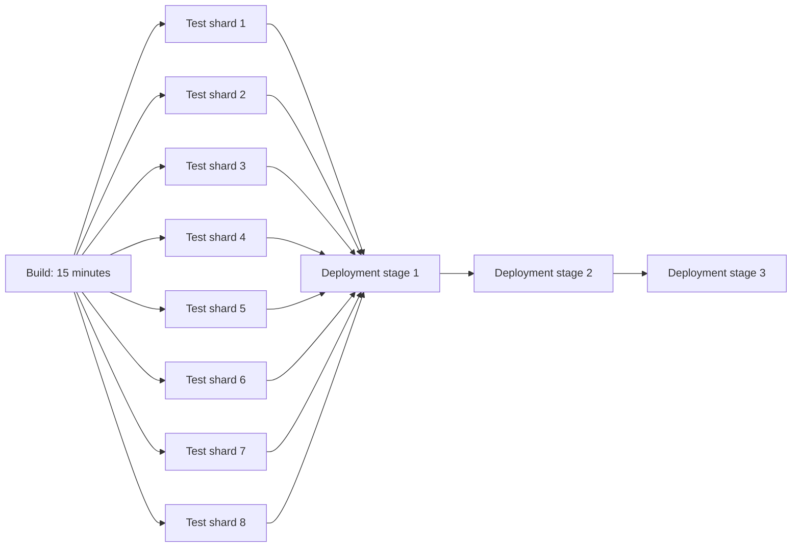

# Comparison of CI/CD Approaches for a High-Volume Fintech Platform

## Executive summary

Adopt GitHub Actions reusable workflows with `needs`-based job dependencies and organization rulesets as the default standardization model for a 200+ service platform, provided its runner pricing and capacity meet the workload.

Reusable workflows centralize the common delivery path while retaining per-service inputs, outputs, job logs, and enforceable required workflows, which most directly reduces definition drift across independently owned repositories.[1][2][3] GitLab DAG pipelines and Buildkite `depends_on` graphs can deliver the same 15-minute-build, eight-parallel-test, three-stage deployment critical path when runner or agent capacity is available, so neither is shown here to have an inherent developer-wait-time advantage.[4][5][6][7] Buildkite is the stronger alternative when each commit must generate a materially different service graph, but that flexibility transfers significant platform ownership to generator code and its governance.[8][9] The material presented here does not establish a comparable cost per 1,000 runs, a similar-scale company deployment dataset, or a native winner for canary deployment with automated rollback.

**Contents**

- Pipeline structure
- Execution time, cost, and maintenance
- Secrets rotation, compliance audit trails, and rollback orchestration
- Deployment data from similarly scaled companies
- Recommendation

How to read this: a paragraph opening “Judgment —” is the author's own view and cites no source; one opening “Derived —” is a figure worked out from the cited figures.

## Pipeline structure

This comparison uses the client’s assumed fintech workload: 200+ microservices and 50–100 daily production deployments. A **pipeline run** is one execution of the collection of CI/CD jobs. A **production deployment** is a release of a service to its production environment. **Developer wait time** is wall-clock time—the elapsed time from pipeline start to the result or release a developer needs—rather than the sum of compute minutes consumed by concurrent jobs. GitLab defines pipeline compute as the total used by all jobs, which can exceed end-to-end duration when jobs run concurrently.[10][11][12]

**Progressive delivery** is a staged release pattern that limits initial exposure before wider production release. Buildkite’s documented sequence is canary queue, smoke tests, approval, then production.[13] The workload figures are client assumptions.

Company deployment figures in this comparison are company-reported observations: in May 2022, Monzo, a bank, said, "We’ve adopted a microservices architecture," "We run over 2000 services and counting!" and "Each service can be deployed entirely independently," while reporting more than 100 production deployments a day.[14] The later execution-time and price results are models for the stated workload.[14]

The three approaches differ principally in where they express that structure. GitLab CI **DAG pipelines** make job dependencies explicit inside a pipeline definition. GitHub Actions **reusable workflows** package a standard workflow for many repositories to call. Buildkite **dynamic pipeline generation** runs code that decides the pipeline’s steps at build time. All three can run eight test jobs in parallel and sequence three deployment stages; the important differences are dependency precision, reuse boundaries, and how much of the topology is known before a run starts.

### How do GitLab CI's DAG pipelines structure pipeline execution?

GitLab CI/CD pipelines are configured in a repository-root `.gitlab-ci.yml` file. A pipeline comprises **jobs**—independent units of work such as compiling, testing, scans, or deploying—which GitLab runners execute.[15] In the ordinary stage model, stages run in sequence and jobs inside a stage run in parallel: every job in the prior stage must complete successfully before the following stage starts.[15][16]

A **directed acyclic graph (DAG)** is a dependency graph with directed links and no circular path. In GitLab, the `needs` keyword creates this graph by naming the specific jobs that must complete before a job may start. The dependent job can run as soon as those listed prerequisites finish, even when unrelated jobs in an earlier nominal stage remain in progress. GitLab therefore permits DAG and conventional staged jobs in the same pipeline.[4][16][11]

**GitLab’s DAG changes the pipeline from a sequence of stage-wide barriers to a set of explicit job-to-job prerequisites.** That is the central structural distinction: a later job can begin when its own inputs are ready rather than waiting for every job assigned to an earlier stage.[4][11][17]

For the fintech service pattern, the first job would build the deployable artifact. The eight test jobs would each `need` that build artifact and could then run concurrently. A deployment job should list only the build, tests, and earlier deployment job that it genuinely requires. GitLab supports direct dependencies to selected `parallel:matrix` job instances, so a deployment path can wait for the required test variant rather than necessarily every unrelated variant.[4][16]

GitLab’s `parallel` setting can create 1 through 200 instances of a job, while `parallel:matrix` creates jobs for combinations of variables such as language version, operating system, or target environment. Both require sufficient runner capacity. If the platform has fewer available runner slots than the eight requested tests, excess jobs remain `pending` until a runner is free.[16] One older supplied YAML reference instead gives a `parallel` range of 2 through 50; current GitLab documentation gives 1 through 200, so the current documented limit should be used for new design work.[16][18]

The DAG also makes **artifact flow**—the passing of build outputs such as binaries, packages, manifests, and test fixtures—more deliberate. In the ordinary staged model, a job can fetch artifacts from all prior-stage jobs unless restricted. A job using `needs`, by contrast, can download artifacts only from jobs named in that `needs` configuration, with artifact download enabled or disabled per needed job.[16] This avoids both unnecessary downloads and accidental dependencies on outputs from unrelated jobs.

GitLab can represent common dependency shapes needed in a microservice estate:

- **Fan-out:** one build triggers many independent tests. GitLab explicitly identifies fan-out as a `needs` pattern. [4]
- **Fan-in:** a deployment waits for several required tests, scans, or packaging jobs. GitLab identifies fan-in as a supported pattern. [4]
- **Diamond:** one build branches into tests and scans, then reconverges at deployment. GitLab identifies diamond dependencies as another DAG pattern. [4]
- **Conditional paths:** `rules` can add or omit jobs when a condition matches, and `optional: true` allows a dependent job to proceed if a conditionally defined prerequisite is absent. [4][16]

For example, GitLab’s own documentation describes independent application paths where `test_app_A` starts as soon as `build_app_A` completes and `deploy_app_A` can proceed without waiting for `build_app_B`. This is directly relevant to a service platform in which unrelated microservices should not hold one another’s release path open.[4][19]

A DAG does not make an individual build, test, or deployment intrinsically faster. It reduces **wall-clock time**—the elapsed time a developer experiences—by overlapping work that does not actually depend on other work. GitLab explicitly distinguishes that from total compute time, which can remain unchanged because the same jobs still execute.[11][12] In the requested pattern, the eight tests can overlap after the 15-minute build, but their real start and finish times still depend on runner availability, image pulls, checkout strategy, cache performance, artifact transfers, and the test durations themselves.[16][17][18][10]

GitLab supplies several controls that shape such a graph:

- **`needs: []`:** starts a job immediately, useful for linting or source-only scanning that does not require the build. [4][16]
- **`rules:changes`:** includes a job only when specified files changed, subject to differing comparison behavior for merge-request, branch, tag, schedule, and manual pipelines. [16]
- **`interruptible`:** permits cancellation of superseded build or test work when a newer commit arrives. GitLab cautions that deployment jobs usually should not be interruptible because cancellation can leave a partial deployment. [16]
- **`resource_group`:** serializes access to a shared resource. GitLab specifically recommends it to prevent two deployments from attempting the same environment at once. [20]
- **`trigger`:** starts child or multi-project downstream pipelines, allowing one service or orchestration pipeline to initiate pipelines elsewhere. A trigger can wait for the downstream result with `trigger:strategy`, although this makes execution linear rather than parallel. [16]

These features make GitLab suitable for both a multi-repository fleet and a monorepo. Parent-child pipelines split a complex same-project pipeline into sub-pipelines at the same commit; GitLab says this is commonly used for monorepositories. Multi-project pipelines coordinate separately owned projects and show their cross-project relationships in one place, which GitLab specifically identifies as useful for microservices architectures.[15][19]

GitLab parent-child pipelines can conditionally trigger a separate child pipeline for each changed service area, with its own `needs` graph.[19][68]

GitLab parent-child pipelines can conditionally trigger independently maintained child pipeline files when component paths change, while multi-project pipelines support cross-project dependencies in microservice architectures.[19]

Pipeline-definition reuse is separate from DAG scheduling. GitLab’s `include` mechanism can import local files, central-repository YAML, templates, or components, and the local project can override matching definitions. Included configuration is evaluated when the pipeline begins and saved as a configuration snapshot, so a later template change does not alter an existing pipeline run.[16] GitLab recommends a full 40-character commit SHA for a cross-project include where stability and security matter, and protected branches or tags for change-managed references.[16]

GitLab also provides `extends` for inheritance, global `default` settings, and `spec:inputs` for reusable configuration inputs. These reduce repetition but introduce composition rules: included configurations merge into the consumer pipeline, same-named jobs can merge unexpectedly, and global configuration can affect unrelated jobs.[16][21] GitLab permits up to 150 includes per pipeline by default; `extends` supports up to 10 inheritance levels and GitLab advises avoiding more than three.[16][18]

GitLab’s default limit of 150 includes per pipeline counts nested includes.[68][16]

For 200+ services, the practical model is a centrally maintained build/test/security baseline, locally parameterized through inputs, with service-specific deployment settings retained in the service project where environments, database migrations, approvals, and release policies truly differ. GitLab’s own guidance gives a Maven test suite as a strong candidate for shared configuration while noting that deployment environments, release approvals, and database migrations may need to remain local.[22]

This structure makes GitLab DAG pipelines especially effective when a service has uneven or independent paths that would otherwise be blocked by stage-wide waits. It does not remove the need to govern shared templates, provision runners, or serialize deployment to a shared environment.

This comparison concerns a fintech platform operating 200+ microservices and making 50–100 daily production deployments. A **pipeline run** is one execution of the collection of CI/CD jobs; a **production deployment** is a release of a service to its production environment. **Developer wait time** is the wall-clock time from pipeline start to the result or release a developer needs, rather than the sum of compute minutes consumed by all concurrent jobs.[10][11][12] **Progressive delivery** is a staged release pattern that limits initial exposure—for example, a canary queue followed by smoke tests, approval, and production—so that a failed release path can be stopped or reversed before full exposure.[13]

The platform statements in this section are documented product capabilities. The company-scale evidence is separately identified as company-reported deployment data: in May 2022, Monzo, a bank, reported more than 2,000 services, independently deployable services, and more than 100 production deployments a day.[14] Execution-time and cost figures elsewhere in the comparison are illustrative calculations for the stated workload, not Monzo measurements.

GitLab.com hosted runners are enabled by default for all projects and run each job in a newly provisioned VM dedicated to that job. GitLab manages hosted runners, so users do not install or maintain them; self-managed runners instead give the platform team complete control but require it to install, configure, manage, and capacity-plan the runner infrastructure.[23][24]

GitLab’s runner-fleet guidance says capacity planning should account for compute, storage, network, languages, operating systems, libraries, and each team’s jobs per hour and day.[24]

GitLab’s Runner Infrastructure Toolkit (GRIT) supplies Terraform modules for common public-cloud runner configurations. Its documented AWS example provisions one to five VMs through an Autoscaling Group according to workload; GitLab Dedicated uses GRIT for hosted-runner provisioning and management.[25]

GitLab’s runner-fleet guidance calls for capacity planning across compute, storage, network throughput, service languages and dependencies—including Go, Java and Python—and jobs per team per hour and day.[154][155]

GitLab runners can autoscale by provisioning virtual machines or Kubernetes pods; distributed caching can use S3, with cache placement varying by executor.[154][155]

GitLab offers three `GIT_STRATEGY` values: `clone`, `fetch`, and `none`. `clone` makes a fresh repository copy for every job; `fetch` reuses the workspace, uses `git clean` to remove the prior job’s changes, retrieves later commits with `git fetch`, and falls back to `clone` when no workspace exists. GitLab describes `clone` as the slowest option and `fetch` as faster.[18]

A job has a default maximum of 50 `needs` entries. GitLab validates that the resulting graph has no cycles and rejects a cyclic pipeline before any job starts.[26] A job that references a job using `parallel:` or `parallel:matrix` waits for every generated instance of that job.[27]

In a `needs` pipeline, stages can remain for display and logical grouping, but they no longer form execution barriers for jobs using `needs`; GitLab can also derive execution order entirely from the `needs` graph without explicit stages.[26] The `needs` model has higher configuration complexity than the classic low-complexity linear stage order because it requires explicit dependency relationships.[26]

GitLab `needs` also supports cross-pipeline and cross-project dependencies through `pipeline` and `project` fields.[26] This permits, for example, a deployment-project job to wait for an artifact or job status from a separate completed build project.[26]

### How do GitHub Actions' reusable workflows structure pipeline execution?

A GitHub Actions **workflow** is a YAML-defined automated process in `.github/workflows` containing one or more jobs. Jobs run in parallel by default. The `needs` keyword defines prerequisite jobs and creates an execution graph for work that must be sequenced. Each job runs in a selected runner environment.[5]

A **reusable workflow** is a complete workflow file that another workflow can call. It becomes callable through `on: workflow_call`. A service-level workflow invokes it with `uses` directly in a job—not inside an individual step—and can provide declared inputs and secrets.[1][5] The calling workflow is the **caller**; the centrally defined workflow is the **called workflow**. The called workflow runs as if it were part of the caller and can itself contain multiple jobs.[2]

**GitHub Actions reusable workflows organize reuse at the whole-workflow, job-call boundary rather than by merging YAML fragments into a caller.** A short service-specific caller delegates a standard build, test, or deployment process to centrally maintained workflow code.[1][2][28]

The reusable-workflow mechanism does not replace GitHub Actions’ dependency graph. A called workflow can have its own parallel jobs and `needs` edges; the caller can call multiple reusable workflows in separate jobs; and caller jobs can depend on outputs from a called workflow.[1][5] Thus, for the requested service pipeline:

1. **First**, a build job runs for the stated 15 minutes and publishes the image, package, or build identifier.
2. **Second**, eight test jobs or eight matrix-created test instances `need` the build and run concurrently if enough runners are available.
3. **Third**, deployment jobs use `needs` to form the three-stage sequence—for example, staging, progressive exposure or approval, and production—so each later stage waits for the preceding release result. GitHub’s reusable-workflow example has a deployment workflow with Staging, Review, and Production jobs, where Production starts only after Staging succeeds. [5][2]

A **matrix strategy** creates repeated job runs from combinations of variables. GitHub documents a maximum of 256 jobs per workflow run and says it maximizes matrix parallelism subject to runner availability. A matrix job can call a reusable workflow, including one parameterized for `dev`, `stage`, and `prod`.[5][1] This is sufficient to represent eight test shards, language versions, platforms, or deployment targets, but it does not itself decide how tests are divided.

Test sharding normally requires service test-runner support or a separate shard-selection mechanism. One example uses a custom script to assign each test job its shard from environment values.[29]

GitHub Actions supports failure behavior appropriate to a dependency graph. If a prerequisite job fails or is skipped, dependent jobs are skipped by default. A job using `always()` can instead run after its prerequisites finish regardless of success, which is useful for cleanup, log collection, notification, or a failure-response path.[5][30] Matrix `fail-fast` can cancel queued and in-progress matrix jobs after a non-tolerated failure; `continue-on-error` can mark selected jobs as non-blocking.[31][5]

A GitHub Actions job with `if: always()` can run after its dependencies finish even when a prerequisite failed, allowing a cleanup or rollback-decision job to execute.[30]

The interface of a reusable workflow is deliberately declared:

- **Inputs:** the called workflow declares typed `boolean`, `number`, or `string` inputs, and unexpected caller inputs produce an error. [5]
- **Secrets:** the called workflow declares secrets it can receive; callers can pass them explicitly or, within the same organization or enterprise, use `secrets: inherit`. A nested workflow must receive a secret again at its own call boundary if it needs that secret. [1][5]
- **Outputs:** an internal step output maps to a job output, which maps to a reusable-workflow output; downstream caller jobs can use that result. For a matrix-called reusable workflow, the output follows the last successfully completing matrix run that sets a value, rather than aggregating all matrix results. [1][5]

These interfaces make a reusable workflow an internal platform API. A common build-and-test workflow can accept service language, build command, test-shard count, artifact name, and environment as inputs, return an immutable image digest or deployment identifier as outputs, and hold the detailed job logic centrally.

GitHub imposes bounded composition. A call chain may have ten total workflow levels—the caller plus up to nine called workflows—and cannot contain loops. A top-level workflow can call at most 50 unique reusable workflows, including workflows in nested call trees. Permissions can only be maintained or reduced through the chain; a called workflow cannot elevate the caller’s `GITHUB_TOKEN` rights.[1][28] These are useful safety boundaries for a regulated platform, but they require a deliberately shallow library design.

Cross-repository reuse also has an access and versioning model. A shared workflow may reside in the same repository, an allowed public repository, or an accessible private repository. Private reusable workflow repositories require explicit access configuration, and callers must have Actions permissions that allow reusable workflows.[28] A reference can use a branch, tag, or commit SHA; GitHub identifies a commit SHA as the safest option for stability and security.[1][5] A SHA pin ensures every caller runs the same YAML, while a branch or tag reference allows centrally published changes to flow to callers according to that reference.[2]

Reusable workflows reduce copy-paste pipeline definitions. GitHub states that they avoid duplication, make workflows easier to maintain, and allow organizations to build centrally maintained libraries. GitHub also says reusable workflows can keep similarly building or deploying repositories synchronized.[2][32] Dependabot can automatically keep action and reusable-workflow references up to date, which reduces manual dependency-update work but should operate through reviewed update policies for production pipelines.[33]

There is a scaling boundary: GitHub’s own enterprise guidance says reusable workflows improved central shareability, but configuring each repository individually did not scale and did not enforce workflow success. GitHub Enterprise Cloud repository rulesets address this by requiring named workflows to pass before merge across selected repositories. Rulesets can target branch, tag, current commit, or a specific SHA, centralize setup and maintenance in a UI, provide bypass rules, and support dry-run evaluation.[3]

For a 200-service fleet, the effective model is therefore two-layered: reusable workflows standardize the implementation path, and organization-level rulesets enforce the required control path. That combination reduces duplication while avoiding reliance on every service team independently wiring critical checks correctly.

Reusable workflows give granular logs: every job and step is logged separately, unlike a composite action whose internal work appears as a single caller-workflow step. GitHub also identifies reusable-workflow usage details in the audit log.[2][32] Those capabilities matter to the compliance discussion in **Secrets rotation, compliance audit trails, and rollback orchestration**, but structurally they also make the shared workflow less opaque to a service owner debugging a run.

This approach makes GitHub Actions strongest where the main problem is standardizing repeated delivery logic across many independently owned repositories. It can create the same build–eight-tests–three-deployment-stage dependency pattern as GitLab, but reusable workflows are primarily a reuse abstraction; their scheduling performance still depends on `needs`, matrix design, runner availability, artifacts, and test-sharding quality.

For GitHub-hosted execution, GitHub maintains and upgrades the runner machines. Except for single-CPU runners, every hosted-runner job receives a new GitHub-hosted VM; custom images can preconfigure approved tooling, security patches, and dependencies, creating consistent validated base environments and reducing setup time.[34]

GitHub-hosted runners autoscale, while GitHub identifies Actions Runner Controller (ARC) as its Kubernetes-based autoscaler for self-hosted runners.[156]

GitHub recommends ephemeral self-hosted runners: each receives one job and is then deregistered, allowing operator automation to wipe the machine.[156]

At enterprise scale, standard GitHub-hosted runners have a documented maximum of 500 concurrent jobs and larger runners 1,000 concurrent jobs; GitHub Support can increase job-concurrency limits on request. An eight-job test matrix is below the 256-job maximum per workflow run. Reuse does not change the billing or hosted-runner allocation context: both remain with the caller workflow.[35][36]

GitHub Actions reusable workflows and YAML matrix builds are static configuration written ahead of time, rather than generated at runtime.[37] A caller defines the matrix when invoking a reusable workflow; the reusable workflow cannot define its own matrix strategy.[38]

Reusable workflows run in isolation and cannot access the caller’s workspace.[38] They must explicitly check out code or receive needed file contents as inputs.[38] They also cannot directly access the caller’s `env` context or job outputs; callers pass required values through declared inputs.[38]

Reusable workflows also cannot directly access the caller’s `env` context or job outputs; callers pass required values through declared inputs.[38]

### How does Buildkite's dynamic pipeline generation structure pipeline execution?

Buildkite pipelines consist of **steps**, each representing a self-contained task. Command steps execute shell commands on agents; wait steps create synchronization barriers; block steps pause for manual approval; trigger steps start other pipelines; and group steps organize sub-steps.[7][39] Multiple independent command steps run in parallel by default when sufficient agents are available.[7][40]

A **dynamic pipeline** is a pipeline whose steps are generated while a build is running. A bootstrap job runs a script that outputs YAML or JSON and pipes it to `buildkite-agent pipeline upload`. Buildkite then inserts the generated steps into the running build immediately after the upload job.[8][41]

**Buildkite dynamic pipeline generation makes the pipeline topology a runtime decision: scripts define steps at runtime and can select them for particular code changes and workflows based on conditions including the branch, environment, or results from earlier steps.** Static YAML remains possible, but the generated graph can change per build.[42][43][39]

The generator can be written in any language capable of emitting YAML or JSON, including Bash, Python, Ruby, Node.js, Go, C#, and PHP. Buildkite’s SDK offers type-safe, unit-testable definitions in JavaScript or TypeScript, Python, Go, and Ruby; Buildkite also lists C# in its SDK support.[8][43][44] This is valuable in a polyglot platform because pipeline-generation logic can be maintained in familiar general-purpose languages rather than solely declarative YAML. Java is not listed among the Buildkite SDK languages in the supplied documentation, although a Java program could emit YAML or JSON like any other generator.

For the requested typical service pipeline, a generator can produce the following keyed graph:

A `depends_on` attribute connects each step to named step keys. With enough agents, the eight test steps run concurrently after the build, and each deployment stage starts only after its required predecessors finish.[6][45][7] A command step may alternatively use `parallelism` to create multiple parallel jobs from a single step; those jobs share dependency and agent-tag configuration but receive different parallel indexes.[45][39][40]

Buildkite supplies two distinct ordering mechanisms:

- **Explicit `depends_on`:** a step waits for named prerequisite steps, and can begin immediately afterward without waiting for unrelated `wait` or `block` steps unless they too are explicit dependencies. [6]
- **Wait step:** a broad phase barrier. It waits for all preceding steps to complete successfully, including recursively generated steps uploaded before it, and prevents all following steps from beginning until that condition is met. [6][46]

The distinction matters. A wait after the eight tests creates a conventional test-to-deploy stage barrier. Explicit dependency edges allow a deployment or analysis job to proceed after only its real prerequisites. Buildkite’s guidance recommends minimizing wait steps and using `depends_on` where it permits more granular parallelism.[9][44]

Buildkite dynamic generation can also be multi-stage. A generator can inspect output from prior steps through artifacts or build metadata, call external APIs, examine feature flags, and upload a further set of steps based on those results.[8][43] The pipeline upload command can add steps or replace pending steps; replacement does not remove jobs already running or completed.[8][41][39] Thus, Buildkite can alter the remaining execution path but cannot undo an already executing or completed deployment by merely replacing pending pipeline steps.

Buildkite documents calculating dependency and matrix combinations at runtime when generating pipeline steps.[8][157]

Dynamic generation is especially useful in a large monorepo or dependency-heavy estate. Buildkite describes a pattern in which a pipeline first detects changed files, then resolves a dependency graph, then generates steps with `depends_on` links, and finally runs independent projects in parallel while respecting dependencies.[44] This avoids a fixed pipeline that runs every service’s work on every change.

When shared code changes, however, Buildkite warns that path-based detection alone does not understand transitive dependencies; the generator must resolve the dependency graph so that indirectly affected services are also built and tested.[44]

Dynamic generation can reduce static YAML maintenance. Buildkite’s documented example creates one test step per test subdirectory, and adding a test directory requires no pipeline YAML change.[8][47] A central generator, shared plugin, or external catalog can enforce common plugin versions, dependency versions, required steps, retry rules, timeouts, and environment variables while teams declare their service-specific steps.[8][44]

For cross-repository reuse, Buildkite documents versioned internal packages pinned by consuming pipelines as another way to share generator behavior.[158][157]

Buildkite can distribute shared generator functions as versioned internal packages, with each consuming service deliberately pinning and upgrading its package version.[48][157]

Buildkite generator modules can be distributed as versioned internal packages and pinned by the pipelines that consume them.[157]

That benefit moves complexity rather than eliminating it. Buildkite recommends treating generation code as production software: version templates and custom plugins, use changelogs, apply `CODEOWNERS` to pipeline files and generation code, and require review for core-template changes.[9][43] Dynamic pipelines can produce different step sets on each build, so Buildkite recommends recording generator decisions using annotations and build metadata and retaining consistent step keys for tracking the same logical step across builds.[8]

Buildkite’s generated pipelines remain subject to scale limits. Default quotas are 500 jobs per upload, 500 uploads per build, and 4,000 jobs per build. Buildkite recommends splitting uploads or using trigger steps to fan work out into separate builds beyond those boundaries.[8] Its monorepo guidance recommends keeping a pipeline build at no more than 500 steps for responsive UI and build processing, while distinguishing step count from total job count.[44] The stated per-service pattern—one build, eight tests, and three deployment stages—is far below those limits.

Buildkite also separates scheduling from execution infrastructure. In the self-hosted hybrid model, Buildkite provides the SaaS control plane and the customer operates the agents that execute jobs. Hosted agents instead place both under Buildkite management.[48] Each generated step becomes its own job and can target an eligible queue or agent, allowing build, integration test, security scan, and deployment work to use different infrastructure types within one build.[8][44]

This flexibility can lower waiting when the platform maintains enough appropriate capacity, including dedicated autoscaling queues for actual workload and one or two small static instances for prompt pipeline uploads.[49] It also creates an operational responsibility absent from a fully hosted runner model: infrastructure, queue layout, and lifecycle policies determine the speed, security, and cost of the Buildkite agent fleet.[49][50]

Buildkite queue metrics expose connected agents, running and waiting jobs, and minimum, p50, p95, and maximum queue wait; its self-hosted reference architecture targets p95 queue wait below 60 seconds.[159][72][70]

Buildkite’s self-hosted reference architecture targets a p95 queue wait below 60 seconds and treats recurring waits above two to three minutes as a reason to adopt a larger-scale agent pattern.[72]

Buildkite can chain separate build and deployment pipelines. A trigger step can pass environment variables and build metadata to another pipeline, and Buildkite documents a pattern where tests run first, a concurrency gate preserves deployment ordering, and a deployment pipeline receives the tested commit.[39][51] A dedicated deployment pipeline separates deployment failures from test failures, supports rerunning failed deployments, and simplifies adding rollback steps.[51] Buildkite also supports deployment through scripts, plugins, Argo CD, Kubernetes, ECS, Spinnaker, Shipit, Samson, or Octopus; the deployment system can therefore be external to Buildkite’s generated graph.[51][52]

Buildkite documentation recommends a progressive sequence of canary queue, smoke tests, approval, then production.[13] Dynamic generation can generate those steps conditionally, while Flagger provides a Kubernetes operator for automated releases using different deployment techniques.[53]

This approach makes Buildkite strongest where the set of affected services, test shards, infrastructure queues, or release steps is genuinely variable at runtime. It reduces YAML sprawl and supports fine-grained execution, but it requires disciplined engineering of the generator, its dependency model, and the agent fleet.

Buildkite hosted agents provide a managed execution option: Buildkite provisions, scales, and maintains the agent servers. Hosted jobs are provisioned on demand and destroyed after each job, dynamically autoscale for concurrent demand, and are dispatched within a matter of seconds; virtual-environment startup takes a few seconds and appears as job wait time.[54]

Buildkite reports that Agent v3.122.0 streaming dispatch accepts jobs in under one second for agents using `buildkite-agent start`, versus waits of up to 20 seconds under its former polling model; the improvement does not apply to hosted agents or the Kubernetes agent stack.[151]

Buildkite says its hosted-agent cache volumes are best-effort, while Buildkite Cache can restore data across jobs and builds; it reports field results of roughly 30% faster hosted-agent test times when cache volumes and a remote cache are combined.[70][72][160][161]

Hosted-agent concurrency is capacity-planned by vCPU: the maximum number of concurrent Linux hosted agents equals the plan’s maximum combined vCPU divided by the selected instance shape’s vCPU. For example, a 48-vCPU plan with 4-vCPU agents runs 12 agents concurrently, while further jobs queue. Buildkite lists Linux hosted shapes from 2 vCPU and 4 GB memory through 64 vCPU and 256 GB memory, in AMD64 and ARM64 variants.[55]

The platform team should restrict who can upload or alter generated steps, particularly when a build evaluates untrusted pull-request code. Otherwise, generation logic can turn a code-change build into an opportunity to add commands or access deployment-capable agent queues.

For a monorepo, Buildkite documents a single entry pipeline that detects changes and builds affected services, and identifies monorepo fan-out as a dynamic-pipeline use case.[13]

### The comparison concerns a fintech platform operating 200+ microservices and

The client’s operating condition—200+ microservices and 50–100 daily production deployments—means the pipeline structure must support service autonomy without allowing every team to invent its own ungoverned release process. Monzo illustrates why: the bank reported over 2,000 services, independent service deployment, and more than 100 production deployments per day in May 2022.[14] It also reported that friction such as waiting for another engineer’s tests or manually moving through several pre-production environments encourages engineers to batch changes.[14]

The appropriate comparison is structural rather than a claim that one product inherently runs a 15-minute build faster. All three can express the basic service graph, subject to enough execution capacity.

| Structural dimension | GitLab CI DAG pipelines | GitHub Actions reusable workflows | Buildkite dynamic pipeline generation |
|---|---|---|---|
| **Primary abstraction** | Direct job dependencies through `needs`; jobs can run out of stage order. [4][16] | A centrally defined workflow called as a job through `uses`; jobs inside it use `needs` for sequencing. [1][5][2] | A script generates and uploads YAML or JSON steps while the build runs. [8][41] |
| **Eight parallel tests after one build** | `parallel` or `parallel:matrix` can fan out tests after the build; runner shortages queue excess jobs. [16] | A matrix can create up to 256 job runs; actual concurrency depends on runner availability. [5] | Independent command steps, or one step’s `parallelism`, fan out across agents. [7][40] |
| **Three ordered deployment stages** | Chained `needs`, stages, delayed jobs, or downstream pipelines can model ordered release work. [16] | `needs` sequences deployment jobs; GitHub’s example uses Staging, Review, then Production. [5][2] | `depends_on` creates a precise chain; wait and block steps create broader or manual gates. [6] |
| **Cross-service reuse model** | Includes, components, inputs, defaults, and `extends` share configuration, but merged names and global settings require governance. [16][21] GitLab CI/CD components provide tested, versioned configuration for reuse across projects and reduce the maintenance overhead of keeping duplicated configuration synchronized. [56] | A centrally maintained workflow library is called from service repositories using declared inputs, secrets, and outputs. [2][5] | Shared generator, catalog, SDK, templates, or plugins can generate service-specific steps and apply central rules. [8][44] Buildkite Pipeline Templates are an Enterprise feature that centrally manages approved step configurations; template updates can roll out centrally to pipelines using them without coordinating updates with every service. [57] |
| **Runtime selection of affected work** | `rules:changes` and conditional dependencies choose jobs during pipeline creation. [16] | Matrix and workflow conditions can vary jobs, but reusable workflow definitions are static ahead of execution. [5][37] | Generator can use changed files, dependency graphs, earlier results, external APIs, and feature flags at runtime. [8][44][13] |
| **Additional service-specific integration** | GitLab’s Kubernetes deployment pattern uses the GitLab agent for Kubernetes and supports environment-scoped CI/CD variables. [162] | GitHub deployment jobs create deployment and deployment-status objects. [163][164] | Buildkite identifies runtime-calculated matrices as a use for generated pipelines. [8] |
| **Pipeline-definition traceability** | Resolved included configuration is snapshotted when the pipeline starts. [16] | SHA references pin the called workflow version; rerun behavior differs when a non-SHA reference is used. [1][28] | Repository-held `pipeline.yml` can be versioned, audited, and reviewed; generated YAML can be saved as an artifact. [7][44] |
| **Main structural trade-off** | Precise dependency scheduling with declarative YAML, but complex includes can collide and global configuration can become hard to manage. [19][21] | Strong central reuse with a clear caller–called interface, but each repository needs caller configuration unless rulesets impose organization-wide requirements. [3] | Maximum runtime flexibility and selective execution, but generator code and agent infrastructure become platform-owned operational systems. [43][49] |

GitLab’s direct DAG is the cleanest expression of a fixed but non-linear service pipeline. It is particularly appropriate when the build, test, scan, package, and deployment relationships are stable enough to declare in YAML but uneven enough that stage-wide barriers waste time. GitLab explicitly says that `needs` pipelines can run more quickly than basic pipelines, while also stating that the compute work may be unchanged.[15][11]

GitHub Actions reusable workflows solve a different primary problem: keeping standardized pipelines synchronized across repositories. A reusable workflow does not inherently improve scheduling over an equivalent Actions workflow; the speed benefit comes from the same parallel job and `needs` graph available within it. Its important structural value is a centrally governed workflow interface, reinforced at enterprise scale by required-workflow repository rulesets.[5][2][3]

Buildkite dynamic generation offers the greatest ability to calculate work from the change itself. Elastic’s Buildkite case study describes replacing statically defined, manually rebalanced test groups with dynamic splitting based on historical runtimes so tests complete within a target build time.[58] That is especially relevant where test shape changes continually, services share libraries, or different changes require radically different deployment paths.

It is not a reason to generate every simple service pipeline dynamically: Buildkite itself recommends starting with static pipelines and moving to dynamic pipelines as repository complexity and requirements grow.[9]

The service fleet should retain **deployment ordering** even while build and test work fans out. GitLab can serialize environments with `resource_group`; Buildkite can use a concurrency limit and group; GitHub Actions can create dependency and concurrency controls within workflows.[20][45][51] This is a necessary distinction: “parallel CI” means build and test capacity should be broad, while production deployment concurrency should be deliberately constrained by environment and risk domain.

Monzo’s experience also illustrates the platform pattern needed beyond any CI product. It reports a common service template and shared abstractions for most microservices, with platform and security teams embedding best practices into service libraries.[59] It says its 2023-era migration model used consistency, centralized automation, gradual rollout, and service tiers; mass deployment tooling pushed library changes asynchronously, deployed least-critical services first, and used automated rollback checks.[60] The relevant lesson for this comparison is that CI/CD structure works best when paired with a standardized service platform, explicit ownership, and a progressive-delivery control plane.

A canary deployment sends a small, controlled share of production traffic to a new version before wider promotion. Automated rollback evaluates pre-agreed signals such as error rate, latency, availability, or transaction failure rate over a defined window and returns traffic to the prior stable version when a threshold fails; the CI/CD pipeline records and invokes this process, while traffic shifting and metric evaluation normally belong to deployment or observability tooling.

Monzo’s backend systems used a microservices architecture implemented in Go.[61]

Monzo’s machine-learning jobs are written in Python, committed and peer reviewed before merging into a shared GitHub monorepo, and created from a base cookiecutter template.[62]

### Synthesis

GitLab DAG pipelines, GitHub reusable workflows, and Buildkite dynamic pipelines all support a 15-minute build followed by eight parallel tests and three ordered deployment stages, provided runner or agent capacity is available. GitLab most directly minimizes avoidable stage-barrier waiting through `needs`; GitHub most directly centralizes repeatable workflow logic across many repositories; Buildkite most directly calculates only the necessary work at runtime.[4][11][2][8][6]

For a 200+ service fintech platform, the structural choice turns on variability. Use GitLab DAG where dependencies are known and stable, GitHub reusable workflows where cross-repository standardization is the dominant problem, and Buildkite dynamic generation where affected-service discovery, test balancing, or release topology must be computed per change. All three require separate progressive-delivery controls for canary traffic and automated rollback, addressed in **Secrets rotation, compliance audit trails, and rollback orchestration**.

## Execution time, cost, and maintenance

A pipeline’s elapsed time is its *critical path*: the longest chain of dependent jobs. Its cost is different: parallel jobs reduce elapsed time but still consume the sum of all runner or agent minutes. The common model assumes a 15-minute build; eight independent five-minute tests that all require the build and must pass; three successive five-minute deployment stages; and at least eight available workers. It excludes queueing, approvals, retries, artifact transfer, and canary observation. Therefore the derived static-pipeline elapsed time is `15 + 5 + (3 × 5) = 35` minutes and compute consumption is `15 + (8 × 5) + (3 × 5) = 70` worker-minutes per run.[4][16][5][6][7][12]

GitLab identifies repository size, job dependencies, and the critical path as factors in total pipeline duration; dependency installation, image size, and network conditions can also affect elapsed time.[165]

The table distinguishes assumptions and derived results from documented dependency, billing, and reuse mechanisms. Production-release wait increases beyond the model when approvals or canary-observation periods are required.[4][16][5][7]

| Dimension | GitLab CI DAG pipelines | GitHub Actions reusable workflows | Buildkite dynamic pipeline generation |
|---|---|---|---|
| **Modeled elapsed time: specified service pipeline** | Derived — 35 minutes: 15-minute build, then eight independent five-minute tests in parallel, then three ordered five-minute deployment stages: `15 + 5 + (3 × 5)`. Developer wait is `35 + queue + artifact-transfer + approval + canary-observation` minutes. GitLab `needs` removes unnecessary stage barriers. [4][16][15] | Derived — 35 minutes: 15-minute build, then eight independent five-minute tests in parallel, then three ordered five-minute deployment stages: `15 + 5 + (3 × 5)`. Developer wait is `35 + queue + artifact-transfer + approval + canary-observation` minutes. GitHub `needs` expresses job prerequisites. [5] | Derived — 35 minutes from build to release: `15 + 5 + (3 × 5)`, plus generation and upload time before the build. If generation and upload take an assumed one minute, elapsed time is 36 minutes. Dynamic-pipeline uploads are processed after the generator emits and uploads steps. [8][6][7] Dynamic-pipeline uploads are processed after the generator emits and uploads steps. [8][6][7] |
| **Modeled compute consumption per run** | Derived — 70 worker-minutes: 15 build + 40 across eight five-minute tests + 15 across three five-minute deployment stages. [12]Derived — 141 compute-minutes: 15 build + 120 across eight tests + 6 deployments, assuming standard Linux runners with cost factor 1. [12] | Derived — 70 billed Linux worker-minutes: 15 build + 40 across eight five-minute tests + 15 across three five-minute deployment stages. [63] | Derived — 70 worker-minutes for generated build, test, and deployment steps, plus the generator’s own consumption. With an assumed one-minute generator, consumption is 71 worker-minutes. [8][42]Derived — 282 vCPU-minutes for the static jobs: 141 two-vCPU job-minutes × 2 vCPUs. The assumed one-minute two-vCPU bootstrap adds 2 vCPU-minutes, for 284 vCPU-minutes per run. [8][42]Derived — 150 vCPU-minutes in the five-minute-deployment illustration: 15 build + 120 tests + 15 deployments, assuming one Linux vCPU per job. |
| **Modeled gross compute cost per 1,000 runs** | Derived — $1,410 after included minutes are exhausted, using 141,000 standard-Linux compute-minutes × $0.010 per minute. | Derived — $846 before included compute value and storage: 141,000 Linux 2-core runner-minutes × $0.006 per minute. | Derived — $600 at $0.004 per Linux hosted-agent vCPU-minute; $584 if 4,000 included Linux AMD64 vCPU-minutes are allocated entirely to this 1,000-run batch. |
| **Definition-maintenance pattern across 200+ services** | Shared YAML through `include`, `extends`, inputs, and versioned CI/CD components; individual services can merge and override the baseline. The trade-off is merge, inheritance, component-version, and variable-contract governance. [16][18][64][65][21] | Centrally maintained reusable YAML workflows called from service workflows; callers retain repository-specific permissions, inputs, secret passing, and version references. [1][5][2][28] | Generator code emits YAML or JSON at build time; shared templates, plugins, or catalogs can enforce common rules while generators select work from repository state or runtime data. This shifts maintenance from repeated YAML edits to tested generator-code ownership. [8][39] |

### For GitLab CI's DAG pipelines

GitLab’s `needs` keyword creates a directed acyclic graph (DAG): a dependency graph in which a job starts when the jobs it explicitly needs finish, rather than waiting for every job in an earlier stage. The default staged model has a full barrier: all jobs in one stage must finish successfully before any job in the next begins. GitLab permits staged and DAG-scheduled jobs in the same pipeline, including jobs with `needs: []` that begin immediately.[4]

Judgment — For the stated service, make the build the predecessor of the eight test shards, then make each deployment stage depend only on the tests and artifacts it requires. Under the common assumption of eight independent five-minute tests and three ordered five-minute deployment stages, the derived critical path is 35 minutes: `15 + 5 + (3 × 5)`. GitLab `needs` removes unnecessary stage barriers but does not shorten the build, longest test shard, or successive deployments.[4][16]

GitLab can express the eight-way test fan-out: `parallel` supports from 1 to 200 job instances. It does not guarantee simultaneous execution, because surplus jobs remain pending until runners are available; GitLab’s recorded pipeline running time also excludes pending, or queue, time. A job using `needs` must explicitly identify artifact-producing predecessors, because it can download artifacts only from listed `needs` jobs.[16][15]

GitLab says runner-fleet sizing must account for compute, storage, network, job volume, and language-specific dependencies, including Go, Java, and Python.[165][154]

GitLab operational data recorded recurring queue spikes from scheduled work, with some waits reaching 15 minutes or more. SeatGeek reported reducing average pending-job wait from 16 seconds to two seconds and p98 wait from more than three minutes to under four seconds after runner changes.[166][167]

SeatGeek reported that migrating its GitLab runners to Kubernetes reduced mean pending-job assignment time from 16 seconds to 2 seconds and p98 queue time from more than 3 minutes to less than 4 seconds.[167]

GitLab SaaS prices additional standard Linux shared-runner capacity at $10 per 1,000 compute-minutes, or $0.010 per minute. Compute usage is the sum of job runtimes, not the pipeline wall-clock time, and GitLab says its runner cost factor is an accounting multiplier rather than a cash price.[12][66][67]

A separate cited pricing comparison lists GitLab hosted Linux compute at $0.008 per minute for a medium 2-vCPU runner and $0.016 per minute for a 4-vCPU runner; it lists GitLab Premium at $29 per user per month with 10,000 included Linux minutes and Ultimate at $99 per user per month with 50,000 included Linux minutes, with Premium’s allowance shared across the group rather than multiplied by seats.[168][169]

Judgment — The GitLab $700 figure is a gross hosted-compute model: 70 compute-minutes per pipeline × 1,000 pipelines × $0.010 per compute-minute. It excludes subscription, included-minute allowances, storage, and customer-runner infrastructure. GitLab lists 10,000 compute minutes per month for Premium and 50,000 per month for Ultimate; customer-owned runners do not consume GitLab.com compute minutes.[12][67]

GitLab CI lets `include` include external YAML configuration files: a local file has the behavior of `include:local`, and a remote file has the behavior of `include:remote`. An `include` block can include files from the same repository, another repository in the same GitLab instance, or a remote file over HTTP; teams have used this pattern to extract versioning, Helm chart generation, container inspection, and security scanning. `extends` inherits named configuration; CI/CD components package reusable pipeline units with input parameters and versioned releases. Inputs can declare descriptions, types, defaults, and allowed values, while component references can be pinned to a release or commit SHA for consistent behavior.[68][64][18][21][22]

That reuse is not frictionless. Included configuration merges into service configuration; matching job names can merge unexpectedly, and include order can affect the effective configuration. Platform owners therefore need versioned components, documented input and environment-variable contracts, representative consumer testing, and a process to track which services use which shared versions.[21][68][64][22]

**Under the common assumptions, GitLab and GitHub Actions have a derived 35-minute static-job critical path. Buildkite has a derived 36-minute path only because the model assigns one worker-minute to bootstrap generation; without that assumption, its generated jobs have the same 35-minute path. GitLab `needs`, GitHub `needs`, and Buildkite `depends_on` express explicit prerequisites.**[4][5][8][6][7]

Cost boundary — The $700 figure is gross hosted compute before GitLab subscription and included-minute allowances.

Mironsoft states that, for pipelines with clearly separable components such as a frontend, backend, and infrastructure definition, `needs` can cut overall runtime by 30 to 50 percent when job runtimes were unevenly distributed within the individual stages.[26] Mironsoft recommends a fully DAG variant mainly for newly built pipelines; for an existing pipeline, its practical migration pattern retains stages as rough logical grouping while `needs` determines execution order within and across stages.[26]

A centrally tested template catalogue, semantic versioning, and a controlled migration process are needed to prevent a shared-template change from becoming a fleet-wide breaking change.

### For GitHub Actions' reusable workflows

A reusable workflow is a YAML workflow with `workflow_call` that another workflow invokes as a job. It primarily solves *reuse*, not scheduling: it centralizes repeatable build, test, or deployment logic, while ordinary Actions job dependencies and matrices determine the critical path. GitHub-hosted jobs each run in a fresh runner instance; matrix variations can run concurrently, and `needs` can make tests depend on a setup or build job.[1][5][29]

Judgment — Under the common 35-minute model, reusable workflows do not themselves shorten the 15-minute build, longest five-minute test shard, or three successive five-minute deployment stages. They can standardize sharding and artifact patterns that make that schedule repeatable. Queueing, test-shard imbalance, fresh-runner setup, and artifact transfer increase developer wait.[5]

GitHub lists a hosted-runner limit of 60 concurrent jobs for the Team plan, compared with 500 for Enterprise; self-hosted jobs queue when no online, idle runner matches their labels. GitHub recommends Actions Runner Controller (ARC) for organizations with Kubernetes expertise that need self-hosted runner autoscaling.[170][156]

GitHub says Actions artifacts v4 writes a single archive directly from a runner to blob storage and that its tests found more than tenfold transfer improvements over earlier artifact versions.[171][172][173]

One benchmark measured a 4-GB `actions/cache` restore in 33 seconds on an 8-vCPU GitHub runner. A separate reported workflow spent 39 minutes 38 seconds uploading 60,000 individual files; archiving them reduced total workflow time to four minutes two seconds.[171][172][173]

GitLab’s Kubernetes pause pods can pre-warm capacity so a job schedules on an existing node rather than waiting for cluster-autoscaler provisioning.[174]

For GitHub Actions self-hosted execution, a job stays queued until a matching runner is online and idle; it fails after 24 hours if no matching runner becomes available.[156]

GitHub lists GitHub-hosted x64 Linux runners at $0.002 per minute for one core and $0.006 per minute for two cores; it lists a standard two-core arm64 Linux runner at $0.005 per minute. The common model consumes 70 runner-minutes per run and derives $420 for 1,000 runs: 70,000 runner-minutes × $0.006. GitHub rounds each job’s partial minute up separately. GitHub’s included compute value ranges from $12 per month for GitHub Free to $300 for GitHub Enterprise Cloud; shared artifact and GitHub Packages storage beyond included allowances costs $0.25 USD per GB-month, while Actions cache storage and custom-image storage each cost $0.07 USD per GB-month.[63][69]

A separate cited pricing comparison lists GitHub Actions standard hosted Linux runners at $0.008 per minute, GitHub Team at $4 per user per month with 3,000 included Linux minutes, and GitHub Enterprise at $21 per user per month with 50,000 included Linux minutes; it also notes that GitHub rounds a build up to the next full minute.[168][175]

Reusable workflows reduce copy-and-paste maintenance because an organization can centrally maintain a workflow library. A caller can reference a workflow in another repository by commit SHA, release tag, or branch, with GitHub identifying a commit SHA as the safest stability and security choice. Dependabot can automatically update action and reusable-workflow references in public and private repositories.[2][5][33]

The remaining burden matters at 200+ services. Each caller repository still needs a caller workflow and must permit access to private reusable-workflow repositories; caller token permissions can only be retained or reduced by called workflows, never elevated. GitHub notes that reusable workflows improved central sharing but that configuring repositories individually did not scale.[28][3]

GitHub recommends Actions Runner Controller (ARC) for Kubernetes-based autoscaling of self-hosted runners and recommends ephemeral runners that accept one job before deregistration; operators of ephemeral runners must export their logs to external storage.[156]

**GitHub Actions reusable workflows therefore offer low-to-moderate central definition maintenance for conventional service pipelines, but they do not remove per-repository integration and permission work at this fleet size.**[2][28][3]

For materially different service graphs, reusable workflows are less natural than dynamic generation; allowing the shared workflow to accumulate service-specific conditionals erodes its maintenance advantage.

### For Buildkite's dynamic pipeline generation

Buildkite dynamic pipelines begin with a bootstrap job that runs a generator script. The script emits YAML or JSON, uploads it into the running build, and each generated step becomes its own job on a matching agent or queue. Generators may be written in Bash, Python, Ruby, Node.js, Go, C#, or PHP; the Buildkite SDK supports type-safe, unit-testable definitions in JavaScript/TypeScript, Python, Go, and Ruby.[8]

Independent Buildkite steps run concurrently when agents are available, while `wait` steps create broad stage barriers. `depends_on` instead declares precise predecessor steps and can avoid waiting for an entire preceding phase. Buildkite’s own guidance recommends minimizing wait steps and splitting independent work and test shards for parallel execution.[7][9][44]

The common bootstrap-to-generate pattern runs a generator script and uploads the generated pipeline immediately after that bootstrap step. The model assumes this bootstrap consumes one worker-minute before the build on a two-vCPU Linux hosted agent. With the common 15-minute build, eight independent five-minute tests, and three successive five-minute deployment stages, it derives 36 elapsed minutes and 71 agent-minutes per run.[8][6][7]

Buildkite lists Linux hosted-agent usage at $0.004 per vCPU-minute, metered to the second with no rounding or minimums. Its Pro plan includes 4,000 Linux AMD64 vCPU-minutes per month, allows up to 250 concurrent agents with 10 included, charges $3.50 per additional agent per month, and costs $30 per active user per month.[42][70]

Buildkite also lists Linux execution at $0.006 per minute, Windows at $0.010 per minute, and macOS at $0.062 per minute under a per-seat-plus-build-minute pricing model; its hosted-agent usage is measured in vCPU-minutes to the second.[37][70]

Buildkite’s supplied pricing material also describes Pipelines pricing as based on 95th-percentile agent concurrency with no runner-minute overages, while its hosted-agent page gives the $0.004 vCPU-minute rate.Judgment — Treat the $584–$600 figure as hosted-compute consumption under the published vCPU-minute schedule; contract pricing must establish whether concurrency charges, user seats, extra agents, and hosted-agent metering apply together for the intended plan.[42][43]

Dynamic generation reduces YAML sprawl where services differ by changed components, test directories, dependency graphs, or runtime feature flags. Buildkite’s example adds a test directory without a pipeline YAML change; shared generator logic can add required plugins, dependency versions, or other organization-wide rules. Elastic reported replacing static test groups that required manual rebalancing with dynamically split tests based on historical runtime.[8][58]

Buildkite’s SDK permits generator functions for individual steps to be shared as language modules; its cross-repository pattern uses a versioned internal package pinned by consuming pipelines, with generated YAML tested when the library changes.[157]

The cost of this flexibility is software engineering. Platform teams should version templates and plugins, require `CODEOWNERS` review for generator code, record generator decisions in annotations and build metadata, preserve generated YAML as an artifact, and use consistent step keys to make changing generated pipelines observable.[8][9][44]

Buildkite’s shared-library guidance recommends distributing generator logic as a versioned internal package, pinning that package in each consuming pipeline, and testing the generated YAML when the library changes.[37][157]

**Buildkite minimizes repeated per-service YAML when service pipelines genuinely vary, but it replaces YAML maintenance with ownership of shared generator code, templates, plugins, tests, observability, and governance. Dynamic selection shortens developer wait only when it removes work from the stated eight-test workload rather than generating the same jobs. Buildkite operates hosted agents; in a self-hosted architecture, the customer operates the agents.**[8][9][48][54]

A central generator plus declarative service metadata can emit language-aware Java, Go, and Python steps while leaving service teams to maintain metadata rather than duplicated pipeline YAML. The platform team should also provide a local developer-debugging path for generated pipelines.

For 200 or more services, Buildkite centralization also requires platform ownership of agents, queues, plugins, and generator compatibility.[37][71][72][73]

GitLab’s runner-fleet guidance names service language, operating system, dependent libraries, and expected CI/CD jobs per team per hour and day as capacity-planning inputs, explicitly including Go, Java, and Python.[154]

Buildkite recommends keeping p95 queue wait below 60 seconds and treats regular waits exceeding two to three minutes as a reason to move beyond a starter agent architecture.[72]

Buildkite reports job-acceptance latency below one second with its newer streaming dispatch for supported self-hosted agents; hosted agents and the Kubernetes Agent Stack use different dispatch mechanisms.[151]

Buildkite can run agents on customer-controlled local machines, cloud compute, container schedulers, or serverless infrastructure, while hosted agents run on Buildkite-managed infrastructure.[49][39]

### Synthesis

Judgment — Under the common assumptions and adequate worker capacity, GitLab CI and GitHub Actions each have a derived 35-minute critical path; Buildkite has a derived 36-minute path because of the assumed one-minute generator. Pipeline structure does not shorten the build, slowest test shard, or successive deployments. GitLab’s DAG is the direct declarative option for eliminating unnecessary dependency waits. GitHub reusable workflows provide the lowest-maintenance central model for stable, repeatable pipelines, although each repository retains a caller, permissions, and a pinned reference. Buildkite is the best fit where conditional, change-based generation removes work, but it requires ownership of generator code and its governance.[4][5][2][8][3]

At the listed hosted-Linux compute rates, GitLab’s $0.010 per compute-minute rate is 1.67 times GitHub Actions’ $0.006 runner-minute rate and 2.50 times Buildkite’s $0.004 vCPU-minute rate; GitHub’s rate is 1.50 times Buildkite’s. This rate ranking explains the gross-compute-cost ordering when runner size, job duration, and included allowances are held constant.[66][63][42]

For the directly comparable build component alone—1,000 15-minute Linux build jobs—the derived gross hosted-compute charges are $150 on GitLab, $90 on GitHub Actions, and $120 on Buildkite with a two-vCPU hosted agent.[74][66][75][63][42][76]

On that build-only basis, GitHub Actions is 40% below GitLab and 25% below Buildkite, while Buildkite is 20% below GitLab; the resulting gross-compute ranking is GitHub Actions first, Buildkite second, and GitLab third.[74][66][75][63][42][76]

## Secrets rotation, compliance audit trails, and rollback orchestration

Secrets rotation, compliance evidence, and rollback are separate control planes. **Secrets rotation** changes credentials before compromise or expiry causes an outage. A **compliance audit trail** records who changed or approved a control, what ran, and when. **Rollback orchestration** restores a known-good release after deployment health degrades. The three CI/CD approaches can coordinate these activities, but none should be mistaken for a complete progressive-delivery controller: canary traffic shifting, metric analysis, and application/database-safe reversal normally remain responsibilities of deployment tooling and platform code.

### How do GitLab CI's DAG pipelines handle secrets rotation

GitLab CI/CD supports externally sourced secrets rather than requiring secret values in `.gitlab-ci.yml`. A job explicitly requests a secret through the `secrets` keyword; unlike ordinary CI/CD variables, secrets are not automatically available to every job. GitLab supports external secret-management integrations that authenticate with ID tokens, including HashiCorp Vault. With Vault, the job presents a GitLab ID token and retrieves the requested secret at runtime; Vault roles can constrain access by GitLab user, project, job, Git reference, or protected-release context. GitLab advises restricting Vault roles with claims such as `project_id` or `namespace_id`, since an unrestricted role could accept JWTs from elsewhere in the GitLab instance.[77][78]

For cloud deployment credentials, GitLab’s OpenID Connect (OIDC) model is stronger than storing a long-lived cloud access key. A job receives an ID token, the cloud provider validates the token and its conditional role, then returns a temporary credential. GitLab documents conditions based on group, project, branch, or tag, and says this default use of temporary credentials removes the need to build rotation logic for those cloud credentials. The trust policy should use stable identifiers such as `project_id` or `namespace_id` where the cloud provider supports them, so repository renames do not silently alter access boundaries.[79]

GitLab can still store CI/CD variables at project, group, or instance level, with masked values hidden from job logs and protected values available only on protected branches or tags. Variables may also be scoped to specific environments, for example production, to reduce the number of jobs able to read a production credential. GitLab warns against putting secrets in YAML and recommends protected variables or external secret management instead; sensitive manual pipeline variables can be revealed to users with Developer, Maintainer, or Owner roles when the relevant setting is enabled.[80][20][81][15]

GitLab separates cache keys for protected and non-protected references by default, reducing the risk that a pipeline on an unprotected branch uses cache content from a protected pipeline.[155]

Judgment — **For a 200-plus-service fintech estate, treat OIDC as the default for cloud and Vault access, and treat static secrets as exceptions with an owner, expiry policy, and external rotation workflow. This removes a large class of synchronized credential-update work across service repositories while preserving a deliberate path for credentials that cannot yet be federated.**

GitLab’s own Vault runbook illustrates a versioned rotation pattern for a remaining long-lived secret: first update the Vault value to create a new version; second, update the Terraform-selected version; third, commit, review, merge, and apply the configuration; finally, delete or irreversibly destroy the old version only when appropriate. Vault KV version 2 retains earlier secret versions until deletion and supports undeleting them. For Kubernetes-delivered secrets, GitLab recommends version-prefixed names, deploying and verifying the new secret and rotated pods before removing the old secret.[82]

GitLab audit events provide a governance record distinct from ordinary pipeline logs. GitLab says audit events support security review, incident response, and compliance; they are retained indefinitely and can be viewed at group, project, instance, and sign-in levels. Group and project audit events are documented for Premium and Ultimate on GitLab.com, GitLab Self-Managed, and GitLab Dedicated. GitLab introduced streaming of all audit events in GitLab 17.7. Ultimate can stream all audit events to an external destination, including structured JSON for a top-level group, its subgroups, and projects.[83][84][85]

The GitLab audit-event catalogue records project CI/CD-variable creation, update, and deletion from GitLab 15.2; group CI/CD-variable creation, update, and deletion from GitLab 15.2; and instance CI/CD-variable creation, update, and deletion from GitLab 16.5. It records project deploy-token creation, failed creation, destruction, and revocation from GitLab 15.1; group deploy-token creation, failed creation, destruction, and revocation from GitLab 15.3; and runner-token resets at project, group, and instance scope from GitLab 15.0. It records protected-environment creation and unprotection from GitLab 15.8; protected-environment deploy-access-level additions, removals, and updates and approval-rule additions, removals, and updates from GitLab 16.5; deployment approval and rejection from GitLab 17.1; and the start of a deployment to a protected environment from GitLab 17.2. The catalogue also records compliance-framework changes.[83] GitLab records an event when a user updates a project-level secret; this `secrets_manager_update_project_secret` event was introduced in GitLab 18.6.[83]

GitLab’s audit trail should be exported to the organization’s security information and event management system (SIEM) or long-term evidence store rather than relying only on pipeline records. Although GitLab retains audit events indefinitely, deleting a pipeline permanently deletes immediately related jobs, logs, artifacts, and triggers. GitLab deployment history can retain archived deployment records for auditing, and GitLab preserves deployed commits as `keep-around` refs, but only the 50,000 most recent deployment refs remain.[84][15][86]

GitLab’s DORA deployment-frequency calculation counts only successful deployments to a production-tier environment or an environment named `production` or `prod`, using the deployment completion time.[176]

GitLab calculates change failure rate as production incidents divided by production deployments; its documented method can double-count duplicate incidents and does not necessarily associate an incident with a specific deployment.[176]

GitLab protected environments add deployment governance. They can restrict deployers, require manual approvals, and support group-level protection by deployment tier—such as production—across differently named service environments. Parent-group protections cannot be overridden by subgroups; when group and project protections both apply, a deployer must pass both rulesets. GitLab further states that approval identity remains in project audit events even if an approval rule is later deleted.[87]

GitLab supplies rollback and deployment-safety primitives, not a complete application-aware rollback engine. A `resource_group` makes deployment jobs mutually exclusive across pipelines in the same project, which prevents simultaneous production deploys. GitLab also offers a setting to prevent an older deployment job from running after a newer deployment has started. These controls prevent release races; they do not interpret health metrics or reverse a bad deployment.[16][20]

A GitLab environment can track deployed code, deployment history, environment-specific variables, health, and previous releases. Its documented manual rollback chooses a prior deployment and creates a new deployment record pointing to the restored commit. Only deployment jobs run during this rollback; if prior build, plan, or artifact-generation work must be recreated, an operator must manually run those jobs. A rollback therefore succeeds only when the deployment script itself can safely deploy the older version.[81][86]

GitLab Auto Rollback is an Ultimate feature that automatically redeploys the most recent successful deployment after a critical alert identifies the environment through `gitlab_environment_name`. It is off by default, skips rollback if a deployment is already running, and performs no more than one rollback in three minutes. This is real automated redeployment, but it is alert-triggered environment rollback rather than documented canary-specific analysis.[81]

A canary deployment updates only a small portion of the fleet first, limiting customer exposure and permitting a quick reversion if the release is unhealthy. GitLab documents canary deployments and lets a DAG sequence deploy, health-check, and rollback jobs. A job with `when: on_failure` can run after an earlier-stage failure, while `resource_group` serializes production jobs. However, traffic shifting, metric evaluation, and the command that restores a prior artifact must be implemented in the deployment job or delegated to a deployment system.[88][18][16]

GitLab explicitly cautions that deployment jobs usually should not be marked `interruptible`, because cancellation can leave a partial deployment. Auto-canceling superseded pipelines is therefore not rollback. Database state requires the same caution: GitLab’s own release runbook checks whether post-deployment migrations make the target version unsafe, drains the affected canary before rollback, and redeploys a prior package through a controlled ChatOps process.[16][89]

**GitLab’s practical outcome is a strong regulated-delivery foundation: per-job federated identity or Vault retrieval reduces credential rotation burden; group governance and indefinitely retained audit events support control evidence; and Auto Rollback can redeploy a prior successful release. The platform team must still make deployment scripts database-aware and connect the DAG to a canary controller and telemetry policy.**[78][79][84][83][81][86]

Release trace — Security or identity administrators configure the cloud OIDC identity provider and conditional roles, while secret administrators rotate the remaining long-lived values in Vault or another secrets provider. The GitLab CI job retrieves its job-scoped credential, records the deployed code and deployment action in the environment, and emits governance events. Argo Rollouts, acting as the deployment controller, shifts canary traffic, evaluates the rollback metrics, and restores the prior release when its analysis fails; the GitLab deployment job invokes that controller or deploys the selected prior artifact. GitLab Ultimate’s Auto Rollback is a separate critical-alert path: an alert carrying `gitlab_environment_name` causes GitLab to select and redeploy the most recent successful deployment.[79][77][82][81][84][90]

GitLab.com hosted runners add a runtime-exposure control for secrets retrieved by a job: an ephemeral runner VM serves one job and GitLab sends its removal request immediately after that job completes. Hosted-runner firewall rules permit outbound public-internet traffic, block inbound public-internet traffic and communication between VMs, and permit internal VM communication only from the runner manager. GitLab.com Linux runners tagged `saas-linux--` run in privileged mode for Docker-in-Docker, whereas `gitlab-org` runners are not privileged and cannot run Docker-in-Docker.[23][91]

GitLab’s Ultimate-tier Compliance Frameworks can label projects with compliance requirements and enforce compliance pipeline configurations and security policies. GitLab Security Policies enforce organization-wide controls for security scans, merge-request approvals, and pipeline execution; Protected Environments restrict deployment access to authorized users; Secret Detection monitors activity to prevent and respond to secret leakage; and Merge Request Guardrails can require specified reviewers, prevent self-approval, and require authentication.[92]

For this fintech estate, combine these centrally enforced GitLab controls with per-job OIDC or Vault access: runner ephemerality reduces residual job data, while compliance frameworks, policies, protected environments, secret detection, and merge-request guardrails make production controls consistent across service projects.[23][92]

Audit-event retention is separate from execution-evidence retention. GitLab retains audit events indefinitely, but deleting a pipeline permanently deletes its immediately related jobs, logs, artifacts, and triggers; job-artifact retention must therefore be configured with `expire_in` where artifacts are part of release evidence.[84][15][16]

Static CI/CD-variable rotation consists of replacing the stored value through controlled API, user-interface, or configuration changes and validating consumer jobs with the new credential.

GitLab’s `identity` job keyword authenticates with third-party services using identity federation.[16]

GitLab container-registry tag-protection rules can make a release-tag rule immutable and set the minimum access level required to push or delete matching tags. The tag’s digest, revision, and publication timestamp identify the exact release artifact selected for deployment or rollback.[93]

GitLab’s `id_tokens` keyword creates JSON Web Tokens (JWTs) for OIDC authentication with third-party services, and its `aud` setting specifies the token audience.[16]

### How do GitHub Actions' reusable workflows handle secrets rotation

A **reusable workflow** is a centrally maintained GitHub Actions workflow invoked by another workflow. Secret passage is explicit at each call boundary: a caller can map named secrets, or use `secrets: inherit` to pass all available secrets. In a chain of reusable workflows, a secret reaches the third workflow only if each intermediate workflow passes it onward. A called workflow can use environment secrets, and an environment secret takes precedence when it has the same name as a repository or organization secret.[1][5]

The explicit mapping model supports least privilege, but `inherit` is broad and should be reserved for trusted internal workflows. Reusable workflows also cannot elevate `GITHUB_TOKEN` permissions beyond the caller’s permissions; nested workflows can retain or reduce, but not increase, those privileges. GitHub recommends defaulting `GITHUB_TOKEN` to read-only repository-content access and adding permissions only for individual jobs that need them.[28][33]

GitHub Actions supports repository, environment, and organization secrets. The REST API can create, update, delete, and retrieve secret metadata without returning secret values; create-or-update requests submit values encrypted with LibSodium using the relevant public key. These endpoints enable a rotation automation to replace the stored value, but GitHub recommends that organizations periodically review, remove, and rotate registered secrets rather than claiming reusable workflows automatically rotate them.[94][33]

OIDC is GitHub Actions’ preferred answer for cloud deployment identity. Each workflow job can request a unique JWT, which the cloud provider validates against configured trust conditions before issuing a short-lived access token for that job. GitHub states that this removes the need to store long-lived cloud credentials as Actions secrets and that the credential is automatically rotated per workflow run. The workflow must request `id-token: write`, and the cloud trust policy must include at least one condition to prevent untrusted repositories from obtaining tokens.[95][96]

Judgment — **Use reusable workflows to standardize OIDC login, cloud-role constraints, and secret interfaces across services. Require callers to pass only named secrets, use environment protections for production, and forbid `secrets: inherit` for workflows that can reach production unless the workflow repository and dependency chain are tightly governed.**

GitHub’s organization audit log records Actions-secret changes. For example, `environment.update_actions_secret` contains the actor, timestamp, repository, environment name, and secret key. Equivalent organization and repository events record creation, update, and removal of Actions secrets. The audit log also records branch-protection overrides, ruleset changes, required-workflow changes, Actions policy changes, and workflow approvals or rejections.[97]

GitHub provides unusually useful workflow-execution audit events outside the normal web interface. `workflows.prepared_workflow_job` records a started job, including the workflow references and SHAs, environment name, job name, workflow run ID, runner information, and the list of secret names provided to the job. `workflows.completed_workflow_run` records the conclusion, timing, branch, commit SHA, run number, attempt, workflow ID, and run ID. These events are accessible through REST, audit-log streaming, or JSON/CSV export.[97]

Cloud audit logs can record the credential exchanges and infrastructure changes associated with a GitHub Actions deployment; correlating them with workflow, approval, and deployment records requires a common release identifier such as the image digest and Git commit SHA.[164][177]

A reusable workflow also gives granular execution visibility: each reusable-workflow job and step is separately logged. A workflow with `deployments: write` can create deployment records, while `attestations: write` allows build artifact attestations. Environment protection rules must pass before an environment-targeting job reaches a runner, and required reviewers can prevent access to environment secrets until approval is granted.[2][5][33]

When a GitHub Actions job references an environment, GitHub creates deployment and deployment-status objects that record the environment name, an optional URL, and job state.[164]

GitHub artifact attestations are cryptographically signed provenance claims that can include the workflow, repository, organization, environment, commit SHA, triggering event, OIDC-token information, and an associated software bill of materials (SBOM).[177]

GitHub’s organization audit log retains events for the preceding 180 days, with the web interface defaulting to three months. GitHub Enterprise Cloud organizations can use REST and GraphQL APIs, export data, or stream enterprise audit logs externally; streamed logs can be retained as long as the receiving system’s retention policy permits. Stream consumers must deduplicate because GitHub uses at-least-once delivery.[98][99]

GitHub Actions has concurrency groups to serialize releases. A group permits at most one running job or workflow; by default, a newer queued run cancels an earlier pending run, while `queue: max` can retain up to 100 pending runs before later runs are cancelled. Processing is FIFO according to when a run begins waiting, not when it was dispatched, so this is coordination rather than strict release-order proof. For production deployment, configure a per-environment concurrency group and avoid cancellation of an in-progress release.[5][100]

GitHub Actions’ `cancel-in-progress` setting can cancel a deployment already running in the same concurrency group; cancellation does not restore the known-good release, so the deployment tool must determine the release state and perform rollback.[30][178][163]

GitHub’s reusable workflows do not provide a native canary controller or built-in automated rollback. A shared deployment workflow can deploy, run health checks, and invoke a rollback-capable tool if checks fail; it needs retained deployment metadata—such as an image digest, prior revision, commit SHA, or artifact—to identify the recovery target. GitHub’s deployment history can provide prior deployment IDs, SHAs, dates, and refs, while rollback depth depends on registry and artifact retention.[101][100]

Third-party deployment protection rules can provide telemetry-based pre-deployment gates. Honeycomb’s GitHub Actions Deployment Protection Rule evaluates a query against a threshold before a deployment: a passing query allows deployment and a failing query blocks it. It attaches a permalink to the exact query results to the workflow run. This protects entry into a release stage; it does not roll back a deployment that has already progressed.[102]

**GitHub Actions’ practical outcome is centralized release procedure and strong workflow-level evidence, especially when Enterprise Cloud audit streaming preserves the 180-day platform history externally. OIDC removes routine cloud-secret rotation, but canary analysis, traffic shifting, stateful rollback, and the retention of rollback artifacts must be engineered into the reusable deployment workflow and its delivery platform.**[95][97][103][101][100]

Release trace — Security or identity administrators configure the cloud trust conditions, and secret administrators rotate any remaining registered secrets. The reusable-workflow job obtains its per-run OIDC credential and records the calling workflow references, SHAs, supplied-secret names, environment, job, run ID, completion status, timing, branch, and commit SHA; the deployment job records the release action. Honeycomb Deployment Protection Rules make a telemetry decision before deployment and block a failed gate; they do not reverse a release already in progress. For a failed canary, Argo Rollouts supplies the metric decision and restores the prior release, and the reusable workflow invokes that controller or an explicitly triggered recovery deployment job.[95][97][5][102][90]

An automated rollback path in a reusable deployment workflow uses the prior known-good immutable release, is idempotent, and runs in a narrowly scoped production permission boundary without being blocked by the approval gate used for initial production exposure.

GitHub Environments can make production credential access conditional on a deployment gate: a job targeting an environment cannot decrypt that environment’s secrets or execute its steps until its protection rules pass. Environment branch and tag policies can limit eligibility to unrestricted references, protected branches, or selected branch and tag patterns.[104]

For separation of duties, enable the Environment setting that prevents self-review. By default, a deployment initiator who is listed as a required reviewer can approve that deployment; a required-reviewer rule supports up to six users or teams and needs approval from only one listed reviewer.[104]

A reusable deployment workflow can use `needs` dependencies to sequence canary deployment, verification, promotion, and rollback jobs, while deployment environments provide the production protection boundary.[105][100]

### How does Buildkite's dynamic pipeline generation handle secrets rotation

A **dynamic pipeline** is a Buildkite build in which an early job generates and uploads later YAML steps at runtime. This enables a generator to select tests, deployment stages, and remediation work based on the repository change, environment, or prior job output. It also makes generated configuration a security-sensitive artifact: Buildkite can reject uploads containing values that resemble secrets through `--reject-secrets`, and its documentation calls allowing interpolated secrets in uploaded YAML insecure.[8][41]

Buildkite supports three main secret-delivery patterns. First, external services such as AWS Secrets Manager or HashiCorp Vault can retain ownership of credentials and expose them to jobs at runtime. Second, self-hosted agent hooks can conditionally inject credentials into only a named pipeline and deployment step. Third, Buildkite Secrets stores secrets scoped to a cluster, with agent-access policies restricting which agents can retrieve them.[106][107]

Buildkite plugins are reusable command libraries attached to pipeline steps and run through lifecycle hooks, providing an agent-side point for implementing secret-delivery controls.[158]

Buildkite Secrets values can be changed, although keys cannot be renamed; only cluster maintainers and organization administrators can create or update them. Buildkite says all secret access is logged and recommends regular credential rotation, asset tracking, and service-side logging. Updating the stored Buildkite value therefore supports a rotation event, but does not itself rotate the credential at AWS, a database, or another target service.[107]

Buildkite OIDC is the preferred alternative for cloud credentials. A job requests a short-lived OIDC token, exchanges it for provider credentials, and can be constrained through claims including organization, pipeline, branch, commit, and step key. Buildkite cautions that all organizations share the same issuer, so trust policies should check immutable organization and pipeline identifiers as well as audience and job context. The platform recommends OIDC over long-lived secrets and recommends separate IAM roles by queue, runtime secret retrieval, and environment- or queue-level secret scoping.[39][108][13]

Judgment — **In a fintech implementation, place production deploy jobs in a dedicated Buildkite cluster or queue, use OIDC for cloud access, and retrieve the few remaining static secrets from Vault or another customer-managed manager at job runtime. This combines Buildkite’s flexible execution model with a narrower production trust boundary.**

Buildkite Enterprise and GitLab both retain audit events indefinitely. In Buildkite, only Enterprise organization administrators can access the audit log.[109][84] The web interface exposes up to 12 months, the Events-tab search covers the previous 90 days, and GraphQL can query all stored events, including those older than 12 months. The audit log is available through REST, GraphQL, and a Query & Export interface.[109]

The Buildkite audit log includes secret lifecycle events—`SECRET_CREATED`, `SECRET_DELETED`, `SECRET_QUERIED`, `SECRET_READ`, and `SECRET_UPDATED`—and pipeline events including pipeline creation, updates, deletion, webhook rotation, and pipeline-template changes. This gives direct evidence of configuration and secret access activity, not merely the final status of a build.[109]

Dynamic pipelines need additional build-level evidence because later steps may differ materially from one build to another. Buildkite recommends saving the generated YAML as an artifact before upload so every build retains an auditable record of generator output. It also recommends recording generator decisions in build annotations and inputs in build metadata, while using consistent step keys to track the same logical work across changing generated pipelines.[8]

Buildkite can send build, job, and agent lifecycle events to HTTP webhooks or Amazon EventBridge, including build creation, start, finish and blocking and job scheduling, start and finish.[159]

Buildkite’s OpenTelemetry facilities distinguish control-plane lifecycle events from agent-side execution phases including checkout, plugins, commands, and artifact uploads.[159]

To reconstruct a dynamically generated release, the evidence chain can also retain generator-package versions, plugin versions, agent images, deployment manifests, external secret-manager logs, and health evidence under the same release identifier.[8][157][159]

Buildkite’s self-hosted architecture keeps source code, secrets, and build artifacts within customer-controlled infrastructure while the SaaS control plane receives job status, logs, and timing data. This suits a regulated organization that needs control over build-network placement and secret stores, but it makes the customer responsible for secure agent images, queues, runtime identity, and evidence retention outside Buildkite’s own records.[43][48]

Persistent self-hosted Buildkite agents require controls against cross-job secret exposure; ephemeral agents or isolated per-job containers reduce that exposure.[179]

Buildkite provides release orchestration primitives: wait steps, block steps, trigger steps, explicit dependencies, concurrency limits, and scripts or plugins. A block step can serve as a human approval between release stages, while deployment examples use a concurrency limit of one to ensure only one deployment happens at a time. A test pipeline can pass a tested commit into a dedicated deployment pipeline, with a wait gate ensuring deploys follow the same order as test builds rather than test-completion order.[7][9][51]

Buildkite trigger steps wait for a triggered build to pass by default; an asynchronous trigger does not update the original build with the downstream build’s completion.[180]

Buildkite deployment jobs can invoke Kubernetes, Argo CD, ECS, Heroku, Spinnaker, Shipit, Samson, Octopus, or another delivery system. Buildkite recommends canary deployments, block-step approvals, production queue separation, policy checks, and audit logging, but these are composed practices rather than a native automated rollback feature. Dynamic generation generates the invocation; it does not supply traffic shifting, health policy, the metric decision, or recovery. For a failed canary, an external rollout controller such as Argo Rollouts supplies the metric decision and restores the prior release. Buildkite documents separate deployment-plugin recovery paths: the AWS Lambda Deploy plugin supplies alias management, health checks, and automatic rollback, with post-deployment health-check failure triggering rollback when `auto-rollback` is enabled; the Argo CD Deployment plugin continuously monitors health through the Argo CD API and can automatically restore the last known good state or offer an interactive rollback through block steps.[51][13][8][90][110][111]

Signed pipelines protect dynamically uploaded steps by cryptographically signing definitions and requiring agents to verify them before execution. This is especially relevant when an upload job can create privileged deployment steps. Buildkite offers signed pipelines on Pro and Enterprise, but Buildkite hosted agents do not support signed-pipeline validation; deployments requiring agent-side signature validation must use a compatible agent model.[42][39][70]

**Buildkite’s practical outcome is maximum freedom to generate service- and change-specific release flows while retaining strong Enterprise audit evidence. That freedom increases responsibility: the platform team must standardize generator controls, artifact retention, canary policy, rollback scripts, and trusted agent boundaries rather than expecting dynamic generation to supply them.**[109][8][51][13]

Release trace — Security or identity administrators configure Buildkite OIDC trust policies, while secret administrators rotate the remaining long-lived credentials in the selected secret store. The dynamic-pipeline job obtains a short-lived token, saves its generated YAML as a build artifact, and records build status, logs, and timing data for the release action. Argo Rollouts, acting as the deployment controller, shifts canary traffic, evaluates rollback metrics, and restores the prior release when analysis fails; Buildkite generates or explicitly triggers the deployment and recovery jobs that invoke that controller. The AWS Lambda Deploy and Argo CD Deployment plugins are separate deployment integrations, not functions of dynamic generation.[39][8][43][109][90][110][111]

Buildkite’s documented secret-management order is OIDC federation to the target system, an external secrets-storage service, then Buildkite Secrets; secret values must not appear in pipeline settings, `pipeline.yml`, step commands, or build metadata. Its baseline also requires secrets to come from a secrets store, be redacted from job logs, and be scanned for in every repository that Buildkite builds. Runtime-fetched external secrets are not automatically redacted and must be passed to `buildkite-agent redactor add`; values shorter than six bytes are never redacted. Redaction must be registered before use and cannot remove output already written to a log.[112][113]

Buildkite recommends scheduled, preferably automated, secret rotation. Its tested rotation procedure replaces the credential, updates the secrets store, verifies that the new credential works and the old credential is rejected, and covers downstream credentials as well as Buildkite tokens; only then should revocation and rotation automation be enabled, with tested target selection, approvals, failure handling, and a manual fallback. API access tokens require least-privilege scopes, a short expiry, and regular review; Public Key credential tokens do not expire and require separate rotation tracking.[113]

Hosted-agent customers do not create or rotate agent tokens. For self-hosted agents, Buildkite requires the customer to manage hosts, images, agent configuration, and updates, and recommends an owner plus an expiry or rotation date for every agent token, storage in a secrets manager, and revocation of unused tokens. Separate clusters, rather than queues within one cluster, isolate Buildkite Secrets for workloads with different trust requirements; hosted clusters have hypervisor-level isolation and their Buildkite Secrets are unavailable to other clusters.[112][113][54]

For dynamic uploads on agent v3, use `buildkite-agent pipeline upload --reject-secrets`; agent v3 does not run this check by default, and a mandatory check requires the upload process to be protected outside repository control. Buildkite also directs teams to reject or block fork builds for pipelines with secrets, pin every plugin to a commit SHA, protect default branches, and enforce mandatory controls outside repository-controlled definitions through organization permissions, protected agent hooks, secret-access policies, or cloud trust policies.[113][112]

Buildkite’s OIDC guidance requires cloud-provider trust policies to use immutable `organization_id` and `pipeline_id` claims rather than mutable slugs; a pipeline-ID subject alone does not restrict branches or steps. The default maximum OIDC lifetime is two hours. For AWS, matching OIDC claims can be passed as session tags and traced in CloudTrail.[113][112][114]

For compliance operations, Buildkite requires a named person to perform access reviews on a fixed schedule and record what was checked; it recommends at least monthly review of API-token access, members and administrators, pipeline visibility, and agents connected to every cluster. Enterprise audit-event REST access requires an administrator token with `read_audit_events`; GraphQL access also requires Enterprise administrator access. UI searches return the most recent 90 days, accept at most three unique terms and 250 characters, and Buildkite directs users to GraphQL for older history.[112][113]

Buildkite recommends sending audit events through Amazon EventBridge to a SIEM and retaining a write-protected or immutable copy that monitored users and services cannot alter or delete. It also recommends alerts for agent-token and API-token changes, SSO-provider changes, secret access, pipeline-visibility changes, terminal sessions, unusual IP addresses, unusual secret-access patterns, and spikes in build frequency. Enterprise customers can export build data and archive job logs to customer-controlled storage.[113]

Audit-event retention is distinct from build evidence retention. Buildkite’s default build retention is 30 days on Free, 90 days on Pro, and 365 days on Enterprise; default artifact retention is 30 days on Free, Personal, and Pro and 90 days on Enterprise and during trials. Buildkite Enterprise also offers custom storage and retention policies for builds, artifacts, and logs.[114][76]

Buildkite advises keeping the pipeline-upload step in the YAML steps editor and the remaining steps in a repository `pipeline.yml` so changes undergo code review and branch protection; it further recommends Terraform management of pipelines, teams, and agent tokens, two reviewers for production security-configuration changes, a dedicated service account for approved changes, read-only pipeline access for teams, SIEM alerts on manual changes, and a documented break-glass process. Because saved pipeline definitions exclude repository files and dynamically uploaded steps, those definitions require separate review.[113][112]

Signed pipelines make self-hosted agents refuse steps modified after upload. Buildkite recommends setting verification failures to `block`, separating signing agents from verify-only agents, ensuring verify-only agents lack `kms:Sign` permission, storing signing keys in AWS KMS, and testing rejection of an invalid signature; signed steps cannot be used with pipeline templates.[39][70][113]

An upload job can inspect changed directories, a service manifest, target environment, and commit metadata, then emit steps only for affected services.

Buildkite recommends block steps for human confirmation before critical production or infrastructure deployments and canary releases or staged rollouts that gradually increase traffic while monitoring for issues. In its Argo CD integration, Buildkite recommends automatic rollback on health-check failure; the documented production example sets `rollback_mode: "auto"`, `health_check_interval: 30`, `timeout: 600`, `health_check_timeout: 300`, log collection, artifact upload, and Slack notifications. The plugin also collects logs, uploads artifacts, and adds Buildkite annotations for deployment visibility.[57][111]

For Kubernetes delivery, Buildkite can handle building, testing, and packaging while Argo CD handles continuous deployment: Buildkite pushes generated manifests to a GitOps repository, and Argo CD monitors that repository and deploys the application to the target cluster. Production Argo CD authentication should retrieve `ARGOCD_PASSWORD` before deployment from Buildkite Secrets, HashiCorp Vault, or AWS Secrets Manager rather than placing it in plaintext pipeline files.[111]

For a regulated dynamic-pipeline implementation, use OIDC and runtime secret retrieval, separate production clusters, protected upload and policy-enforcement paths, Enterprise audit export to immutable SIEM storage, and Argo CD or another rollout controller for canary health analysis and automatic rollback.[113][57][111]

Buildkite’s REST API can list a build’s dynamic-pipeline step uploads and retrieve an individual uploaded definition rendered as YAML, but access is limited to the build’s maximum lifetime.[115]

Buildkite’s Kubernetes deployment guidance states that Kubernetes stores rollout history by default and can roll a deployment back to a previous stable version. For a Kubernetes canary, separate `stable` and `canary` release labels and their replica counts control the traffic proportion; `kubectl rollout undo` rolls back a deployment when canary issues are detected.[116]

Buildkite audit events use cursor pagination, so an audit-event review follows the response `links.next` URL. Buildkite resource-list examples show only the first page, and inventory review follows pagination before treating an inventory as complete.[112]

When builds exceed the applicable retention limit, Buildkite automatically exports their data as JSON to the configured S3 or GCS destination. Without a configured bucket, Buildkite stores the JSON in its own Amazon S3 bucket for a further 18 months; it is unavailable through the API and dashboard during that period and is obtained through Buildkite Support.[117]

Buildkite deletes all builds associated with a deleted pipeline and does not export them. Archiving, rather than deleting, a pipeline preserves build data for retention and export.[117]

### Synthesis

GitLab, GitHub Actions, and Buildkite all support the preferred security pattern: replace long-lived cloud credentials with job-scoped OIDC tokens, and use an external manager for the secrets that remain. GitLab and Buildkite Enterprise both retain audit events indefinitely; GitLab Ultimate can stream all audit events, while Buildkite Enterprise exposes its audit log through REST, GraphQL, and Query & Export. GitHub’s organization audit log covers the preceding 180 days and GitHub Enterprise Cloud can export or stream it externally. Audit-event retention remains distinct from execution evidence: GitLab pipeline deletion removes related jobs, logs, artifacts, and triggers, while Buildkite defaults build retention to 365 days and artifact retention to 90 days on Enterprise; preserving Buildkite generated YAML, annotations, and metadata makes each generated build reconstructable. GitLab Auto Rollback is alert-triggered redeployment, Honeycomb is a pre-deployment telemetry gate, and Buildkite plugins are deployment integrations; metric-driven canary reversal is supplied by the external rollout controller that restores the prior release.[79][84][83][109][98][99][15][114][8][81][102][110][111][90]

**End-to-end, retained change-to-production evidence**

A fintech audit trail must retain links among the approved change, artifact identity, actor, target environment, deployment result, and any rollback event—not merely show a successful CI job. GitLab retains deployment-approval identity in project audit events even after an approval rule is deleted; GitHub’s workflow audit events link the calling workflow references and SHAs, actor, environment, supplied-secret names, run, commit SHA, timing, and conclusion; and Buildkite requires the generated YAML to be saved as an artifact for each dynamically generated build, while its Enterprise audit events are stored indefinitely.[87][97][8][109]

## Deployment data from similarly scaled companies

A useful scale analogue shows both service-estate size and production-deployment throughput, not merely use of a CI product. Language evidence matters because a Java, Go and Python estate needs standardised controls that work across different build and runtime ecosystems.[14][118][119][120]

DORA defines delivery throughput using measures including change lead time and deployment frequency, and instability using change failure rate, failed-deployment recovery time, and deployment rework rate. DORA reports that speed and stability tend to be correlated for most teams rather than inherently traded off.[181]

### Which companies managing similar-scale polyglot service environments have deployment data

| Company | Service-estate evidence | Deployment/release evidence | Match to the 200+ services and 50–100 daily-deployments scenario |
|---|---:|---:|---|
| **Monzo** | On 16 May 2022, over 2,000 independently deployable services. Over 2,000 services in May 2022; later accounts describe over 2,800 and over 3,000 production microservices. [14] [59] [60] InfoQ reports that Monzo standardized its development stack on Go and a limited, consistent set of technologies across services. [121] | On 16 May 2022, over 100 production deployments a day; a later account says it ships changes hundreds of times per day. [59] Monzo says its deployment process takes a couple of minutes per deployment. [60] | A bank above the 200-service threshold and above the 50–100 daily-production-deployment range. [14] Its documented standardized Go stack does not evidence the requested Java, Go, and Python polyglot environment. [121] |
| **Wise** | Over 1,000 microservices and 700+ Java repositories. | During 2024, its deployment system automatically blocked hundreds of releases that would have caused production incidents. Wise migrated from CircleCI to GitHub Actions and identified pre-populating caches for frequently used containers as an optimization that could reduce build times by 15%. [118] | A financial-services estate above the service threshold; the stated release-safety result is not a daily production-deployment rate. [118] Wise moves about £36 billion across borders each quarter, with 65% of transfers arriving instantly. [118] |
| **Stripe** | Several thousand software engineers and hundreds of engineering teams; no total service count is given. Stripe describes a polyglot environment with data pipelines in Scala and Python, build pipelines for Go, Java, and TypeScript, and Ruby code generation; it says canonical log lines are used in almost every service it runs. [122][123] | One undated account says it ships hundreds of times per day; another undated account reports over 1,000 daily deployments. Stripe says its CI orchestrates build pipelines and executes tens of thousands of test suites. [124] | A high-frequency fintech comparator without an established service-count match to the 200-service threshold. [119][120] |

Monzo is a UK bank with independently deployable services and is the strongest production-rate comparator for the requested fintech platform. On 16 May 2022, Monzo reported over 2,000 services and over 100 production deployments a day, placing it above both target thresholds.[14]

Wise supplies the clearest large-estate release-safety observation: during 2024, its deployment system automatically blocked hundreds of releases that would have caused production incidents. This is a release-safety count, not a production-deployment rate. Wise’s system sent 5% of traffic to a new version, watched technical and business metrics for 30 minutes, and rolled back anomalies without human intervention; its move to Spinnaker associates canary analysis, metric validation and automatic rollback with the deployment orchestrator rather than the CI definition mechanism.[118]

Stripe has two differing, undated cadence claims: it ships hundreds of times per day in one account and deploys over 1,000 times daily in another. The latter account reports 99.999% uptime and an average of one deployment per engineer every three days. Its service count remains unstated.[119][120]

**The comparison set identifies Monzo as the dated production-rate analogue, Wise as the release-safeguard analogue, and Stripe as a high-throughput comparator with no established service count.**[14][118][119][120]

Buildkite reports that Wix handled 9,000 backend builds a day; low-priority feature tests could block high-priority hotfixes in build storms until workloads could be prioritized and assigned to different agent pools.[125]

Buildkite reports that Rippling had more than 650 engineers, 60,000 tests and hundreds of pull requests a day; at peak, its CI/CD workload used over 1,200 large virtual machines, equivalent to 50,000 CPUs and 100,000 GB of memory, with builds extensively parallelized across nodes and processes.[126]

Buildkite reports that Uber’s Go monorepo had more than 50 million lines of code, more than 500,000 files, more than 3,000 engineers and 1,000 commits per day by 2022; the displayed Uber Main dashboard shows 47 queues and 98 pipelines, while its `web-service-deploy` entry displays 3,200 agents and 2,045 jobs.[127][128]

Buildkite reports that Elastic reduced Kibana pull-request CI from three hours to 55 minutes, a 70% reduction; it separately reports Shopify cutting build times by 75% and Reddit achieving 47% lower p90 mobile build times, 33% lower p50 times, and queue times around five seconds.[129][130][131]

In its 4 May 2022 account, Stripe describes a polyglot CI environment with data pipelines in Scala and Python, infrastructure in Terraform, Go-to-native-binary and Java-to-bytecode build pipelines, TypeScript bundles for the Stripe Dashboard, and Ruby code generation that creates hundreds of thousands of files for gRPC service definitions and GraphQL bindings. Stripe says this CI system executes tens of thousands of test suites and produces artifacts that ultimately process billions of dollars each day.[132][122]

Monzo’s speakers describe an estate of 1,600 systems in which teams work on clusters of particular systems rather than needing to know how all 1,600 work.[133]

Headout reports more than 40 microservices and a fast-paced release cycle. It integrated Argo Rollouts into its internal platform service for one-click canary deployments that automatically catch faulty releases without manual intervention; its canary-and-rollback system intercepted three defective production releases and reports 100% identification of faulty releases.[90]

A close operational match requires both at least 200 services and a production-deployment rate within, or clearly close to, 50–100 deployments per day. Record whether each published deployment figure means a production service release rather than a build, test run, commit, or general change, because these are not comparable measures.

GitLab’s DORA deployment-frequency metric counts successful deployments to production-tier environments by finish time and reports the average number per day; workflow starts and deployment-job attempts are different measures.[176]

DORA defines deployment frequency as the number of deployments in a period or the interval between deployments. Its failed-deployment recovery time measures how long restoring service takes after a deployment failure requiring intervention, while change failure rate is the share of deployments requiring immediate intervention, commonly a rollback or hotfix.[181]

### What is known about the Java service environment of each

Wise has the most concrete Java scale figure: 700+ Java repositories, rather than 700+ Java production services, within an estate of over 1,000 microservices. It uses in-house Gradle plugins, including one that standardises GitHub Actions workflows, and a language-agnostic automation service fully automates Java dependency upgrades by creating pull requests for owning teams.[118]

In its 27 May 2026 account, Stripe describes a large centrally governed Java environment. Java and Scala upgrades require coordination across hundreds or thousands of owners; supported JDK and JRE versions are centrally controlled, CI checks enforce dependency-ordering constraints, and the build system supports multiple JDKs during staged migration.[134]

In 2016, Monzo’s banking-backend account said its approach had enabled services in Java, Python and Scala while Go was expected to remain dominant. It gives no Java-service count.[135]

**Wise is the clearest Java-scale example; Stripe shows the strongest evidence of centrally managed Java-version governance, while Monzo establishes Java use without fleet-size detail.**

Wise’s Go service role is unspecified in the documented estate.[118]

### What is known about the Go service environment of each

Monzo identifies Go as its primary microservice language, says the vast majority of its microservices are written in Go, and describes shared code structure, tooling and templates across services. Its later migration account states that all services in its stated migration population were written in Go.[136][59][137][60]

Monzo’s 2016 banking-backend account says that its approach had enabled Java, Python and Scala services alongside Go, which it expected to remain dominant. In a later migration account, Monzo says that all services in the migration population were written in Go.[135][60]

Stripe says it is investing heavily in Go and Java on the backend, but the available account gives neither a Go-service count nor a specific production-service role.[119]

**Monzo is the direct Go microservices comparator: its standardised Go chassis and templates demonstrate how a large estate can reduce per-service variation.**

### What is known about the Python service environment of each

In April 2022, Monzo introduced Python microservices into its production stack for machine-learning work. They are generated from a template, integrated with deployment tooling, and intended to deploy similarly to Go services; their described role is receiving data, calling `predict()`, and returning the result.[62][138]

Monzo says its machine-learning systems are primarily Python, while Go is its general language for business logic and broader service development.[136][14] Monzo’s 2016 banking-backend account separately says that its service approach had enabled Java, Python and Scala services while Go would probably remain dominant.[135]

Wise’s documented Python item is a library that wraps APIs for prototyping, not a stated Python-service fleet. Stripe publishes a Python API client for applications written in Python, currently supporting Python 3.9 and later; Stripe also uses Python for all machine-learning model training, and its Radar service trains and deploys fraud models daily.[118][139][140]

**Monzo is the only identified company with documented Python production microservices. Stripe documents Python machine-learning training and daily fraud-model deployment through its centrally managed Railyard system, not a Python microservice fleet.**[62][138][140]

### Synthesis

The company evidence shows that high deployment volume is sustained by an opinionated platform: reusable templates, shared libraries, common tooling, automated policy checks and a separate progressive-delivery system. On 16 May 2022, Monzo reported over 2,000 independently deployable services and over 100 production deployments a day; in April 2022, it documented templated Python microservices integrated with deployment tooling alongside a production stack largely written in Go. During 2024, Wise’s automated canary analysis blocked hundreds of unsafe releases.[14][62][118][60]

Judgment — For the client’s 200+ service platform, treat CI pipeline design as the fast, repeatable path to an artifact, and treat canary analysis and automated rollback as deployment-platform responsibilities. The examples indicate that this separation is the operating model that remains manageable as service count and deployment rate rise.

## Recommendation

For this fintech platform, the decision is not simply which CI tool can run eight tests in parallel. It is which operating model keeps feedback fast across 200+ services while making the safe path—versioned pipeline policy, controlled production access, canary analysis, and rollback—the easiest path for teams to use. A **progressive-delivery controller** is the deployment-layer system that shifts traffic gradually, evaluates live service metrics, and reverses a release if those metrics fail; it is distinct from the CI system that builds and validates code.

**Conditional ranking, assuming equal runner capacity, services that can use a common build-test-deploy contract, the corrected 35-minute execution-time model for GitHub Actions and GitLab, a further assumed one-minute Buildkite pipeline-generator step, and normalized hosted-compute estimates: (1) GitHub Actions reusable workflows; (2) GitLab CI DAG pipelines; (3) Buildkite dynamic pipeline generation. GitHub Actions and GitLab therefore tie at 35 minutes in the model, while Buildkite is modeled at 36 minutes; the ranking is decided by common-workflow maintenance at equal capacity, not by a measured product-speed advantage.** GitHub reusable workflows avoid duplication and support a centrally maintained library; GitLab components are reusable, parameterized configuration units but GitLab recommends named maintainers and visibility of consumer versions; Buildkite requires ownership of agents, pipeline code, and design decisions.[5][2][21][22][8][37] The deciding criterion is maintenance of 200+ pipeline definitions, not the ability to express eight concurrent tests: GitHub jobs run in parallel by default and reusable workflows avoid duplication through a centrally maintained library; GitLab components provide reusable parameterized pipeline units but require named maintainers and consumer-version management; Buildkite requires ownership of agents, pipeline code, and design decisions.[5][2][21][22][37] **Use GitHub Actions reusable workflows as the default CI paved road and pair them with a deployment controller such as Argo Rollouts for canary traffic management and automated rollback.

GitLab moves to first where an existing GitLab estate already operates reusable components and their governance. Buildkite moves to first where runtime work selection or historical-duration test balancing produces a demonstrated latency gain.**[5][58][39][21][22][90]

### How well do GitLab CI's DAG pipelines minimize developer wait

GitLab’s directed acyclic graph (DAG) model uses the `needs` keyword to state a job’s actual prerequisites. Instead of every job in a later stage waiting for all earlier-stage jobs, a job can start as soon as the jobs named in `needs` complete. GitLab explicitly describes this as avoiding unnecessary waiting, and it supports fan-out, fan-in, and diamond dependency patterns.[4][16]

For the representative service, the practical benefit is that each test or packaging path can begin after its own build artifact is ready rather than after unrelated work completes. GitLab’s example shows one application’s test and deployment progressing after that application’s build while another application’s build continues. GitLab also permits a hybrid model: ordinary stages where broad synchronization is desirable, plus DAG dependencies where it is not.[4][16][141][19]

The eight parallel test jobs are straightforward to express: GitLab’s `parallel` setting can create 1 to 200 instances of a job. Parallel configuration does not create physical capacity, however. GitLab states that multiple runners—or one runner configured for concurrent jobs—are needed, and jobs beyond available capacity remain pending. At 50–100 daily production deployments, runner-pool sizing and queue-time service-level objectives therefore decide whether the DAG’s theoretical parallelism becomes reduced developer wait.[16]

GitLab can further reduce repeated work with caches shared between jobs and pipelines. It documents cache keys based on file contents, which preserve a cache when those files have not changed, and recommends `cache:policy: pull` for many parallel cache consumers because it avoids upload work and reduces cache-server load. These are useful latency controls for Java dependency resolution, Go module retrieval, and Python package environments, but their actual gain must be measured against each service’s dependency graph and cache hit rate.[16]

GitLab runners can use distributed caches backed by S3, MinIO, Google Cloud Storage, or Azure Blob Storage; a Kubernetes runner job also spends time preparing its pod, restoring caches and artifacts, and uploading results after the build.[182][174]

GitLab supports distributed cache backends including S3, MinIO, Google Cloud Storage, and Azure Blob Storage.[24][154][168][182]

For a 200-service estate, GitLab offers reusable configuration through `include`, components, and versioned catalog releases. Local projects can extend an included shared definition; GitLab resolves conflicting keys using a closest-scope-wins model. Components can accept typed inputs and be version-pinned, which allows a platform team to share standard Maven, Go, Python, scanning, artifact, and deployment jobs while retaining service-specific configuration.[65][21]

That reuse has a real operating cost. GitLab warns that included configuration merges into the consumer pipeline rather than running in isolation, so matching job names and global settings can affect unrelated jobs. It also recommends named maintainers, consumer-version visibility, representative consumer testing, release guidance, and potentially automated upgrade proposals for a larger user base. In other words, shared GitLab YAML reduces duplicated edits but creates a supported internal product that needs ownership.[22]

GitLab supplies several building blocks around a canary: environments identify deployment targets; `resource_group` can serialize production deployments; `when: delayed` can create timed rollout stages; `on_failure` can run a response job; and Canary Ingress can split HTTP traffic by weight, session, or cookie. GitLab’s documented traffic-weight change is an operator-directed operation, not a closed-loop health-analysis mechanism: its Canary Ingress example sets `weight: 45`, sending 45% of traffic to the canary and 55% to stable; a successful GraphiQL or GraphQL API request causes GitLab to send a `PATCH` request to the Kubernetes cluster to update the Canary Ingress weight. GitLab deprecated this feature in GitLab 14.5.[88][16]

GitLab does provide Auto Rollback in Ultimate. When enabled, a critical alert containing the environment name causes GitLab to redeploy the most recent successful deployment; it is disabled by default, skips rollback while a deployment is running, and limits rollback to one action every three minutes. GitLab’s standard deployment rollback redeploys a previous commit through a new deployment record, and only deployment jobs run; database-aware reversal must be designed in the deployment process rather than assumed.[81][86][142]

**GitLab DAG is strong for eliminating stage-barrier wait and provides a credible shared-baseline-plus-local-override model, but it requires disciplined runner capacity, component governance, and an explicitly engineered deployment/rollback design to provide reliable progressive delivery at fintech volume.**[4][16][22][81][86]

For clearly separable components, Mironsoft says that `needs` can cut overall pipeline runtime by 30 to 50 percent, depending on how unevenly job runtimes were originally distributed within the individual stages.[26] GitLab’s runner-fleet dashboard also reports the average `Wait time to pick a job`—the time before a runner picks up a queued job—to assess whether runners meet the organization’s CI/CD queue service-level objectives; the metric updates every 24 hours, requires ClickHouse, and is beta.[143]

Where GitLab is already the system of record, source control, CI execution, environment and deployment records, protected environments, approvals, and audit-oriented controls can be operated in one product family. This can reduce governance fragmentation relative to introducing a separate CI platform.

GitLab component usage details identify the projects using a component and the versions they use; a project is marked `Up to date` when it uses the latest version and `Outdated` otherwise.[21]

### How well do GitHub Actions' reusable workflows minimize developer wait

GitHub Actions runs independent jobs in parallel by default, while `needs` establishes only the dependencies that must be sequential. A matrix can generate up to 256 jobs in one workflow run, and GitHub maximizes parallel execution subject to runner availability. For the stated service shape, this allows one build job, eight concurrent test jobs that depend on it, and deployment jobs whose dependencies reflect the actual release path rather than a universal stage barrier.[5]

Reusable workflows are YAML workflows made callable with `workflow_call`. A service repository invokes the shared workflow as a job, optionally passing inputs and permissions. GitHub’s model centralizes deterministic, repeatable pipeline logic, avoids duplication, and allows an organization to maintain a reusable-workflow library rather than replicate near-identical YAML in every service repository.[1][2][28]

Versioning is important for a regulated estate. A caller can reference a reusable workflow by branch, tag, or commit SHA; GitHub identifies the SHA as the safest stability and security option because it fixes the exact YAML executed. GitHub Enterprise Cloud repository rulesets can require selected workflows before merge, and can target a branch, tag, current commit, or precise SHA. This supports a centrally governed baseline for SAST, dependency controls, attestations, release metadata, and required checks without trusting every application team to retain every control manually.[5][2][3]

A SHA-pinned reusable workflow fixes the exact YAML executed, so each service must deliberately update its caller reference to adopt a shared-workflow release. Caller workflows retain service-specific permissions, environment choices, and inputs. This explicit update work is the maintenance trade-off for controlled workflow-version rollout across 200+ services.[5][2][3]

GitHub can reduce wasted feedback time by cancelling obsolete branch workflows through a concurrency group with `cancel-in-progress: true`. In April 2025, the author reports that splitting Oh Dear’s PHP test suite into 12 concurrently running parts cut its runtime from 16 minutes to four minutes; the same practitioner warns that unevenly distributed shards reduce the benefit because fast shards sit idle while slower ones continue.[29]

Production deployment concurrency needs narrower scope than a single platform-wide lock. GitHub concurrency groups permit at most one active job or run in the group. By default, a new queued run replaces the existing pending run; with `queue: max`, up to 100 can wait, although the platform cautions that order is based on when jobs begin waiting rather than dispatch time. A per-service-and-environment group, such as `payments-api-production`, protects that service’s target without putting unrelated services into the same 50–100-deployment daily queue.[5]

GitHub environments add a gate: all environment protection rules must pass before an associated deployment job reaches a runner, and required reviewers can protect environment secrets from access before approval. OpenID Connect (OIDC), meaning a short-lived identity token exchanged with a cloud provider rather than a stored cloud credential, is available through the `id-token: write` permission. A cloud policy can restrict production credentials to the designated reusable deployment workflow and job.[5][33][32]

Reusable workflows do not themselves perform canary traffic shifting or native automated rollback. GitHub’s documented deployment controls can gate a release, while custom workflow logic can deploy, run health checks, retain prior artifact metadata, and invoke a rollback-capable tool such as Kubernetes, Terraform, or Ansible. Honeycomb’s GitHub deployment protection rule can also gate a deployment based on a telemetry query and is documented for canary-release patterns, but it blocks a subsequent deployment step rather than rolling back one already live.[101][102]

**GitHub Actions gives the lowest pipeline-definition maintenance burden when services are sufficiently uniform for a versioned reusable workflow, but automated canary rollback belongs in the deployment controller or deliberately maintained deployment integration, not in the reusable-workflow mechanism itself.**[2][3][90]

In the reported 12-part GitHub Actions test-matrix example, reducing elapsed test time from 16 minutes to four minutes is a 75% reduction and a 4.0× speedup. This quantifies the potential value of well-balanced parallel test sharding, rather than reusable workflows alone.[29]

Use OIDC federation to obtain narrowly scoped, short-lived credentials at run time, and rotate the underlying cloud or secret-manager credentials outside individual service workflows. For a regulated release, retain or export workflow and deployment evidence linked to the immutable artifact digest, approval, rollout decision, and rollback result.

Parallelism shortens elapsed feedback time but changes billed consumption. GitHub bills each job separately after rounding its runtime up to the next whole minute; the cited three-job illustration consumed 10 minutes 5 seconds of runner time and billed 12 minutes.[144] In a separate four-shard illustration, tests running 2 minutes 10 seconds per shard billed 12 minutes rather than seven billed minutes before sharding because checkout and dependency installation were repeated and each shard rounded to three minutes.[144]

GitHub workflow design can protect both current-feedback time and consumption by cancelling an obsolete branch run with `cancel-in-progress: true`, retaining matrix `fail-fast`, rerunning only failed jobs and dependent jobs, setting job timeouts, and measuring cache hits through the `cache-hit` output. Production deployment groups require the opposite cancellation policy: `cancel-in-progress: false` leaves a new deployment waiting behind the active deployment.[145][144]

### How well does Buildkite's dynamic pipeline generation minimize developer wait

Buildkite dynamic pipelines generate YAML or JSON steps while a build is running. The common pattern is a bootstrap step that executes a generator script and uploads the resulting graph; generated steps are inserted immediately after that bootstrap step. The generator can be written in common scripting languages or with Buildkite’s SDK in TypeScript, Python, Go, Ruby, or C#, which makes it especially adaptable to a polyglot platform even though Java is not listed among the SDK languages.[8][43]

This is more than reusable static YAML. Dynamic generation can calculate dependency graphs, select work from changed files, inspect external state, use earlier build outputs, and generate deployment steps only for changed services. `depends_on` gives each step explicit prerequisites, whereas a `wait` step blocks the whole following phase; Buildkite says this distinction can significantly reduce build time when generated steps have unequal durations.[8][43][39][44]

For the stated workload, Buildkite’s strongest wait-time case appears when eight nominal test jobs are not actually equal. Its Test Engine Client can use historical timing data to split a suite so parallel jobs carry similar expected durations. Elastic reports using dynamic pipelines to divide Kibana test suites by average historical runtime and keep them within a target build time; after migrating Kibana’s pull-request pipeline to Buildkite, Elastic reports reducing it from three hours to 55 minutes, a 70% reduction.[58] This is a company-specific result, not a forecast for the fintech service.[39][58]

Buildkite hosted agents are designed to autoscale concurrent jobs and are described as dispatching jobs within seconds. Hosted-agent startup can still take a few seconds, varying with base image and cache-volume state. Self-hosted agents can preserve warm local caches, but the customer then provisions, patches, scales, upgrades, and manages cache infrastructure. For regulated services that require runners inside a private network, that operational work may be necessary.[70][146][49]

Dynamic generation reduces repeated YAML but shifts maintenance into generator code. Buildkite supports centrally managed templates, shared plugins, catalogs, and generator-applied rules. Its templates can be enforced across new or all pipelines, and an administrator’s template update applies to every assigned pipeline. Dynamic generators can also read centrally maintained retry, timeout, and environment settings so a common policy takes effect on each pipeline’s next build.[8][43][39][147][44]

That power demands platform engineering maturity. Buildkite itself describes the trade-off as owning more: agents, pipeline code, and design choices. Its Enterprise reference architecture calls for a dedicated platform-engineering function in complex multi-cloud, hybrid, or multi-region organizations, alongside self-service catalogs to prevent configuration sprawl. Dynamic pipelines should therefore be reserved for cases where runtime selection, conditional graphs, or test balancing pays back their greater design complexity.[37][72][44]

Buildkite can structure progressive release stages with canary queues, smoke tests, approvals, and production steps. It can serialize deployment targets using concurrency groups, separate a deployment pipeline from build and test work, and invoke Kubernetes, Argo CD, Spinnaker, or other delivery systems. Buildkite’s Argo CD deployment plugin is documented as detecting deployment failures and rolling back to the last known good state, with continuous health monitoring through the Argo CD API.[13][39][51][52]

For metric-based canary rollback, a rollout controller remains the clearer control point. Headout’s Argo Rollouts design progressively changes traffic in three stages, pauses two minutes after each routing change for New Relic data, and automatically reverts when the analysis run fails its configured rollback metrics. Its later canary-versus-stable error comparison reduced reported false-positive rollbacks from five per week to one per week.[90]

**Buildkite is the best technical fit when change-aware job generation and historically balanced sharding are needed to protect developer feedback time, but it does not minimize total platform burden unless the organization already has—or is willing to fund—the engineering discipline to own generators, agent architecture, and governance.**[58][39][37][72]

For compliance evidence, retain the generated pipeline graph together with the artifact digest, deployment approval, progressive-delivery controller result, and rollback result. This prevents dynamically generated steps from becoming an unreconstructable release path.

### Which approach best minimizes both developer wait time and platform

The corrected equal-capacity model assigns GitHub Actions reusable workflows and GitLab CI DAG pipelines 35 minutes for the representative pipeline and assigns Buildkite dynamic pipeline generation 36 minutes, including the assumed one-minute generator step. The normalized hosted-compute estimates use the same workload and capacity basis. GitHub jobs run in parallel by default, GitLab `needs` starts jobs after their declared dependencies finish, and Buildkite can generate steps during a build; consequently, common-workflow maintenance at equal capacity, rather than a measured product-speed advantage, decides the default order. GitHub centrally maintains reusable workflows; GitLab supplies reusable parameterized components and calls for named maintainers and consumer-version visibility; Buildkite requires ownership of agents, pipeline code, and design choices.[5][2][21][22][8][37]

The ranking reverses together under three conditions. GitLab moves ahead when established reusable-component governance, named maintainers, consumer-version visibility, and the cost of migrating that operating model make GitLab the lower-maintenance choice. Buildkite moves ahead when demonstrated selective-work or historical-duration balancing gains justify dynamic generation and an existing agent operation already owns the required agents, pipeline code, and design decisions; Elastic used dynamic pipelines to split test suites by average historical runtime, and Buildkite Test Engine Client splits suites across parallel jobs using historical timing data. GitHub loses its default position when queueing, enterprise licensing, or integration costs change the normalized total-cost result.[21][22][8][58][39][37]

At the requested deployment rate, the safest architecture separates CI speed from release confidence. CI should build once, test in parallel, create an immutable artifact, and record provenance. The deployment controller should promote that artifact through canary traffic shifts and metric analysis, and automated rollback must redeploy a retained, already-built prior artifact rather than rebuild it. Wise’s reported deployment system sent 5% of traffic to a new version, observed technical and business metrics for 30 minutes, and rolled back anomalies without human intervention; Wise attributes canary analysis, metric validation, and automatic rollback to Spinnaker rather than to GitHub Actions itself.[118][148]

Monzo provides scale context closer to the requested operating model: it reports production deployment more than 100 times per day and describes tooling for a rollout involving 1,500 services that automatically rolls back when it is not working well. It also emphasizes a common service structure and tooling to reduce cognitive overhead. These examples support standardization plus dedicated deployment automation, rather than asking each repository to invent rollout logic.[14][136]

The verdict changes if the real workload differs from the assumed one. Buildkite becomes the default choice if test durations are persistently uneven, changes affect highly variable dependency sets, or specialized queues materially alter runtime and cost. GitLab becomes more attractive if the organization already operates GitLab Ultimate environments, critical-alert integration, reusable components, and compliant runners. GitHub remains first when service pipelines are uniform enough that central reusable workflows and rulesets remove more maintenance than runtime generation would save.[58][39][81][21][3]

### Synthesis

GitLab, GitHub Actions, and Buildkite can all parallelize the service’s build-and-test path; none should be selected on that capability alone. GitLab DAG is especially effective at removing unnecessary stage barriers, GitHub reusable workflows best centralize a predictable estate’s common pipeline contract, and Buildkite dynamic generation best adapts a variable estate’s job graph and test balance.[4][2][58][39]

The progressive-delivery requirement changes the recommendation. Canary traffic shifting, metric analysis, and automated rollback should be operated as a deployment-layer capability, exemplified by Argo Rollouts and by Wise’s Spinnaker-based system, rather than encoded repeatedly in CI YAML. That separation gives developers rapid CI feedback without treating a long-lived production canary observation window as a blocked developer task.[90][118]

1. **Standardize on GitHub Actions reusable workflows**, pinned to reviewed SHAs and enforced through required-workflow rulesets for the 200+ service baseline.
2. **Use service-scoped production concurrency groups and organization-level runners** so one service’s release does not queue unrelated production deployments.
3. **Delegate canary promotion and automatic rollback to Argo Rollouts or an equivalent controller**, with service-specific metrics, stable-versus-canary comparison, and immutable-artifact rollback.
4. **Introduce Buildkite dynamic pipelines only for proven high-variance repositories**, where runtime selection or historical test balancing produces a measured latency benefit.

5. **Instrument the paved road.** Track GitLab job P50, P95, and failure rate where GitLab is used; capture GitHub deployment and protection-rule webhooks in the compliance record; and use Buildkite queue states and Test Engine duration and reliability metrics to locate capacity and test-suite bottlenecks. [149][150][151]

5. **Instrument the paved road.** Track GitLab job P50, P95, and failure rate where GitLab is used; capture GitHub deployment and protection-rule webhooks in the compliance record; and use Buildkite queue states and Test Engine duration and reliability metrics to locate capacity and test-suite bottlenecks. [149][150][151]

The progressive-delivery controller needs a retained immutable known-good artifact or revision, a health or user-success metric, and an automatic policy that defines a threshold, time window, and retry limit. Metric- or service-level-objective (SLO)-based rollback is the form that reverts a canary when error rate or latency crosses its threshold; it is distinct from rollback on a failed deployment step or failed readiness check.[152]

DORA defines change fail rate as the ratio of deployments requiring immediate intervention, commonly rollback or hotfix, and failed deployment recovery time as the time needed to recover from a deployment failure requiring immediate intervention; neither replaces the short-window telemetry used to decide whether to roll back a particular canary.[181]

Argo Rollouts supplies this controller behavior: when an `AnalysisTemplate` reaches its `failureLimit`, a canary or blue/green rollout enters an aborted state and traffic returns to the previous stable ReplicaSet. Canary and blue/green strategies keep the prior version warm, making reversal a traffic switch; a rolling update instead requires a further rollout to revert.[152]

Automated rollback policy must be paired with expand-contract database migrations and feature flags where irreversible database migrations, cache or schema changes, or in-flight queue messages would make a binary revert unsafe.[152] The platform team must maintain metrics-provider wiring, analysis templates and thresholds, health checks, RBAC, and artifact or image-retention policy for the controller.[152]

Monzo’s deployment model also shows that automated deployment steps and a human deployment trigger can coexist: in the cited interview, an engineer triggered deployment while the steps were automated, and the team described merge-to-rollout automation as technically supported by its infrastructure and monitoring.[153]

### Open questions

Comparable cost per 1,000 runs remains open because it depends on each provider’s applicable plan, billed runner minutes or Buildkite build/agent model, runner or agent capacity, and the measured duration of the eight tests and three deployment stages. The requested deployment figures from similarly scaled Java, Go, and Python environments remain open. Canary analysis and automated rollback remain open: the deciding design inputs are the deployment controller or progressive-delivery tool, rollback health metrics and thresholds, production-environment approval policy, and the authority granted to the pipeline to reverse a release.

## Sources

[1] https://docs.github.com/en/actions/how-tos/reuse-automations/reuse-workflows
[2] https://docs.github.com/en/actions/concepts/workflows-and-actions/reusing-workflow-configurations
[3] https://github.blog/enterprise-software/ci-cd/enforcing-code-reliability-by-requiring-workflows-with-github-repository-rules
[4] https://docs.gitlab.com/ci/yaml/needs
[5] https://docs.github.com/actions/using-workflows/workflow-syntax-for-github-actions
[6] https://buildkite.com/docs/pipelines/configure/depends-on
[7] https://buildkite.com/docs/pipelines/configure/defining-steps
[8] https://buildkite.com/docs/pipelines/configure/dynamic-pipelines
[9] https://buildkite.com/docs/pipelines/best-practices/pipeline-design-and-structure
[10] https://www.theodo.com/en-ma/blog/lets-make-faster-gitlab-ci-cd-pipelines
[11] https://about.gitlab.com/blog/directed-acyclic-graph
[12] https://docs.gitlab.com/ci/pipelines/compute_minutes
[13] https://buildkite.com/docs/pipelines/best-practices/iac
[14] https://monzo.com/blog/2022/05/16/how-we-deploy-to-production-over-100-times-a-day
[15] https://docs.gitlab.com/ci/pipelines
[16] https://docs.gitlab.com/ci/yaml
[17] https://about.gitlab.com/blog/basics-of-gitlab-ci-updated
[18] https://ewserver.di.unimi.it/gitlab/help/ci/yaml/README.md
[19] https://docs.gitlab.com/ci/pipelines/pipeline_architectures
[20] https://docs.gitlab.com/ci/environments/deployment_safety
[21] https://docs.gitlab.com/ci/components
[22] https://about.gitlab.com/resources/well-architected/best-practices/recommendations/adopt-and-maintain-reusable-pipelines
[23] https://docs.gitlab.com/ci/runners/hosted_runners
[24] https://docs.gitlab.com/runner
[25] https://docs.gitlab.com/runner/grit
[26] https://www.mironsoft.de/en/blog/gitlab-ci-needs-for-dag-pipelines-over-strict-stages
[27] https://www.stephane-robert.info/en/docs/pipeline-cicd/gitlab/industrialisation/dag-parallelisme
[28] https://docs.github.com/en/actions/reference/workflows-and-actions/reusing-workflow-configurations
[29] https://ma.ttias.be/running-our-test-suite-in-parallel-on-github-actions
[30] https://docs.github.com/actions/using-jobs/using-jobs-in-a-workflow
[31] https://docs.github.com/actions/writing-workflows/choosing-what-your-workflow-does/running-variations-of-jobs-in-a-workflow
[32] https://github.blog/news-insights/product-news/github-actions-reusable-workflows-is-generally-available
[33] https://docs.github.com/en/enterprise-cloud@latest/actions/reference/security/secure-use
[34] https://docs.github.com/en/actions/concepts/runners/github-hosted-runners
[35] https://docs.github.com/en/actions/reference/limits
[36] https://docs.github.com/en/actions/concepts/billing-and-usage
[37] https://buildkite.com/resources/comparison/buildkite-vs-github-actions
[38] https://khimananda.com/blog/github-actions-reusable-workflows-and-matrix-builds
[39] https://buildkite.com/docs/pipelines/glossary
[40] https://buildkite.com/docs/pipelines/best-practices/parallel-builds
[41] https://buildkite.com/docs/agent/cli/reference/pipeline
[42] https://buildkite.com/pricing
[43] https://buildkite.com/docs/pipelines/advantages/buildkite-pipelines
[44] https://buildkite.com/docs/pipelines/best-practices/working-with-monorepos
[45] https://buildkite.com/docs/pipelines/configure/step-types/command-step
[46] https://buildkite.com/docs/pipelines/configure/step-types/wait-step
[47] https://buildkite.com/resources/examples/buildkite/dynamic-pipeline-example
[48] https://buildkite.com/docs/pipelines/architecture
[49] https://buildkite.com/docs/pipelines/best-practices/agent-management
[50] https://buildkite.com/platform/pipelines/hosting-options/self-hosted-agents
[51] https://buildkite.com/docs/pipelines/deployments
[52] https://buildkite.com/docs/pipelines/deployments/with-argo-cd
[53] https://buildkite.com/resources/blog/best-practices-for-running-ci-cd-on-kubernetes
[54] https://buildkite.com/docs/pipelines/hosted-agents
[55] https://buildkite.com/docs/agent/buildkite-hosted/linux
[56] https://docs.gitlab.com/ci/pipelines/pipeline_efficiency
[57] https://buildkite.com/docs/pipelines/best-practices/platform-controls.md
[58] https://buildkite.com/resources/case-studies/elastic
[59] https://www.infoq.com/presentations/monzo-microservices-devex
[60] https://monzo.com/blog/how-we-run-migrations-across-2800-microservices
[61] https://www.infoq.com/news/2017/03/monzo-bank-golang
[62] https://monzo.com/blog/2022/04/26/monzos-machine-learning-stack
[63] https://docs.github.com/en/billing/reference/actions-runner-pricing
[64] https://medium.com/wbaa/effectively-scaling-your-gitlab-pipeline-configuration-in-microservice-environments-d7e83c8f3222
[65] https://www.baeldung.com/ops/gitlab-share-ci-cd-config-multiple-projects
[66] https://cicdcost.com/gitlab-ci-pricing
[67] https://about.gitlab.com/pricing
[68] https://docs.gitlab.com/ci/yaml/includes
[69] https://docs.github.com/billing/managing-billing-for-github-actions/about-billing-for-github-actions
[70] https://buildkite.com/docs/agent/buildkite-hosted
[71] https://buildkite.com/docs/agent/queues/managing
[72] https://buildkite.com/docs/agent/reference-architectures
[73] https://buildkite.com/docs/agent/hooks
[74] https://docs.gitlab.com/ci/pipelines/compute_minutes#how-compute-minutes-are-calculated
[75] https://docs.github.com/en/billing/reference/actions-runner-pricing#standard-github-hosted-runners
[76] https://buildkite.com/docs/pipelines/configure/job-minutes
[77] https://docs.gitlab.com/ci/secrets
[78] https://docs.gitlab.com/ci/secrets/hashicorp_vault
[79] https://docs.gitlab.com/ci/cloud_services
[80] https://docs.gitlab.com/ci/migration/github_actions
[81] https://docs.gitlab.com/ci/environments
[82] https://gitlab.com/gitlab-com/runbooks/-/blob/v2.333.0/docs/vault/usage.md
[83] https://docs.gitlab.com/user/compliance/audit_event_types
[84] https://docs.gitlab.com/user/compliance/audit_events
[85] https://docs.gitlab.com/user/compliance/audit_event_streaming
[86] https://docs.gitlab.com/ci/environments/deployments
[87] https://docs.gitlab.com/ci/environments/protected_environments
[88] https://docs.gitlab.com/user/project/canary_deployments
[89] https://gitlab-org.gitlab.io/release/docs/runbooks/rollback-a-deployment
[90] https://backstage.headout.com/canary-deployment-with-automated-rollback
[91] https://docs.gitlab.com/ci/runners/hosted_runners/linux
[92] https://about.gitlab.com/pricing/feature-comparison
[93] https://docs.gitlab.com/api/graphql/reference/objects
[94] https://docs.github.com/rest/actions/secrets
[95] https://docs.github.com/en/actions/concepts/security/openid-connect
[96] https://docs.github.com/actions/deployment/security-hardening-your-deployments/configuring-openid-connect-in-cloud-providers
[97] https://docs.github.com/en/organizations/keeping-your-organization-secure/managing-security-settings-for-your-organization/audit-log-events-for-your-organization
[98] https://docs.github.com/organizations/keeping-your-organization-secure/managing-security-settings-for-your-organization/reviewing-the-audit-log-for-your-organization
[99] https://docs.github.com/enterprise-cloud@latest/admin/monitoring-activity-in-your-enterprise/reviewing-audit-logs-for-your-enterprise/streaming-the-audit-log-for-your-enterprise
[100] https://www.stephane-robert.info/en/docs/github-actions/deploy/rollback
[101] https://github.com/orgs/community/discussions/175488
[102] https://docs.honeycomb.io/integrations/github-deployment-protection-rules
[103] https://docs.github.com/enterprise-cloud@latest/organizations/keeping-your-organization-secure/managing-security-settings-for-your-organization/reviewing-the-audit-log-for-your-organization
[104] https://sph.sh/en/posts/github-environments-approval-gates
[105] https://github.com/pricing
[106] https://buildkite.com/docs/pipelines/security/secrets/managing
[107] https://buildkite.com/docs/pipelines/security/secrets/buildkite-secrets
[108] https://buildkite.com/docs/pipelines/security/oidc
[109] https://buildkite.com/docs/platform/audit-log
[110] https://buildkite.com/docs/pipelines/deployments/to-aws-lambda
[111] https://buildkite.com/docs/pipelines/deployments/with-argo-cd.md
[112] https://buildkite.com/docs/pipelines/best-practices/secrets-management.md
[113] https://buildkite.com/docs/pipelines/best-practices/secrets-management
[114] https://buildkite.com/docs/platform/limits
[115] https://buildkite.com/docs/llms-dynamic-pipelines.txt
[116] https://buildkite.com/resources/blog/ci-cd-kubernetes-optimize
[117] https://buildkite.com/docs/pipelines/governance/build-exports
[118] https://blog.bytebytego.com/p/the-tech-stack-powering-wise
[119] https://newsletter.pragmaticengineer.com/p/stripe
[120] https://daily.dev/posts/stripe-deploys-1-000-times-a-day-and-you-don-t-deploy-on-fridays-1ggzeiodk
[121] https://www.infoq.com/news/2024/09/monzo-microservices-migrations
[122] https://stripe.com/blog/fast-secure-builds-choose-two?__=&__hstc=106715356.2af3f924a8d9f62fbbee3a8b127f2354.1668124800348.1668124800349.1668124800350.1&__hssc=106715356.2.1668124800351&__hsfp=2323581667
[123] https://stripe.com/blog/canonical-log-lines
[124] https://stripe.com/en-GB/blog/engineering/page/2
[125] https://buildkite.com/blog/how-to-build-ci-cd-pipelines-dynamically
[126] https://buildkite.com/resources/blog/how-rippling-reduced-ci-cd-costs-by-50-with-aws-spot-instances
[127] https://buildkite.com/resources/blog/how-uber-halved-monorepo-build-times-with-buildkite
[128] https://buildkite.com
[129] https://buildkite.com/_site/case-studies/elastic.pdf
[130] https://buildkite.com/resources/comparison/buildkite-vs-depot
[131] https://buildkite.com/resources/comparison/buildkite-vs-circleci
[132] https://stripe.com/blog/fast-secure-builds-choose-two
[133] https://www.youtube.com/watch?v=t7iVCIYQbgk
[134] https://stripe.dev/blog/modern-java-at-stripe-language-upgrades-as-a-service
[135] https://monzo.com/blog/2016/09/19/building-a-modern-bank-backend
[136] https://www.infoq.com/presentations/monzo-microservices
[137] https://news.lavx.hu/article/monzo-engineer-details-opinionated-stack-that-enables-hundreds-of-daily-deployments
[138] https://www.evidentlyai.com/blog/ama-neal-lathia
[139] https://github.com/stripe/stripe-python
[140] https://stripe.com/blog/railyard-training-models
[141] https://genboree.org/gitlab/help/ci/directed_acyclic_graph/index.md
[142] https://forum.gitlab.com/t/how-to-write-pipelines-with-a-working-rollback/130484
[143] https://docs.gitlab.com/ee/ci/runners/runner_fleet_dashboard.html
[144] https://avrea.com/blog/github-actions-pricing
[145] https://tenki.cloud/blog/github-actions-cost-optimization
[146] https://buildkite.com/docs/agent
[147] https://buildkite.com/docs/pipelines/governance/templates
[148] https://github.com/Just-Git-Dev/reusable-workflows/blob/main/docs/rollback-service.md
[149] https://docs.gitlab.com/user/analytics/ci_cd_analytics
[150] https://docs.github.com/en/webhooks/webhook-events-and-payloads
[151] https://buildkite.com/resources/changelog/tag/improvement
[152] https://www.qovery.com/blog/ci-cd-tools-automated-rollback-compared
[153] https://www.youtube.com/watch?v=5wN5MUrTc1I
[154] https://docs.gitlab.com/runner/fleet_scaling
[155] https://docs.gitlab.com/ci/caching
[156] https://docs.github.com/en/actions/reference/runners/self-hosted-runners
[157] https://buildkite.com/docs/pipelines/configure/dynamic-pipelines/sdk
[158] https://buildkite.com/docs/pipelines/integrations/plugins/using
[159] https://buildkite.com/docs/pipelines/best-practices/monitoring-and-observability
[160] https://buildkite.com/docs/pipelines/configure/cache
[161] https://buildkite.com/docs/pipelines/best-practices/caching
[162] https://docs.gitlab.com/topics/autodevops/cloud_deployments/auto_devops_with_gke
[163] https://docs.github.com/actions/deployment/about-deployments/deploying-with-github-actions
[164] https://docs.github.com/actions/deployment/targeting-different-environments/using-environments-for-deployment
[165] https://repository.prace-ri.eu/git/help/ci/pipelines/pipeline_efficiency.md
[166] https://gitlab.com/gitlab-com/gl-infra/infrastructure/-/issues/7814
[167] https://chairnerd.seatgeek.com/ci-runner-optimizations
[168] https://leanopstech.com/blog/ci-cd-pipeline-costs-github-actions-circleci-gitlab-2026
[169] https://medium.com/@surbhi19/jenkins-vs-github-actions-vs-gitlab-ci-in-2026-what-we-learned-migrating-200-pipelines-fb529fbd966b
[170] https://docs.github.com/en/actions/reference/limits#job-concurrency-limits-for-github-hosted-runners
[171] https://github.blog/news-insights/product-news/get-started-with-v4-of-github-actions-artifacts
[172] https://runs-on.com/benchmarks
[173] https://thomasbillington.co.uk/2023/01/08/speed-up-upload-artifact-action.html
[174] https://docs.gitlab.com/runner/executors/kubernetes
[175] https://depot.dev/blog/comparing-github-actions-and-depot-runners-for-2x-faster-builds
[176] https://docs.gitlab.com/user/analytics/dora_metrics
[177] https://docs.github.com/en/actions/concepts/workflows-and-actions/workflow-artifacts
[178] https://docs.github.com/actions/writing-workflows/choosing-what-your-workflow-does/control-the-concurrency-of-workflows-and-jobs
[179] https://buildkite.com/docs/llms-self-hosted-agents.txt
[180] https://buildkite.com/docs/pipelines/configure/step-types/trigger-step
[181] https://dora.dev/guides/dora-metrics
[182] https://docs.gitlab.com/runner/configuration/speed_up_job_execution
