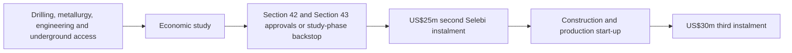

# Premium Resources’ financial sustainability and capital structure risks

## Executive summary

Premium faced high funding risk at December 2024, and the March 2025 recapitalization relieved immediate liquidity and term-loan pressure but did not finance the full path to Botswana project development.

Shareholders’ equity deteriorated by C$13,192,746, from C$9,745,686 at December 31, 2023 to a C$3,447,060 deficiency at December 31, 2024, making external refinancing urgent for a pre-revenue company with falling cash and continuing losses.

At June 30, 2025, C$26,463,957 of cash and management’s expected runway into the first quarter of 2026 provided temporary operating capacity, but management stated that further financing would be needed for asset-purchase commitments and project advancement.

The company therefore remained exposed to dilution, funding-market access and the timing of contractual and contingent Botswana obligations, with any cash-preservation measures likely to delay drilling, studies and the work required to support a future mine-development decision.[1][2]

**Contents**

- Financial position and refinancing
- Warrants and capital structure
- Committed expenditure and payment obligations
- Botswana-project funding and development timelines

How to read this: a paragraph opening “Judgment —” is the author's own view and cites no source; one opening “Derived —” is a figure worked out from the cited figures.

## Financial position and refinancing

Shareholders’ equity, also called net assets, is the residual interest left for shareholders after all liabilities are deducted from assets. It is not cash, but its movement is an important indicator of the company’s loss-absorption capacity and the extent to which creditors and new investors must finance a pre-revenue business. For Premium Resources, the key issue is that 2024 losses and cash consumption eroded that residual buffer before the March 2025 recapitalization.

### Calculate the change in shareholders’ equity from December 2023 to

Premium Resources’ audited comparative statements show that total shareholders’ equity was positive at December 31, 2023 but had become a deficiency by December 31, 2024. An equity deficiency means recorded liabilities exceeded recorded assets.

The following table compares the like-for-like consolidated balances stated in Canadian dollars.

| Measure | December 31, 2023 (C$) | December 31, 2024 (C$) | Change, 2024 less 2023 (C$) |
|---|---:|---:|---:|
| Total shareholders’ equity / (deficiency) | 9,745,686 | (3,447,060) | Derived — **(13,192,746)** = C$(3,447,060) − C$9,745,686 [1]. Premium Resources moved from positive equity to a shareholders’ deficiency in 2024; at December 31, 2024, liabilities of C$28,400,529 exceeded assets of C$24,953,469. [3] |
| Change as a percentage of 2023 equity | — | — | Derived — **(135.37%)** = C$(13,192,746) ÷ C$9,745,686 × 100 [4] |

The C$13,192,746 decline was greater than the opening C$9.75 million equity balance. That is why the percentage decrease exceeds 100%: the company did not merely reduce its equity cushion; it crossed from positive equity into a C$3.45 million deficiency. The calculation is an analytical result based on the two reported balance-sheet values, not a figure separately published by the company.[1]

Premium’s statement of changes in equity identifies the underlying movement. At December 31, 2023, reported share capital was C$116,069,973 and accumulated deficit was C$(104,566,816). By December 31, 2024, share capital had risen to C$145,025,333, but the accumulated deficit had increased to C$(146,987,099). Other contributed surplus and foreign-currency translation amounts did not offset that loss-driven deterioration.[1]

Common shares increased from 149,300,920 at December 31, 2023 to 185,708,588 at December 31, 2024. During 2024, Premium issued 36,281,409 private-placement shares and 126,259 shares through net option exercises.[8]

The principal operating cause was the year’s C$42,420,283 net loss, compared with a C$32,376,069 loss in 2023. Premium’s reported 2024 operating cash outflow was C$37,599,434, C$8,136,574 greater than the C$29,462,860 used in 2023. Management attributed the increase in operating cash use to expanded drilling, geology, geophysics, mine development and other activities at the Mines.[5][1]

Premium’s FY2024 profile reported zero revenue, negative US$37.69 million EBITDA and negative US$39.02 million EBIT.[53]

**The decisive point is that 2024 equity fell by C$13.19 million despite a C$28,955,360 increase in reported share capital, from C$116,069,973 to C$145,025,333, because the C$42.42 million annual loss more than absorbed that balance-sheet increase.** In ordinary terms, shareholders supplied capital during the year, but the business spent and lost more than that capital could offset.[1][6]

The loss was not solely a technical accounting movement. Premium stated that its 2024 net loss was C$10,044,214 higher than in 2023, principally because Botswana exploration activity increased by C$6,787,620, general and administrative expense rose by C$2,333,076, and interest expense and accretion on the term loan rose by C$1,434,306.[7] The company also paid C$2,082,530 of interest to Cymbria and other financing parties during 2024, compared with C$793,392 in 2023.[1]

The equity deterioration therefore reflected both the cost of advancing the Botswana projects and the cost of carrying debt. Premium reported a C$42,420,283 net loss for the year ended December 31, 2024, compared with C$32,376,069 in 2023.[8][7] At December 31, 2024, the term loan had a carrying value of C$18,983,212 and a fair value of C$20,862,478; the comparable carrying value at December 31, 2023 was C$17,956,423.[1] The loan bore annual interest of 10%, was secured by pledges of subsidiary shares and other parent- and subsidiary-level security, and was scheduled to mature on June 28, 2026.[5][1]

A different figure—C$23,099,764 of shareholders’ equity at December 31, 2023—appears in an external MD&A page that labels itself only as “the Company.” That figure conflicts with Premium’s own 2024 comparative consolidated statements, which report C$9,745,686 at December 31, 2023.[9] The C$9,745,686 figure is the appropriate comparison for this analysis because it is the stated comparative balance in Premium’s 2024 consolidated equity reconciliation.[1]

The deterioration also coincided with a weaker liquidity position. Premium reported C$6,105,933 in cash at December 31, 2024, down from C$19,245,628 at December 31, 2023. Working capital—current assets less current liabilities—fell to C$2,963,061 from C$14,787,484. The company stated that it had no source of operating cash flows and no significant credit lines.[1]

The year-end balance sheet accordingly showed an asset base of C$24,953,469 against C$4,655,182 of current liabilities and C$19,229,349 of non-current financial liabilities, the latter including the term loan, lease liabilities and vehicle financing.[7] A negative equity position does not automatically mean insolvency or an immediate payment default.

It does mean, however, that the balance sheet had little capacity to absorb further losses and that external capital was central to maintaining the company’s activities.

Judgment — In an exploration-stage mining company, negative equity is especially consequential when it accompanies declining cash, no operating revenue and no committed credit facility. Development spending precedes any possible mine cash flow by years, so the company cannot rely on project operations to replenish the capital that losses consume. The relevant question is not whether book equity itself can pay a supplier; it cannot. The question is whether investors and lenders will continue to supply capital on terms that preserve the projects’ timetable and existing shareholders’ economic interest.

Premium’s own disclosures place its two principal Botswana assets—the Selebi Mines, comprising Selebi Main and Selebi North, and the Selkirk Mine—at the exploration, evaluation and planned redevelopment stage.[2] These were pre-revenue projects, and Premium stated that it had not generated profitable operations from its resource activities.[2][8] That status makes the 2024 equity decline a financing-capacity issue rather than merely a retrospective accounting outcome.

The company also had no proven or probable mineral reserves at either project at the time of its 2024 reporting. It had mineral resource estimates, but stated that economic viability had not been confirmed.[7][1] This does not invalidate the projects; it means that conventional project debt was less likely to be available on the terms usually associated with a producing or feasibility-stage mine. Until studies, permitting, engineering and funding establish a financeable development case, equity and equity-linked financing remain particularly important.

The reported annual spending pattern shows why the cash position mattered. In 2024, Premium recorded project and other costs of C$29,651,360, of which C$28,017,207 related to Selebi, C$1,477,696 to Selkirk and C$156,457 to other activities. The comparable 2023 total was C$22,863,740.[1] The company was therefore increasing spending on its principal projects while still lacking operating revenue.

Premium’s December 2024 balance-sheet condition was also not a situation in which the company could simply reduce work and preserve a self-funding operating business. The company stated that its properties were pre-revenue and that it depended on external financing to fund activities. It also stated that additional financing would be needed to support advancement of the Selebi Mines and Selkirk Mine toward development.[5]

This sub-section establishes the starting point for the rest of the assessment: Premium entered 2025 with a C$3.45 million equity deficiency, sharply lower cash and working capital, and project spending that was consuming rather than generating funds.

The equity reconciliation quantifies the offsetting movements: additional paid-in capital increased by C$28,955,360, from C$116,069,973 to C$145,025,333; the deficit increased by C$42,420,283, from C$(104,566,816) to C$(146,987,099); and accumulated other comprehensive loss decreased by C$272,177, from C$(1,788,987) to C$(1,516,810). The C$42.42 million increase in the deficit exceeded the increase in paid-in capital, producing the overall equity deficiency.[10]

### Determine what this equity deterioration suggests about refinancing urgency.

Refinancing urgency concerns the timing and importance of obtaining replacement or additional capital before a company’s cash resources, debt terms or contractual requirements constrain operations. It is broader than the maturity date of a single loan. For a pre-revenue developer, it includes the need to finance administrative costs, exploration, study work, care and maintenance, project advancement and acquisition obligations.

At December 31, 2024, Premium’s C$13.19 million equity deterioration occurred alongside a material reduction in liquidity: cash fell by C$13,139,695 during 2024, from C$19,245,628 to C$6,105,933.[1] Its working capital fell by C$11,824,423, from C$14,787,484 to C$2,963,061.[1] Those figures are important because they show that the equity decline was accompanied by a shrinking pool of near-term financial resources.

Premium’s auditor stated that recurring net losses and no source of operating cash flows raised substantial doubt about the company’s ability to continue as a going concern. The auditor further noted that the company’s ability to execute planned refinancing actions was especially judgmental in volatile financial markets and economic conditions.[5] A going-concern uncertainty does not state that a company will fail. It states that material uncertainty exists about whether it can continue without obtaining sufficient financing or achieving profitable operations.

MNP LLP issued an unqualified audit opinion while expressing doubt about Premium’s ability to continue as a going concern.[54]

Management’s own 2024 financial statements made the same central point. Premium said that the company had not generated profitable operations, would need to invest further amounts in evaluation, development and operating activities, and depended on external financing because its properties were pre-revenue. It concluded that material uncertainties cast substantial doubt on its ability to continue as a going concern.[8][7]

The company’s 2024 annual report also stated that it expected negative operating cash flows to continue until one or both material projects entered commercial production, if at all. It said additional capital would be required to fund future project activities, maintain and grow operations and continue developing material projects. The company identified equity, debt and project-level debt as possible sources, while cautioning that funding might not be available or might not be available on terms as favourable as those previously obtained.[1]

Premium’s February 18, 2025 announcement was more direct about the practical financing condition. It described the recapitalization transactions as necessary to relieve “financial hardship” caused by an “unsustainable total debt level and pressing liquidity deficit.” The board and independent directors also determined, in good faith, that Premium was in serious financial difficulty and that the private placement and debt conversion would improve its financial position.[11]

That contemporaneous assessment matters because it confirms that high refinancing urgency was not inferred only from a negative equity number. The company itself described an immediate liquidity problem, a debt burden it considered unsustainable, and a need for recapitalization.

The term loan was a significant component of this pressure. At December 31, 2024, the company reported a C$18,983,212 carrying balance, while other disclosures described C$20,882,353 of principal outstanding.[5][1] The distinction arises because carrying value can differ from contractual principal through accretion and accounting presentation. The principal bore 10% annual interest payable quarterly and was due June 28, 2026.[7][1]

The stated maturity was not within twelve months of the December 2024 year-end, and Premium stated it was compliant with the loan covenants at that date.[7][1] Thus, the record does not support describing the company as facing an imminent loan maturity default in December 2024.

The financing pressure was nonetheless acute because the loan was secured against subsidiary shares and assets, carried a high cash interest burden, sat within a negative-equity balance sheet and existed alongside declining cash and no operating cash flow.[5][1]

Premium addressed that pressure on March 18, 2025. The company completed a C$46,000,000 gross-proceeds non-brokered equity private placement and converted C$20,882,353 of term-loan principal into equity.[2][12] Accrued interest of C$268,896 was paid in cash.[12][13] The conversion removed the term loan’s scheduled principal repayment and, under the settlement terms, Cymbria was to release and discharge guarantees and security previously granted over the Selebi and Selkirk properties.[2][13]

The completed transaction therefore changed the immediate financing profile in two ways. First, it raised cash through the private placement. Second, it eliminated a secured, interest-bearing debt principal obligation without a cash principal repayment. This reduced debt-service and security-enforcement risk associated with that specific term loan. The company reported a nil term-loan carrying value at June 30, 2025, compared with C$18,983,212 at December 31, 2024.[2]

Premium’s presentation of the transaction as a “significant recapitalization” and balance-sheet deleveraging is supported by the mechanics: C$46.0 million in gross new equity proceeds and C$20.9 million of loan principal converted into equity.[2][12] The private-placement proceeds were intended for exploration and development of Botswana mineral assets and general corporate and working-capital purposes.[14][15]

However, gross proceeds are not the same as unrestricted cash available for every future obligation. The transaction also involved cash financing costs, finder compensation and other transaction-related expenses. In the six months ended June 30, 2025, the company recorded C$46,000,000 of proceeds from issuance of units but C$43,715,146 of net cash provided by financing activities.[2] The C$2.28 million difference reflects that financing inflows must be assessed net of costs and other financing cash movements rather than by headline proceeds alone.

The recapitalization improved liquidity markedly. At March 31, 2025, Premium reported C$45,466,839 of cash and C$39,434,623 of working capital, compared with C$6,105,933 cash and C$3,410,490 working capital at December 31, 2024.[12] By June 30, 2025, cash and cash equivalents were C$26,463,957 and working capital was C$23,875,340.[2] This was a substantial improvement from the year-end position and shows that the March transaction reduced immediate operating-liquidity pressure.

The company nevertheless consumed C$21,685,611 in operating cash during the first six months of 2025 and C$1,510,130 in investing cash, including property, plant and equipment acquisition.[2] The June 2025 cash balance was therefore already lower than the March 2025 balance as drilling, studies, evaluation work and corporate expenditures resumed. That pattern is consistent with the company’s own warning that negative operating cash flow would continue until commercial production, if achieved.[2]

Premium’s June 2025 disclosure gave the practical endpoint of the recapitalization’s initial runway. As of June 30, 2025, it had spent C$17,582,633 of the private-placement net proceeds. Subject to changes in its operational plan, management expected the financing to fund planned activities and administrative costs into the first quarter of 2026. Premium then stated that it would need additional financing to meet commitments under its asset purchase agreements.[2]

That is a clear distinction:

- **Near-term operations:** management considered the March financing sufficient, subject to operational-plan changes, to continue planned work and administrative costs into the first quarter of 2026. [2]

- **Project advancement:** management said further funding was needed to move the Selebi Mines and Selkirk Mine toward development. [1][2]

- **Asset-purchase commitments:** Premium stated that additional financing would be needed to meet obligations under its asset purchase agreements. [2][1]

The refinancing urgency was therefore high at the December 2024 year-end and eased, but did not disappear, after the March 2025 transaction. The evidence supports a distinction between immediate liquidity relief and full project financing. The completed transaction solved neither the structural reliance on external capital nor the requirement to finance future Botswana development and purchase-agreement obligations.

Premium’s June 2025 going-concern disclosure reinforces that conclusion. It stated that the company had not generated profitable operations, needed to invest additional funds in planned activities, and remained dependent on external financing. It again concluded that material uncertainties cast substantial doubt on its ability to continue as a going concern, notwithstanding the March financing.[2]

Judgment — A company can simultaneously have a positive cash balance and a high refinancing need. The relevant issue is not only current cash but the match between that cash, the expected burn rate, unavoidable commitments and the time needed to reach a cash-generating development stage. Here, management’s stated runway into the first quarter of 2026, coupled with its statement that additional financing would be required for asset-purchase commitments and project advancement, indicates a refinancing requirement that was deferred by the March financing rather than resolved by it.

The company also stated that if funding proved insufficient, it could defer discretionary expenditures and postpone or revise planned initiatives and work programs.[12][7] That is a normal cash-preservation mechanism for an exploration-stage issuer, but it creates a direct trade-off between conserving liquidity and maintaining momentum on resource definition, metallurgy, engineering, permitting and economic studies.

The March 2025 recapitalization had capital-structure consequences as well as liquidity benefits. At March 31, 2026, the Company had 35,623,164 common shares and 23,464,096 outstanding warrants. Full exercise would result in 59,087,260 shares; the warrants equal 65.9% of the then-current share count, and existing shareholders’ collective ownership would fall by 39.7% on the post-exercise share base: 23,464,096 ÷ (35,623,164 + 23,464,096).[16] This substantial potential dilution is assessed in the following section, Warrants and capital structure.

For the refinancing assessment, the relevant point is that Premium exchanged debt repayment risk for equity issuance and potential dilution, while EdgePoint and its affiliates became a control person after the transaction. EdgePoint’s amended investor-rights agreement increased its director-nomination right from one director to two and gave it information and registration rights; the registration rights apply while EdgePoint’s equity interest exceeds 30% on a partially diluted basis.[15][17] That structure may make capital available when conventional debt is difficult to obtain, but it can also narrow the company’s future financing options and alter bargaining power in later rounds.[15][17]

Premium’s financial position must also be viewed in light of the nature of its assets. The Selebi Mines and Selkirk Mine are permitted past-producing mines in Botswana, but they remained exploration-stage redevelopment projects. Their 10-year mining licences were granted in 2022 and are renewable upon submission of approved mine plans and satisfaction of other customary conditions.[12] Their licences run to May 26, 2032 and are renewable upon submission of approved mine plans and other customary conditions.[12][1][2] Those licence dates provide tenure, not a funded construction or production schedule.

The specific near-term project requirements were study-stage and advancement-stage requirements. At Selebi, the company was pursuing underground resource-expansion drilling, drilling between Selebi North and Selebi Main, underground development to facilitate drilling, metallurgical work and engineering trade-off studies. At Selkirk, it was pursuing resource expansion and metallurgical-flowsheet work.[2][12] These activities require continuing capital before they can support a financing case for mine construction.

The June 2024 financing proceeds were intended to fund underground infill drilling at Selebi North, surface infill and exploration drilling at Selebi Main and the Hinge Zone, and working capital.[55]

In its August 8, 2024 release, PNRL said the Selebi resource estimate, combined with further drilling, could allow it to advance the Selebi Mine to a Preliminary Feasibility Study, with completion targeted for the end of the first half of 2025; it was finalizing arrangements for a consultant for that work. Premium also said it was working toward a potential mine reopening in late 2027.[18] These were forward-looking targets, not binding obligations.[18] By April 2025, the company’s announced strategic direction was instead framed around rapidly demonstrating deposit size, conducting drilling and finalizing metallurgical work for a future economic study.[2] The shift in emphasis underscores that the funding position and technical work program were still being refined rather than moving on a fully funded construction timetable.

The company’s own risk disclosure also identifies the link between financing and project execution. It stated that future funding availability and costs, changes in equity markets, cost inflation, commodity-price movements, permitting delays and project-development delays could cause results to differ from plans.[19][20] This does not mean that a schedule failure had occurred. It means that funding availability was one of the variables determining whether plans could advance on time.

The refinancing conclusion is therefore not that Premium lacked any funding after March 2025. It had C$26.46 million of cash at June 30, 2025 and management expected to fund planned activities and administration into the first quarter of 2026.[2] The conclusion is that Premium did not have demonstrated self-funding capacity for the full path from exploration and evaluation to development, construction and production. The company’s own disclosure places continued project advancement and asset-purchase commitments beyond the financing already arranged.[2]

This sub-section establishes that the equity deterioration signalled high refinancing urgency at the end of 2024; the March 2025 recapitalization removed the immediate secured-debt burden and improved liquidity, but further capital remained necessary before the Botswana projects could be advanced through their contractual and development milestones.

Derived — Cash fell by **C$19,002,882, or 41.80%**, from C$45,466,839 at March 31, 2025 to C$26,463,957 at June 30, 2025. This quantifies the pace at which the post-recapitalization liquidity cushion was being deployed during the following quarter.[2][12]

The December 31, 2024 capital structure also included 185,708,588 common shares issued and outstanding and 42,526,857 outstanding common-share purchase warrants. These warrants were a separate potential-equity overhang in addition to the immediate liquidity and debt pressures that drove the refinancing.[21]

The March 18, 2025 recapitalization mechanics show both the liquidity benefit and the equity-linked cost of deleveraging. Premium issued 153,333,334 private-placement units at C$0.30 per unit for approximately C$46 million gross proceeds; each unit contained one common share and one-half warrant. It issued 69,607,843 settlement units to Cymbria in satisfaction of C$20,882,353 of term-loan principal; each settlement unit contained one common share and one warrant. The placement therefore created 76,666,667 warrants and the settlement created 69,607,843 settlement warrants, both exercisable until March 18, 2028.[21]

At the March 18, 2025 closing, Premium stated that, subject to changes in its operational plan, the transaction would fund planned activities and administrative costs through the end of 2025. Premium Resources completed the March 18, 2025 refinancing by converting the Term Loan into equity and issuing 153,333,334 units at C$0.30 per unit for approximately C$46 million of gross proceeds.[7] Its June 2025 disclosure subsequently described a runway into the first quarter of 2026. Together, these statements show a finite operating funding horizon rather than a full development-financing package.[21][2]

The [June 30, 2025 interim Form 10-Q](https://www.sec.gov/Archives/edgar/data/795800/000149315225011913/form10-q.htm) also reported C$36,555,627 of positive shareholders’ equity and no term-loan balance after the March recapitalization. This confirms that the transaction repaired the reported book-equity deficiency as well as eliminating the term loan; it does not alter the severity of the December 2023-to-December 2024 deterioration calculated above.[22][3][2]

The deterioration was already evident in Premium’s September 30, 2024 interim position. For the nine months ended September 30, 2024, Premium reported a C$31,145,332 net loss and C$27,749,262 of operating cash outflow; cash was C$17,358,377, compared with C$19,245,628 at December 31, 2023. Management stated that it had no operating cash flows or credit line, depended on external financing, and required additional funds for planned operations, commitments and forecast expenditures through September 30, 2025.[23]

At that September 2024 date, management expected available funds, subject to changes in the operational plan, to complete Selkirk’s mineral-resource estimate and advance Selebi underground exploration drilling and studies into the first half of 2025. It also stated that additional capital would be needed to continue operations, exploration, evaluation and redevelopment. This establishes that the subsequent year-end refinancing urgency followed an already finite funding horizon for the Botswana work program.[23]

The operating-cash outflow increased by 27.62% year on year, from C$29,462,860 in 2023 to C$37,599,434 in 2024, while the net loss increased by 31.02%, from C$32,376,069 to C$42,420,283. This one-year worsening in both cash consumption and loss-making explains why the December 2024 equity erosion carried an urgent financing implication rather than being solely a non-cash balance-sheet movement.[1][7]

Premium reported a C$30,317,076 net loss for the six months ended June 30, 2025.[22]

Premium’s March 19, 2025 MD&A reported 428,986,474 common shares and 188,579,919 warrants in its fully diluted share-capital table.[24]Derived — exercise of every reported warrant would add shares equal to **43.96%** of the then outstanding common-share count (188,579,919 ÷ 428,986,474 × 100) and produce 617,566,393 common shares; the warrant shares would represent **30.53%** of that post-exercise total (188,579,919 ÷ 617,566,393 × 100).[24] This is a large equity-overhang risk: future financing capacity was improved by the March equity raise and debt conversion, but existing shareholders faced substantial further dilution if all warrants were exercised.[24]

### Premium Resources’ financing position

Premium Resources is a mining developer rather than a producing miner. Its principal business in Botswana was exploration, evaluation and planned redevelopment of the Selebi Mines and the Selkirk Mine.[2] Selebi comprises the Selebi Main and Selebi North nickel-copper-cobalt mines and related infrastructure. Selkirk is a nickel-copper-cobalt-platinum-group-elements mine with associated infrastructure and four surrounding prospecting licences.[12]

The company held its interests through wholly owned subsidiaries, PNRPL for Selebi and PNGPL for Selkirk.[2][1] Its business model required external capital because both principal assets were pre-revenue and their economic viability had not yet been confirmed through proven or probable mineral reserves.[7][1]

The financing context is best understood as a sequence.

First, Premium financed its activities historically through share issuances, debt and other external capital. It stated that it had financed operations primarily through common-share issuance while also seeking capital through equity, royalty or streaming transactions and term loans.[25] The C$15 million term loan completed in June 2023 was one example of that mixed approach.[25]

In December 2023, Premium proposed an approximately C$20 million financing package comprising approximately C$14.1 million of best-efforts private-placement proceeds and a C$5 million cash advance under an amended term loan. The proposed proceeds were intended for Botswana exploration and development, working capital and corporate purposes.[56]

The proposed December 2023 loan amendment would have raised principal from C$15,000,000 to C$20,882,353; the additional C$5,882,353 of principal carried an approximately 15% original-issue discount and would have provided C$5,000,000 in cash. The proposal retained 10% annual interest payable quarterly and a June 28, 2026 maturity, and remained conditional on closing and required approvals, including TSX Venture Exchange approval.[56]

The December 2023 financing proposal also included 700,000 lender warrants exercisable at C$1.4375 until June 28, 2026.[56]

Second, during 2024, the company increased project activity while its liquidity declined. Annual operating cash use rose to C$37.60 million and year-end cash fell to C$6.11 million.[1] The company entered 2025 with a C$3.45 million equity deficiency and a material going-concern uncertainty.[1][8]

Third, Premium undertook the March 2025 recapitalization: C$46.0 million of gross equity proceeds and C$20.882 million of term-loan principal converted into equity.[2][26] The company’s board described the transaction as necessary to relieve serious financial difficulty and improve the company’s financial position.[14][11]

Fourth, Premium’s post-financing liquidity improved but began to be spent on the planned work program. Cash declined from C$45.47 million at March 31, 2025 to C$26.46 million at June 30, 2025.[12][2] Operating cash use in the six months to June 30 was C$21.69 million, while investing cash use was C$1.51 million.[2]

This pattern does not imply that the financing failed. It indicates that the proceeds were being deployed to fund the programs for which they were raised. Premium stated that net proceeds were expected to fund Botswana exploration and development as well as general corporate and working-capital purposes.[14][13] A developer’s financing is intended to be spent; the risk arises when required spending and contractual timing exceed the available runway.

The company’s June 2025 forecast framed the short-term program in operational terms. Costs expected through September 30, 2025 included drilling, Selebi underground development, capital expenditure, project-economics work and operating costs.[2] The anticipated capital-expenditure element was C$0.8 million to C$1.2 million, covering mobile-equipment refurbishments and electrical and communications equipment supporting drill programs and underground development.[2]

Those anticipated costs are a forecast, not the same thing as committed capital expenditure. The committed-expenditure and contractual-obligations analysis is addressed in the following section, Committed expenditure and payment obligations. The financing significance here is that premium’s cash had to support both active operational spending and the more material asset-purchase milestones discussed there.

Premium’s reported June 30, 2025 cash balance must therefore not be treated as a free surplus. It had no operating cash-flow source or significant credit lines.[2] The company was using cash for ongoing exploration, evaluation, corporate administration, capital equipment and project studies, while still facing future purchase-agreement requirements.[2]

Judgment — The useful liquidity measure for a development-stage miner is not cash alone. It is cash plus committed or realistically available financing, less the cash required to sustain operations and satisfy binding or strategically necessary milestones before the project can generate revenue. A company can report positive working capital while remaining exposed if its largest obligations arise shortly after the forecast runway or are triggered by progressing the very project work that its cash is funding.

Premium’s stated funding horizon was limited. It expected the March financing, subject to operational-plan changes, to fund planned activities and administrative costs into the first quarter of 2026.[2] The company also stated that additional financing would be required to meet asset-purchase commitments.[2][7] This implies that management did not present the March financing as a complete funding package to construction, commissioning or commercial production.

The project-development sequence compounds this funding issue. The Selebi study phase was extended to January 31, 2026 after the company completed required work and investment milestones.[1] Under the Selebi asset purchase agreement, the second US$25 million instalment becomes payable on the earlier of ministerial approval of specified licence applications or January 31, 2026.[2][1] The next section analyzes that payment as a contingent contractual milestone rather than ordinary current debt, but its timing is central to liquidity planning.

The third Selebi instalment—US$30 million—was linked to completion of mine construction and production start-up, subject to a January 31, 2030 deadline and an approval-linked outside limit.[2][1] If Premium elected to develop Selkirk first, ministerial approval for Selkirk could trigger the second Selebi instalment, while Selkirk commissioning before Selebi could trigger the third instalment.[2] Thus, project sequencing affects when the funding requirement crystallizes.

Premium had a contractual option to cancel the second and third Selebi payments and return the Selebi Mines to the liquidator if it determined the mines were not economical. It could also elect to pay the instalments early if it determined the mines were economical.[2] This makes the obligations conditional; it does not eliminate the financing challenge if Premium chooses to retain and advance Selebi.

Premium closed the Selebi acquisition on January 31, 2022. It stated that failure to comply with post-closing covenants and contingent milestone payments, if and when achieved, could materially adversely affect its business, operations and financial condition and affect the market price of the Common Shares.[1][7] It also stated that missed required milestones could result in the Selebi project reverting to the BCL Liquidator.[1][7] Consequently, financing is tied not only to work-program speed but also to retaining a flagship asset.

Premium’s disclosed project status provides context for this risk. PREM intends to use pre-concentration to separate minerals from waste and flotation to produce concentrate for sale or further refining, rather than restart the existing concentrator or smelter. Its engineering trade-off studies were nearing completion and covered alternative mining methods, electrification of the underground mining fleet, refurbishment of historical critical infrastructure, crushed-ore conveying versus haul trucks, and blasting options.[1] The Selebi Mines were on care and maintenance, with underground resource and exploration drilling initiated in August 2023 and continuing through 2024 and into 2025.[1] The company intended to use pre-concentration and flotation rather than restart the historic concentrator or smelter, while engineering trade-off studies considered mining methods, electrification, infrastructure refurbishment, ore conveying versus haul trucks and blasting options.[1] This is a redevelopment and re-engineering process, not a simple reopening of an existing operating plant.

On January 10, 2025, Premium announced that it had filed an initial 44.2 MT mineral resource estimate for the Selkirk Mine, based on the January 8, 2025 NI 43-101 Technical Report Selkirk Nickel Project, North East District, Republic of Botswana, effective November 1, 2024.[27] The company stated that the estimate provided a foundation for advancing Selkirk to an economic study.[27][7] PREM was also conducting resource-expansion drilling and metallurgical work, had initiated an internal study into the feasibility of an open-pit concept, and was exploring several processing options with limited test information; planned metallurgical studies were to determine cobalt payability at Selkirk.[1][28]

These are valuable advancement steps, but they are capital-consuming rather than revenue-producing. Premium’s financial sustainability therefore depends on maintaining access to new capital long enough to convert the projects from exploration and study work into a technically and economically financeable development proposition.

The March recapitalization changed the balance-sheet structure. Before conversion, Cymbria’s loan was secured against subsidiary shares and assets.[1] After conversion, the term-loan balance was nil at June 30, 2025, and Cymbria agreed to release the guarantees and security previously granted over Selebi and Selkirk.[2][26] Removing security over project assets can improve strategic flexibility, including the ability to pursue project-level financing later. It does not create project financing by itself.

The recapitalization also showed that Premium could attract a strategic investor group and raise a sizeable equity placement despite its financial difficulty.[2][7] That is an important offsetting consideration.

It demonstrates market access and a shareholder willing to convert debt rather than demand repayment. In particular, the conversion of C$20.882 million of principal into equity preserved cash that otherwise might have been required for debt service or refinancing.[26][29]

However, the terms also reveal the price of that support: large equity issuance, warrant issuance and increased ownership concentration. The specific potential dilution calculation and the risk assessment of warrants are addressed in Warrants and capital structure. For financing analysis, the relevant conclusion is that Premium relied on equity-linked capital because its operating model and project stage did not support self-funded development.[2]

The company’s current financial capacity should also not be conflated with the licence horizon. Both Selebi and Selkirk had ten-year mining licences granted or renewed in 2022, ending in May 2032.[2][1] These licences provide a relatively long tenure period, but licence expiry is not a construction deadline and does not ensure that the company can finance the technical, regulatory and commercial work needed for production.

Premium’s disclosed schedule requirements were nearer term and more operational:

- **Selebi study phase:** the company had until January 31, 2026 to complete an economic study and make the next US$25 million milestone payment under the Selebi APA, unless the specified approvals triggered payment earlier. [20][1]

- **Selebi project work:** the company’s program included ongoing resource-expansion drilling, underground development, metallurgical work, engineering trade-off studies and work supporting an economic study. [2][12]

- **Selkirk advancement:** the company planned drilling and metallurgical work to support an updated resource estimate and economic-study progression. [12][7]

- **Potential reopening target:** Premium had earlier described a potential Selebi reopening in late 2027, but that was a forward-looking target rather than a committed construction or production date. [18]

The company had also identified Phikwe South and the Southeast Extension as additional deposits adjacent to Selebi North. It had agreed to a US$1 million upfront acquisition cost and US$5 million of aggregate work commitments over four years, but the acquisition had not closed as of March 19, 2025.[1] Those commitments are relevant to the broader Botswana opportunity set, but they are distinct from the completed Selebi and Selkirk acquisitions and should not be treated as current funding requirements for the core projects.

Premium’s own financial-risk statements identify the practical consequence of a financing shortfall: it may defer discretionary expenditures, postpone work programs or revise planned initiatives.[12][7] In a mining redevelopment context, such delays can affect drilling continuity, technical-study sequencing, permitting submissions, contractor availability and the timing of milestone triggers. The funding risk is therefore both financial and operational.

**The combined evidence shows that Premium had enough capital after March 2025 to relieve the immediate liquidity crisis and fund near-term work, but not a demonstrated financing package for the entire path to Botswana mine development or for all future asset-purchase commitments.** The strength of the conclusion lies in the consistency between the company’s improved cash balance and its simultaneous statements that it still needed additional financing for project advancement and acquisition obligations.[2]

The company’s December 2024 planning table listed C$13 million to C$16 million of anticipated costs for the Selebi Mines and Selkirk Mine, with advancement toward economic studies and operating costs continuing through December 31, 2025.[21]

The Botswana redevelopment timetable includes progression from exploration and evaluation through engineering, construction and commissioning. PRIL’s consulting arrangement assigns responsibility for design, build, redevelopment, commissioning and Stage 3 hot commissioning, when the projects produce commercial quantities of saleable concentrates.[21] If Premium proceeds to production, it must obtain and comply with permits and licences covering operating procedures, water use, discharges to land, air or water, waste disposal, spills, environmental studies, abandonment and restoration plans, and financial assurances.[21]

The BCL liquidator retained a 2% net-smelter-returns royalty on the Selebi Mines and a 1% net-smelter-returns royalty on Selkirk when the subsidiaries acquired those mines from liquidation.[21] The separate Cymbria NSR-option amounts—C$11,658,687 for a 0.5% Selebi royalty and C$1,165,869 for a 0.5% Selkirk royalty—apply only if the relevant NSRs are repurchased, terminated, settled or waived with the liquidator. They are not BCL-liquidator milestone payments and are not added to the Selebi APA instalments.[21]

The proposed Phikwe South and Southeast Extension acquisition was also distinct from the completed Selebi and Selkirk acquisitions. The binding commitment letter contemplated C$1,438,900 of upfront cost and C$7,194,500 of aggregate work commitments over four years, but the acquisition had not closed as of March 19, 2025.[21]

At June 30, 2025, current liabilities were C$5,496,030: C$4,812,152 of trade payables and accrued liabilities, C$180,949 of current vehicle financing and C$502,929 of current DSU liability. The C$1,288,277 increase from December 31, 2024 was largely attributable to a C$918,936 increase in trade payables and accrued liabilities as exploration and evaluation activity increased.[22]

The immediate Selebi instalment was only one part of the acquisition-payment structure. Premium reported approximately US$55 million of contingent post-closing milestone payments due to the liquidators for the Mines: US$25 million due on January 31, 2026 and US$30 million due upon the earlier of commissioning and start of production or four years from the mining-licence renewal date for either Selebi or Selkirk. This is the company-reported aggregate of the two contingent milestones; it is distinct from the separately described contingent-consideration formula and optional royalty-buyback rights.[22]

Derived — June 30, 2025 cash of C$26,463,957 was C$7,643,543 below the C$34,107,500 second Selebi instalment: C$34,107,500 − C$26,463,957. This comparison excludes ongoing operating expenditure and other liabilities; Premium separately stated that it did not then have sufficient funds for the instalment.[22]

The BCL Liquidator contingent-consideration agreement creates no fixed aggregate payment that can be totalled in advance. Its first component is a sliding-scale payment of US$0.50 to US$1.40 per tonne of ore for qualifying newly discovered mineable deposits exceeding 25 million tonnes from a 15.9-million-tonne base case, with at least 2.5% nickel equivalent, accrued when the Company makes a decision to mine. Its second component is price participation equal to 15% of post-tax net earnings directly attributable to commodity-price increases of at least 25%, payable quarterly for seven years from first concentrate or materials shipment.[30] These are project-outcome contingent payments rather than unconditional near-term debt; their eventual cash cost depends on qualifying tonnes, a decision to mine, commodity prices, post-tax earnings and first shipment.[30]

After the June 2025 funding assessment, NexMetals closed a brokered public offering on November 17, 2025, issuing 14,035,100 units at C$5.70 each for C$80,000,070 of gross proceeds. Each unit contained one common share and one warrant exercisable at C$8.00 until November 17, 2027. This later financing increased funding capacity after the June assessment while adding further warrant-linked potential dilution.[16] The Company expected that financing to fund planned activities, including completion of a Selebi Mines Preliminary Economic Assessment, and administrative costs into the fourth quarter of 2026; it also assumed that additional financing would be available on acceptable terms for development beyond that funding horizon.[16]

Subsequent APA disclosure states that the Company prepaid the non-refundable second Selebi instalment of C$34,441,488 (US$25,000,000), securing unencumbered title to both mines. The payment is therefore no longer outstanding. The disclosed trigger required approval of the Section 42 and Section 43 applications, to be submitted with a compliant economic study on or before December 31, 2026.[30] The final Selebi instalment remained C$42,630,000 (US$30,000,000), payable on the earlier of mine-construction completion and production start-up or December 1, 2029.[30]

The technical status of the assets reinforces why external capital remained necessary. Premium’s Selebi mineral-resource estimate, effective June 30, 2024, reported 3.0 million tonnes of Indicated resources at Selebi North and 24.7 million tonnes of Inferred resources across Selebi Main and Selebi North. Its Selkirk estimate, effective November 1, 2024, reported 44.2 million tonnes of Inferred resources at 0.81% copper equivalent. Premium reported no mineral reserves at either project and stated that mineral resources that are not mineral reserves do not have demonstrated economic viability.[31]

Premium stated that Selkirk’s initial resource estimate was a foundation for an economic study and that engineering and metallurgical work was continuing to improve cut-off assumptions, optimize efficiency, assess alternate processing options and determine cobalt payability. These are capital-consuming technical steps before a development financing case can be established.[32][33]

June 2025 committed expenditure and contractual obligations

At June 30, 2025, Premium reported committed capital expenditures of C$7,180 and contractual obligations of C$4,993,101 due within one year.[2] The separately identified second Selebi milestone was C$34,107,500.[2] The resulting indicative near-term cash-requirement stack was C$39,107,781, calculated as C$7,180 plus C$4,993,101 plus C$34,107,500.

June 30 cash of C$26,463,957 covered 67.67% of that stack, calculated as C$26,463,957 divided by C$39,107,781 multiplied by 100.[2]

The Breniklan Limited retirement-benefit arrangement is a scheduled cash commitment within this period. Premium agreed to pay C$1,168,728.96 in 24 equal monthly instalments of C$48,697.04 from January 31, 2025 through December 31, 2026, irrespective of future services.These scheduled instalments create cash commitments in the twelve months after June 30, 2025, while Premium stated that its continued ability to operate depended on securing sufficient funding to meet current commitments as they became due.[34][22]

The two fixed remaining BCL-liquidator milestone instalments had a June 2025 Canadian-dollar equivalent of C$75,036,500. They remained conditional milestone payments rather than unconditional near-term debt.[2][24] The fixed instalments were US$25,000,000 for the second Selebi instalment and US$30,000,000 for the third, for a derived US$55,000,000 total; neither condition had been met at December 31, 2024 and neither amount was accrued in the financial statements.[24][35][36][34]

If the Phikwe South and Southeast Extension acquisition closes, the stated 10% increase adds US$5,500,000 to the US$55,000,000 of remaining Selebi instalments, creating a derived conditional total of US$60,500,000.[34] The reported Canadian-dollar amount of this increase was C$7,913,950, while a separate disclosure reported C$7,906,800; both disclosures identify the same US$5,500,000 increase and state that the trigger events remain unchanged.[5][37] Together, the US$55,000,000 unpaid instalments and the US$5,500,000 increase imply US$60,500,000 of conditional APA milestones applying in aggregate to Selebi and Selkirk.

Applying the earlier disclosed 10% increase to the June 2025 Canadian-dollar base amounts produces adjusted contingent instalments of C$37.518250 million for the second Selebi payment and C$45.021900 million for the third.[2][25]

If Premium develops Selkirk first, approval of Selkirk’s Section 42 and Section 43 applications triggers the second Selebi instalment, and Selkirk commissioning before Selebi triggers the third.[24][35][23]

Premium’s formula-based contingent consideration must be kept separate from these fixed APA instalments. The Selebi arrangement provides for US$0.50 to US$1.40 per tonne of qualifying newly discovered mineable deposits exceeding the 15.9-million-tonne base case and for 15% of post-tax net earnings attributable to qualifying commodity-price increases, while the Selkirk contingent-consideration agreement has similar terms.[30][1]

Management estimated C$13 million to C$16 million of advancement-toward-economic-studies costs and a further C$13 million to C$16 million of operating costs for Selebi and Selkirk through December 31, 2025, or C$26 million to C$32 million in total. Premium was pre-revenue, had no significant credit lines and no operating cash flows at December 31, 2024, and used C$37,599,434 in operating cash during 2024. These factors indicate reliance on external funding to sustain the work program.[24]

The Selebi Mines and the Selkirk Mine were Premium’s only material mining properties as of the report’s filing date.[21]

Premium reported C$1,062,094 of capital-expenditure commitments over the next 12 months.[12]

The US$25 million and US$30 million remaining Selebi APA instalments totalDerived — **US$55 million**: US$25 million + US$30 million. They apply in aggregate to the Selebi Mines and Selkirk Mine as the assets are derisked, rather than constituting a separate US$55 million payment set for each project.

At June 30, 2025, the two fixed remaining BCL-liquidator milestone instalments had a reported Canadian-dollar equivalent of C$75,036,500.[2][24] They comprised US$25,000,000 for the second Selebi instalment and US$30,000,000 for the third instalment, for a **derived total of US$55,000,000**: US$25,000,000 + US$30,000,000.[24] These were conditional asset-purchase milestones rather than unconditional near-term debt.[24]

As at March 31, 2025, Premium’s undiscounted contractual obligations included $6,918,583 due in less than one year, comprising $6,781,524 of trade payables and accrued liabilities and $137,059 of vehicle financing.[12]
Total listed contractual obligations at March 31, 2025 were $7,436,251.[12]

Premium estimated combined costs of C$26 million to C$32 million through December 31, 2025: C$13 million to C$16 million for advancing the Selebi Mines and Selkirk Mine towards economic studies and a further C$13 million to C$16 million of operating costs. These were management estimates of ongoing costs, separate from committed capital expenditures.[24]

Management’s December 31, 2024 planning table separately estimated C$13 million to C$16 million for advancement toward economic studies and C$13 million to C$16 million for operating costs, both ongoing through December 31, 2025.Derived — the combined anticipated range was C$26 million to C$32 million: C$13 million + C$13 million to C$16 million + C$16 million. These were anticipated advancement and operating costs, not a statement of legally committed capital expenditure.[24]

Management estimated C$13 million to C$16 million of costs to advance the Selebi Mines and Selkirk Mine toward economic studies, plus C$13 million to C$16 million of operating costs, through December 31, 2025.[24]

A separate scheduled commitment was payment to Breniklan Limited of C$1,168,728.96 in 24 monthly instalments of C$48,697.04 from January 31, 2025 through December 31, 2026, payable irrespective of future services.Premium also engaged ICP Securities Inc. from May 15, 2025 for an initial four-month term at C$7,500 per month plus applicable taxes, payable from working capital;Derived — initial-term fees were C$30,000 before taxes: 4 × C$7,500.[38]

Premium agreed to pay Breniklan Limited C$1,168,728.96 in 24 equal monthly instalments of C$48,697.04 from January 31, 2025 through December 31, 2026, irrespective of future services.[34]

### Synthesis

Premium entered 2025 from a weak financial base: shareholders’ equity had fallen C$13.19 million from positive C$9.75 million to a C$3.45 million deficiency, while cash and working capital also declined sharply during 2024.[1] That position made the February–March 2025 recapitalization urgent; the C$46.0 million equity financing and C$20.9 million debt conversion materially improved liquidity and removed the secured term-loan principal.[2] The improvement was real but limited: Premium remained pre-revenue, had no operating cash-flow source or significant credit lines, spent C$21.69 million in operating cash in the first half of 2025, and expected the financing to fund planned work only into the first quarter of 2026.[2] As of the June 2025 assessment, the balance sheet had moved from immediate distress to a finite operating runway, while development of Selebi and Selkirk and the then-unfunded Selebi instalment remained dependent on further capital.

The November 17, 2025 C$80,000,070 gross offering and the subsequently disclosed prepayment of the C$34,441,488 second Selebi instalment changed that later position: the specific second-instalment funding pressure was resolved, while the pre-revenue projects still required capital for continued advancement.[2][16][30]

Premium’s June 30, 2025 risk disclosure stated that failure to raise capital could result in the Company ceasing operations or losing its mineral interests.[22] This makes the refinancing requirement consequential not only for the pace of Botswana work, but also for operational continuity and retention of the projects.[22]

## Warrants and capital structure

### Calculate the potential dilution percentage if all outstanding warrants were

Judgment — A warrant is a right, rather than an obligation, to buy newly issued company shares at a fixed exercise price before expiry. It is a contingent equity claim: it does not dilute ownership while unexercised, but exercise normally creates new shares and reduces the percentage ownership and voting power of holders who do not participate.

NexMetals Mining reported **35,623,164 common shares issued and outstanding at March 31, 2026** and **23,464,096 outstanding warrants**. These matched-date counts are the current share base and total warrant position used for the all-exercise calculation.[16]

The calculation needs two denominators because “dilution” is used in two valid ways. **Warrant overhang** measures the potential new shares relative to the shares that exist now. **Post-exercise dilution** measures the warrant shares as a proportion of the enlarged share base after assumed exercise; this is the requested post-exercise convention and shows the ownership stake transferred to warrant holders in the all-exercise scenario.

The following table separates those measures and identifies each calculation as derived arithmetic from the company’s June 30, 2025 reported share and warrant counts.

| Measure | Inputs and method | Result |
|---|---:|---:|
| Common shares outstanding | 35,623,164 common shares at March 31, 2026; 21,449,318 common shares at June 30, 2025 [2] | 35,623,164 shares [16]. Premium Resources’ filing cover reports 428,986,474 common shares outstanding at March 19, 2025 [39]. |
| Outstanding warrants | 23,464,096 warrants at March 31, 2026; 9,428,996 warrants at June 30, 2025 [2] | 23,464,096 warrants [16]. Premium Resources reported 9,428,996 outstanding warrants at June 30, 2025, following the 20:1 share consolidation effective June 11, 2025 [6]. |
| Fully exercised share count | Derived — 21,449,318 existing shares + 9,428,996 warrant shares | 30,878,314 shares |
| Warrant overhang relative to existing shares | Derived — 9,428,996 ÷ 21,449,318 × 100 | 43.96% |
| Warrant shares as percentage of post-exercise shares | Derived — 9,428,996 ÷ 30,878,314 × 100 | 30.54% |
| Existing shareholders’ collective post-exercise interest | Derived — 21,449,318 ÷ 30,878,314 × 100 | 69.46% |

**The all-exercise scenario would increase the June 30, 2025 share count by 43.96%, and the warrant shares would comprise 30.54% of the resulting 30,878,314 shares.** This means holders of all currently issued common shares would collectively move from 100% to 69.46% ownership if they did not exercise or otherwise acquire shares in the enlarged capital structure.[2]

For the historical June 30, 2025 warrant population, the company’s warrant table showed five tranches, all exercisable for one share: 301,200 warrants at C$28.75 expiring June 28, 2026; 1,012,981 at C$22.00 expiring June 14, 2029; 801,089 at C$22.00 expiring June 21, 2029; 3,833,334 at C$11.00 expiring March 18, 2028; and 3,480,392 at C$8.00 expiring March 18, 2028. The company reported aggregate intrinsic value of C$22,143,137 for that June 30, 2025 warrant population, concentrated in the C$8.00 and C$11.00 tranches.[2]

A slightly later share-capital presentation reports **21,451,442 common shares** and the same **9,428,996 warrants**, producing a fully exercised count of 30,880,438 and post-exercise warrant dilution of 30.53%. That common-share figure was also reported as outstanding on August 13, 2025, so the immaterial 0.01-percentage-point difference reflects the later denominator rather than a different warrant position.[2]

The June 30, 2025 calculation is a historical comparison, not the current-share-base answer: its all-exercise scenario produced 30,878,314 shares, a 43.96% increase relative to the June 30 starting share count, and warrant shares equal to 30.54% of the post-exercise total.[2]

For historical context, at December 31, 2024, before the March 2025 recapitalization and June 2025 share consolidation, Premium reported 185,708,588 common shares and 42,526,857 warrants. Assuming one share per warrant, the fully exercised count would have been 228,235,445 shares and warrant shares would have represented 18.63% of that post-exercise total, derived as 42,526,857 ÷ (185,708,588 + 42,526,857) × 100. The same warrants equalled 22.90% of the then-issued common-share base.[21][34]

The June 2024 offering raised approximately C$27.5 million in two tranches: C$15 million on June 14, 2024 and approximately C$12.5 million on June 21, 2024. The second tranche issued 16,021,795 units at C$0.78 each, with one common share and one warrant per unit.[55]

The securities issued in the June 2024 second tranche were subject to a four-month-and-one-day hold period, and final TSX Venture Exchange acceptance was pending when the tranche was announced.[55]

An earlier proposal contemplated 700,000 lender warrants exercisable at C$1.4375; these were historical context rather than part of the March 2025 outstanding-warrant balance.[56]

The June 30, 2025 warrant table totals 9,428,996 warrants across its five tranches and reports aggregate intrinsic value of C$22,143,137.[2]

The separate share-capital table’s 21,451,442 common shares and 9,428,996 warrants produce warrant overhang of 43.96% and warrant shares equal to 30.53% of 30,880,438 post-exercise shares; it also reports fully diluted share capital of 32,202,169 shares, including common shares issuable on exercise of company securities.[2]

The June 20, 2025 20-for-one share consolidation explains the apparent reduction from 188,579,919 warrants before consolidation at March 31, 2025 to 9,428,996 afterward: warrant share counts and exercise prices were adjusted proportionately, so the lower post-consolidation count reflects adjusted share units rather than warrants disappearing.[12][2]

At June 17, 2026, NexMetals had 35,512,606 common shares issued and outstanding; the capital-structure presentation separately identified 9,428,996 warrants and 14,035,100 tradeable warrants exercisable at C$8.00, for 23,464,096 potential warrant shares in the all-warrant scenario.[6]

Derived — Warrant shares would represent 39.79% of the post-exercise share count, calculated as 23,464,096 ÷ (35,512,606 + 23,464,096) × 100; they equal 66.07% of the pre-exercise share count, calculated as 23,464,096 ÷ 35,512,606 × 100.[4]

### Assess what this level of potential dilution indicates about capital

Judgment — Capital-structure risk is the risk that the mix of debt, issued equity, and claims on future equity makes funding more costly, weakens existing holders’ control, or restricts the company’s ability to raise further funds on acceptable terms. Here, the relevant claim is the warrant overhang: 9,428,996 potential new shares against 21,449,318 shares already issued.

A 43.96% warrant overhang is substantial.[2] The all-exercise result would place 30.54% of the enlarged equity base in the hands of warrant holders.[2] Existing owners who do not exercise would suffer proportionate dilution of voting influence as well as ownership, while a larger share count can dilute per-share metrics once the company generates earnings.[2][40][41]

The risk is not only arithmetic. Warrants can make a future equity offering harder to price because prospective investors must consider the potential issuance of 23.46 million additional shares before assessing their own eventual ownership percentage. Companies with high potential dilution can face investor-retention and investor-attraction challenges, particularly where additional funding may itself require further share issuance.[16][41]

The warrant structure also reflects a financing trade-off. In March 2025, Premium raised C$46.0 million gross through a private placement of 153,333,334 pre-consolidation units, each carrying one share and one-half warrant, and converted C$20,882,353 of term-loan principal into 69,607,843 settlement units, each carrying one share and one warrant. Those transactions created 76,666,667 private-placement warrants at C$0.55 and 69,607,843 settlement warrants at C$0.40, both expiring March 18, 2028, before the subsequent 20-for-one consolidation adjusted their share and exercise-price terms.[12][2]

At March 31, 2025, all outstanding warrants were exercisable one-for-one for common shares.[12]

That recapitalization reduced debt repayment pressure and injected gross cash, but it did so by issuing common shares and a large volume of warrants. The company also issued 4,000,000 finder shares and 12,750,000 advisory shares in connection with the financing arrangements; these were actual share issuances, not part of the warrant-only dilution calculation.[26][12]

The concentration of this financing risk matters. After the March 2025 private placement and debt conversion, EdgePoint and affiliates held or controlled 93,441,067 pre-consolidation common shares and 83,324,150 pre-consolidation warrants, which Premium described as 21.8% of outstanding common shares and 34.5% on its partially diluted basis. EdgePoint became a control person, and its amended investor-rights agreement increased its director nomination right from one director to two and provided information and registration rights; the registration rights may be exercised only while EdgePoint’s equity interest exceeds 30% on a partially diluted basis.[14][17][15]

Judgment — The combination of large warrant overhang and a control investor changes the practical risk from generic dilution to concentrated dilution: future exercises can affect both the percentage held by ordinary shareholders and the distribution of governance influence. The company’s March recapitalization reduced a specific debt burden, but it made the equity side of the capital structure more sensitive to future exercise decisions and further financing terms.[14][17][2]

Warrant exercise could supply cash only if holders use cash exercise: the holder pays the exercise price to the company and receives the full number of shares covered by the warrant. Cashless exercise instead issues fewer shares because the holder surrenders warrants in payment, but brings the company no proceeds.[42] The C$8.00 and C$11.00 post-consolidation tranches had reported intrinsic value at June 30, 2025, whereas the C$22.00 and C$28.75 tranches did not; those terms and intrinsic values apply to the June 2025 warrant population, not to an assessment of exercise of all March 2026 warrants.[2] A warrant with an exercise price below the current share price is in the money and immediately exercisable for profit, while one above the share price is out of the money and represents future dilution risk unless a share-price rise makes it exercisable.[42] The company therefore cannot treat gross theoretical proceeds from the March 2026 warrant total as committed liquidity, because exercise remains optional and is affected by the share price, timing, and warrant terms.[2][42][43]

For the March 31, 2025 warrant population, theoretical gross proceeds from exercise of all warrants totaled C$118,593,914 before transaction costs; those proceeds depended on holders exercising their warrants.[12]

Only the 69,607,843 warrants exercisable at C$0.40 had reported intrinsic value, of C$2,088,235, at March 31, 2025; the other warrant classes had nil intrinsic value.[12]

Premium itself warned that future fundraising may not succeed or may be insufficient, and that failure to raise capital could result in cessation of operations or loss of mineral interests. Premium identified progress and results at the Mines, international debt and equity market conditions, inflation, and investor perceptions and expectations of global commodity markets as factors affecting financing availability. Its governing documents permit unlimited common-share issuance, and common shareholders have no pre-emptive rights to preserve their percentage ownership when new shares are issued.[2][9][7]

The warrant structure therefore creates a clear capital-structure risk: it offers a possible future funding channel, but the channel is contingent, while the potential ownership and control dilution is already measurable.

The 30.54% result is a warrant-only measure, not the company’s complete fully diluted capitalization. At December 31, 2024, Premium separately reported 15,586,771 outstanding stock options, of which 11,107,920 were exercisable, 2,164,744 deferred share units (DSUs), and 1,000,000 restricted share units (RSUs).[34] The DSU Plan allowed up to 5,000,000 common shares from treasury, and the RSU Plan allowed up to 5,000,000 common shares from treasury; under each plan, the aggregate number reserved under that plan and all other security-based compensation arrangements could not exceed 20% of then-issued and outstanding common shares.[34] DSUs could be settled in common shares at the company’s election; RSUs could be settled in cash or one common share at the company’s discretion. Those instruments were distinct from the 42,526,857 warrants and could add further equity dilution if settled or exercised in shares.[21][34]

The March 2025 debt conversion also illustrates the refinancing trade-off behind the warrant overhang. Before conversion, the C$20,882,353 Cymbria term loan bore 10% annual interest, was scheduled to mature on June 28, 2026, and was secured by subsidiary-share pledges and security arrangements at the parent and subsidiary levels; Premium reported covenant compliance at December 31, 2024. The March 18, 2025 conversion eliminated the principal maturity and settled C$268,896 of accrued interest in cash, but it issued settlement shares and warrants and produced a C$5,982,434 accounting loss because the C$25,125,122 fair value of settlement units exceeded the C$19,142,687 carrying amount of the term loan.[22][34][44]

Premium estimated the fair value of the settlement warrants issued in the debt conversion at C$7,398,104 using a Monte Carlo model.[12]

The warrant-only calculation also does not capture the recapitalization’s wider share-structure impact: Premium granted 5,750,000 options and 3,175,000 RSUs, issued 4,000,000 finder shares and 12,750,000 advisor shares, and issued 3,586,709 shares to its financial advisor in payment of the US$1.0 million share component of a US$1.5 million fee.[13][5][2]

At January 8, 2026, NexMetals’ estimated capital structure showed 35,490,708 issued and outstanding shares, 9,428,996 warrants, 14,035,100 tradeable warrants with a C$8.00 exercise price, and 60,641,848 fully diluted shares.[45] The C$5.47 share price on that date was below the C$8.00 exercise price of the 14,035,100 tradeable warrants, so that warrant class represented potential dilution rather than an assured near-term source of exercise cash.[45][42]

### Synthesis — capital structure implication

The March 31, 2026 capital structure contained 23,464,096 warrants against 35,623,164 issued common shares. Full exercise would expand the share count by 65.87% and allocate 39.71% of the enlarged 59,087,260-share equity base to warrant holders, leaving existing shares with 60.29%. That is a material dilution overhang, not a minor technical adjustment.[16]

The warrants partly arose from the March 2025 recapitalization that raised C$46.0 million gross and converted C$20.9 million of term-loan principal into equity-linked securities, reducing debt pressure but increasing contingent equity claims and concentrating influence with EdgePoint.[12][14][17] The direction is clear: Premium’s near-term balance-sheet flexibility improved through the financing, but its future equity-financing flexibility is weakened by a large, price-dependent warrant overhang and meaningful control concentration.[16][2]

1. Use **39.71%** as the March 31, 2026 post-exercise ownership-dilution measure and **65.87%** as the March 31, 2026 pre-exercise warrant-overhang measure; they answer different questions. [16]
2. Treat potential warrant exercise proceeds as contingent upside liquidity, not as committed funding for Botswana development expenditures.
3. Model any new equity financing on a fully diluted basis, including the governance effects of EdgePoint’s control-person position.

The 39.79% post-exercise allocation makes another equity issue more consequential for existing holders, while the warrant exercise cash remains contingent on holders electing to exercise and cannot be treated as committed development funding.[4][46]

## Committed expenditure and payment obligations

### Analyze the company’s total committed capital expenditures as of June

Judgment — A capital-expenditure commitment is a binding obligation to spend on long-lived project assets or equipment. It differs from an anticipated capital-expenditure budget: a budget forecasts management’s intended spending, while a commitment identifies expenditure already contractually required.

Premium Resources reported **C$7,180 of capital-expenditure commitments over the following 12 months as of June 30, 2025**. This is the company’s disclosed total committed capital expenditure at that date.[2]

The June 2025 commitment was very small beside management’s separately reported expected capital spending. Management estimated **C$0.8 million to C$1.2 million** of capital expenditures through September 30, 2025, for mobile-equipment refurbishment and electrical and communications equipment supporting drilling and underground development.[2]

| June 30, 2025 capital-spending measure | Amount (C$) | Period and purpose | Interpretation |
|---|---:|---|---|
| Committed capital expenditures | 7,180 | Following 12 months | Contracted capital-spending requirement. [2] The report states that substantial expenses are required to establish and upgrade resources and reserves, develop metallurgical processes, and develop mining, processing, and site infrastructure. [2] |
| Anticipated capital expenditures | 0.8m–1.2m | Ongoing costs through September 30, 2025; equipment supporting drilling and underground development | Management forecast rather than reported committed expenditure. [2] The reported anticipated capital-expenditure range is $2.8 million to $3.1 million, including drilling equipment, mobile equipment, and electrical and communications equipment supporting drill programs and underground development. [12] |

Derived — The C$7,180 committed-capex amount equals only **0.60% to 0.90%** of the C$0.8 million–C$1.2 million anticipated near-term capital-expenditure range: C$7,180 ÷ C$1,200,000 = 0.60%; C$7,180 ÷ C$800,000 = 0.90%.

The small contractual amount means Premium had retained discretion over much of its planned Botswana work at June 30, 2025. That flexibility can conserve cash if funding is unavailable, but it also means drilling, underground development and equipment deployment can be delayed without breaching major capital contracts.[2]

Based on information as of December 31, 2024, management estimated C$13 million–C$16 million for advancement of the Selebi Mines and Selkirk Mine toward economic studies and C$13 million–C$16 million of operating costs, with both categories ongoing through December 31, 2025. The advancement program included metallurgical studies, drilling, underground development supporting drilling, testing deep BHEM plates beneath Selebi Main, assaying historic Selkirk core and engineering studies.[1][7]

Derived — The December 2024 plan implied combined expected advancement and operating costs of **C$26 million to C$32 million through December 31, 2025**: C$13 million + C$13 million = C$26 million at the low end, and C$16 million + C$16 million = C$32 million at the high end.

The contrast is important: Premium’s project plans required material continuing expenditure, but very little had become firm committed capex by June 2025. The company could defer discretionary work to protect liquidity, but deferral would work against the economic-study, permitting and development progress required for its Botswana assets.[2][1][7]

Management also anticipated C$3.3 million–C$3.7 million for Selebi and Selkirk drill programs, C$0.6 million–C$0.9 million for Selebi underground development, C$2.4 million–C$2.8 million for advancing project economics, and C$3.6 million–C$3.9 million of operating costs, all ongoing through September 30, 2025.[22]

As of March 19, 2025, Premium’s proposed acquisition of the adjacent Phikwe South and Southeast Extension deposits from the BCL liquidator had not closed, and the acquisition remained unclosed as of May 13, 2025. The proposed terms were US$1.0 million upfront and US$5.0 million of work commitments in aggregate over four years; these amounts are not included in the June 30, 2025 committed-capex total.[21][12]

The proposed Phikwe South and Southeast Extension acquisition’s US$1.0 million upfront cost was specified in August 2023 transaction terms.[25]

In the May 13, 2025 filing, the stated Phikwe South and Southeast Extension commitment was C$8,625,600 (US$6.0 million) in aggregate: C$1,437,600 (US$1.0 million) upfront plus C$7,188,000 (US$5.0 million) of work commitments over four years. The acquisition had not closed at that date.[12]

Premium had separately entered a binding commitment letter with the BCL liquidator for Phikwe South and the Southeast Extension, adjacent to the Selebi North historical workings. As of March 19, 2025, that acquisition had not closed; its terms included a US$1.0 million upfront cost and US$5.0 million of additional work commitments in aggregate over four years.[24]

During the six months ended June 30, 2025, Premium recorded C$1,510,130 of property, plant and equipment additions. Its June 30 equipment balance included C$945,296 for the Selebi Hinge deep drill and other capital components in transit, which were non-depreciable at that date.[2]

### Analyze contractual obligations due within twelve months as of June

Judgment — Contractual obligations are known cash payments required under agreements or recognized liabilities. The relevant short-term horizon is the following 12 months, because these payments compete directly with operating expenditure and project-development spending for available cash.

Premium Resources’ June 30, 2025 undiscounted contractual-obligations table reported **C$4,993,101 due in less than one year**. The total comprised **C$4,812,152** of trade payables and accrued liabilities and **C$180,949** of vehicle financing.[2]

| Contractual obligation reported at June 30, 2025 | Due in less than one year (C$) | Later maturities (C$) | Total (C$) |
|---|---:|---:|---:|
| Trade payables and accrued liabilities | 4,812,152 | 292,182 | 5,104,334 [2] |
| Vehicle financing | 180,949 | 161,762 | 342,711 [2] |
| **Reported contractual obligations** | **4,993,101** | **453,944** | **5,447,045** [2] |

The trade-payables and accrued-liabilities amount included a retirement-related obligation to the former chief executive officer. The company reported **C$876,547** outstanding at June 30, 2025, of which **C$584,365** was current, payable in equal monthly instalments of **C$48,697** through December 31, 2026.[2] The C$584,365 is already embedded in the C$4,812,152 current payables-and-accruals line and is therefore not an additional obligation to add to the table.[2]

Premium had no term-loan balance at June 30, 2025 following its debt conversion.[2] The company also carried a **C$1,120,153 deferred share unit (DSU) liability**, which management excluded from the maturity table because allocation by maturity was impracticable.[4]

The reported short-term contractual-obligations total excludes the second **Selebi APA** asset-purchase instalment to the BCL liquidator. If Premium retained and advanced the Selebi Mines, the **US$25.0 million, or C$34,107,500**, instalment had a contractual backstop of January 31, 2026, or an earlier trigger on approval of the specified Botswana licence applications.[2] Premium had the contractual option to cancel the second and third Selebi APA payments and return the Selebi Mines to the liquidator if it determined the mines were not economical.[2] The liability had not been recognized, and Premium stated that it might need to raise additional funding because it did not have sufficient funds to meet the instalment.[2]

Derived — Adding the reported contractual obligations due within one year to the separately disclosed Selebi second instalment produces **C$39,100,601** of indicative near-term obligations: C$4,993,101 + C$34,107,500. This is a timing-focused comparison, not a statement that the C$34,107,500 milestone was recognized debt.

Derived — Including the separate C$7,180 of committed capital expenditures produces a broader indicative near-term cash-requirement stack of **C$39,107,781**: C$4,993,101 contractual obligations + C$34,107,500 Selebi milestone + C$7,180 committed capex. This calculation keeps each item separate and does not add the former CEO’s current retirement balance again because it is already included in payables and accruals.

Premium reported **C$26,463,957** of cash and cash equivalents at June 30, 2025. The separately assessed, conditional second Selebi APA instalment had a stated Canadian-dollar equivalent of **C$34,107,500**, exceeding cash by **C$7,643,543**: C$34,107,500 − C$26,463,957. Management stated that it did not have sufficient funds to meet this instalment and might need additional funding.[22][2]

Derived — The Selebi instalment alone was about **6.83 times** the reported C$4,993,101 of less-than-one-year contractual obligations: C$34,107,500 ÷ C$4,993,101 = 6.83.

The June 2025 debt conversion removed a scheduled term-loan burden, but it did not solve the liquidity problem created by current payables, vehicle financing and the much larger January 2026 Selebi payment. The company’s stated inability to fund that instalment from available resources made additional financing a near-term requirement if it intended to retain and advance the project.[2]

Premium reported total current liabilities of **C$5,496,030** at June 30, 2025, including a **C$502,929 current DSU liability**. The DSU current liability is a balance-sheet liability but was not included in the contractual-obligations maturity table because the company considered allocation by maturity impracticable.[22][4]

Premium stated that the financing arranged through its March 2025 refinancing was intended for exploration and evaluation activities at the Mines and that additional financing would be required to meet asset-purchase-agreement commitments.[21]

Other disclosed operating arrangements also drew on working capital but are not added to the C$4,993,101 maturity-table total. Premium engaged ICP Securities Inc. from May 15, 2025 for an initial four-month term at C$7,500 per month plus applicable taxes, or C$30,000 before taxes for the initial term; the agreement renews in one-month terms unless either party gives 30 days’ notice.[38] PRIL’s consulting agreement with ANZAC carried a US$50,000 monthly service fee and could be terminated by either party on 90 days’ written notice.[34][38]

Separately disclosed service commitments sat alongside, but were not included as separately quantified members of, the C$4,993,101 maturity-table total. ICP Securities Inc. PRIL’s ANZAC Consulting Ltd.

Premium’s contractual-obligations table separately showed C$4,993,101 due within 12 months, comprising C$4,812,152 of trade payables and accrued liabilities and C$180,949 of vehicle financing, and C$5,447,045 across all maturities.

At June 30, 2025, Premium held C$26,463,957 of cash and cash equivalents and had used C$21,685,611 of net cash in operating activities during the six months then ended.[2]

The November 11, 2024 extension of the Selebi study phase gave Premium until February 1, 2026 both to complete an economic study and to make the next US$25 million Selebi APA milestone payment.[34]

For liabilities incurred before the mine acquisitions, BCL and TNMC were responsible. Premium was responsible for rehabilitation costs arising after acquisition, but as of June 30, 2025 management expected no material rehabilitation costs and was not aware of or anticipating contingent liabilities affecting its financial position or performance in relation to exploration and evaluation assets.[22]

Premium’s Capital Analytica investor-relations and communications agreement began March 18, 2025 and had an initial six-month term with aggregate payments of C$120,000 at C$20,000 per month; Premium could renew for a further six months at C$10,000 per month unless terminated earlier.[15][14][13][47]

Derived — The disclosed C$7,180 committed-capex amount plus C$4,993,101 of contractual obligations due within one year equals C$5,000,281. Adding the conditional C$34,107,500 Selebi second instalment gives C$39,107,781 of indicative near-term cash requirements, C$12.64 million above June 30, 2025 cash of C$26,463,957 and C$15.23 million above working capital of C$23,875,340, before continuing exploration, development and administrative expenditure.[4]

PRIL agreed to pay ANZAC Consulting Ltd. a US$50,000 monthly service fee for consulting services that included leadership and input for the Botswana projects’ design, build, redevelopment and commissioning and delivery of Stage 3 (Hot Commissioning).[1]

### Calculate total contingent milestone payments due to BCL liquidators.

Derived — As of June 30, 2025, the two fixed BCL-linked contingent instalments outstanding totaled **US$55 million**: the US$25 million second Selebi APA instalment plus the US$30 million third Selebi APA instalment. The milestones applied in connection with the Selebi Mines and Selkirk Mine, but Selkirk approval or commissioning triggers did not create separate Selkirk purchase-price instalments.[2]

The Selebi asset purchase price was C$77.123 million (US$56.75 million) in three instalments. Its C$2.086830 million (US$1.75 million) closing instalment had already been paid and is excluded from the remaining milestone total.[2]

| Fixed contingent milestone | Amount | Trigger and timing | June 30, 2025 status |
|---|---:|---|---|
| Second Selebi APA instalment | US$25.0m; C$34.1075m | Earlier of specified MMRGTES licence approvals or January 31, 2026 | Not recognized; conditions had not been met. [2] Management stated that the Company did not have sufficient funds to meet this obligation and may need additional funding. [22] |
| Third Selebi APA instalment | US$30.0m; C$40.9290m | Earlier of commissioning and start of production, or four years from the mining-licence renewal date for either the Selebi Mines or Selkirk Mine; Completion of construction and production start-up; by January 31, 2030 and no later than four years after relevant approvals [2] The Company may cancel the second and third payments and return the Selebi Mines to the liquidator if it determines that the mines are not economical, or pay them in advance if it determines that they are economical. [22] | Not recognized; conditions had not been met. [2] As of December 31, 2024, none of the conditions of the second and third instalments had been met and these amounts were not accrued in the Financial Statements. [21] |
| **Fixed contingent milestone total** | **US$55.0m** | Across the Selebi–Selkirk development pathway | Conditional, not accrued at June 30, 2025. [2] |

Derived — The fixed contingent milestone total equals **US$55.0 million**: US$25.0 million + US$30.0 million.

If Premium retained and advanced Selebi, the US$25 million second Selebi APA instalment was the immediate funding pressure because its January 31, 2026 contractual backstop fell within 12 months after June 30, 2025; approval by the Botswana Ministry of Mineral Resources, Green Technology and Energy Security of the relevant Section 42 and Section 43 applications would trigger payment earlier.[2] Premium could instead cancel the second and third Selebi APA instalments by determining the Selebi Mines were uneconomic and returning them to the BCL liquidator.[2] The US$30 million instalment was due upon the earlier of commissioning and start of production or four years from the mining-licence renewal date for either the Selebi Mines or Selkirk Mine, tying development success to a later major cash requirement.[2]

If Premium elected to develop Selkirk first, approval of Selkirk’s corresponding licence applications would trigger the **US$25 million second Selebi APA instalment**. If Selkirk were commissioned before Selebi, Selkirk’s commissioning would trigger the **US$30 million third Selebi APA instalment**.[2] Project sequencing therefore affects not merely technical priorities but the timing of Premium’s largest BCL-linked payment obligations.

The fixed US$55 million total should not be treated as unconditional near-term debt. As of June 30, 2025, neither the second nor third instalment conditions had been met, and neither was accrued in the financial statements.[2] Premium also held an option to cancel the second and third payments and return the Selebi Mines to the liquidator if it determined the mines were uneconomic.[2]

Neither the second nor the third Selebi instalment had been accrued at June 30, 2023; Premium’s policy was to recognize contingent consideration when its conditions were met.[25]

The company disclosed additional variable contingent consideration under the Selebi agreement: a sliding-scale payment of **US$0.50 to US$1.40 per tonne** for qualifying new mineable deposits and price participation of **15% of specified post-tax net earnings** attributable to qualifying commodity-price increases, payable quarterly for seven years from first shipment.[2] These formula-based obligations cannot be added to the US$55 million fixed milestone total because future qualifying tonnes, commodity prices, earnings and production timing determine the amount.[2]

An earlier disclosure stated that expansion of the Selebi mining licence would increase each remaining asset-purchase obligation by 10%, or **US$5.5 million in total**, while leaving the trigger events unchanged.[12] That implies potential remaining fixed obligations of **US$60.5 million** if the stated increase applied to the US$55 million base instalments.

The June 2025 disclosure nevertheless reported approximately US$55 million of contingent milestone payments, so US$55 million is the appropriate reported June 2025 fixed-milestone figure and US$60.5 million is a separate potential amount arising from the earlier licence-expansion description.[2][12]

Failure to meet post-closing covenants, study-phase requirements or applicable milestones could require Premium to return the Selebi Mines or Selkirk Mine to the liquidators and could materially harm operations and financial condition.[2] The milestones are therefore both financing obligations and asset-retention conditions.

Derived — The two remaining fixed BCL milestone instalments have stated Canadian-dollar equivalents totaling **C$75,036,500**: C$34,107,500 for the US$25 million second instalment plus C$40,929,000 for the US$30 million commissioning-linked third instalment. This is the Canadian-dollar scale of the fixed contingent purchase-price exposure across the project-development pathway.[2]

Premium also had a conditional commitment letter to acquire Phikwe South and the Southeast Extension for a US$1.0 million upfront cost and US$5.0 million of work over four years. The remaining Selebi APA asset-purchase obligations would each increase by 10%, or US$5.5 million in total, while their trigger events remained unchanged; the additional-deposit acquisition had not closed as of March 19, 2025.[24] These commitments are separate from, and are not added to, the reported US$55.0 million fixed BCL milestone total.[24]

The liquidator retained a 2% net-smelter-returns royalty on Selebi and a 1% net-smelter-returns royalty on Selkirk. Premium held contractual rights to repurchase one-half of the Selebi royalty for C$28,778,000/US$20.0 million and all of the Selkirk royalty for C$2,877,800/US$2.0 million at a future time; these are optional royalty-repurchase prices, not BCL milestone instalments, and are not included in the US$55.0 million total.[34][24]

The Selkirk acquisition announcement identifies the TNMC liquidator as the holder of the 1% Selkirk net-smelter-returns royalty, which could be repurchased for US$2.0 million.[57]

Cymbria’s C$2.75 million option payment for participation rights in possible royalty repurchases was paid to Premium subsidiaries, not to either liquidator.[58]

Selkirk’s contingent-consideration agreement was on terms similar to Selebi’s. Its undisclosed qualifying tonnes, commodity prices, earnings and production timing likewise prevent calculation of a fixed Selkirk contingent-consideration amount.[34][2]

Later disclosures amended the timing description: the later-reported third-instalment deadline was December 1, 2029, and Premium subsequently prepaid the US$25 million second instalment. Those later developments do not alter the June 30, 2025 terms or the June 2025 status of the two instalments.[30]

The C$75,036,500 stated Canadian-dollar equivalent of the two fixed remaining BCL milestone instalments was 2.84 times Premium’s C$26,463,957 cash balance at June 30, 2025. This quantifies the scale of the fixed contingent purchase-price exposure relative to then-available cash, while retaining its conditional status.[2]

The Selkirk APA provided for a three-year study phase expiring August 17, 2025, extendable for one year by written notice to the liquidator. Premium had submitted the written extension notice and, as of the report date, was awaiting the liquidator’s formal acceptance.[2]

The Selebi contingent-consideration agreement provides a sliding-scale payment of US$0.50–US$1.40 per tonne of ore for qualifying discoveries greater than 25 million tonnes from a 15.9-million-tonne base case, with a minimum grade of 2.5% nickel equivalent; it accrues when a decision to mine is made.[48]

### Synthesis

The June 2025 position combined low committed capex with high funding pressure. Only C$7,180 of capital expenditure was contractually committed, but management’s planned Botswana work required much larger discretionary expenditure and the company faced C$4,993,101 of reported obligations due within a year.[2] The decisive pressure, if Premium retained and advanced Selebi, was the separately disclosed C$34,107,500/US$25 million second Selebi APA instalment, with a January 31, 2026 contractual backstop or an earlier approval trigger; management said it could not then fund the instalment. Premium could cancel the remaining Selebi APA instalments only by determining the mines were uneconomic and returning them to the BCL liquidator.[2]

The US$55 million fixed BCL milestone total is conditional rather than accrued debt, but its first US$25 million component had a near-term payment backstop and its second US$30 million component is linked to commissioning.[2] **The practical result is that Premium could defer much of its project spending, but it could not both preserve liquidity and maintain an uninterrupted Botswana development path without new capital or a project-level decision to relinquish the relevant assets.**[2]

Premium had not generated profitable operations from its resource activities, its properties were pre-revenue, and it depended on external financing. Premium stated that material uncertainties cast substantial doubt on its ability to continue as a going concern: the March 18, 2025 refinancing provided sufficient capital for near-term operations, but further funding was required to advance the Selebi Mines and Selkirk Mine toward development.[2]

Premium stated that contemplated Selkirk expenditures were minimal and contingent on additional financing. Because the contemplated geology and geophysics work was intended to advance Selkirk toward a mineral resource estimate and evaluate priority targets, constrained funding could delay that development step, as well as the broader project milestones of metallurgical studies, drilling, underground development supporting drilling, deep-BHEM testing, historic-core assaying and engineering studies.[23][21]

## Botswana-project funding and development timelines

Premium Resources’ Botswana strategy was not a simple mine restart. The company was advancing two pre-revenue, exploration-stage redevelopment projects while funding drilling, metallurgical work, underground access and economic studies from external capital. The central issue is therefore timing: cash must support continuing work and the asset-purchase-agreement milestones before either project can generate operating cash flow.[2]

### Identify the relevant Botswana projects and their development timeline requirements.

Premium’s relevant Botswana assets are the **Selebi Mines**—the Selebi Main and Selebi North nickel-copper-cobalt mines and related infrastructure—and the separate **Selkirk Mine**, a nickel-copper-cobalt-platinum-group-elements mine with associated infrastructure and four surrounding prospecting licences. The company holds them through wholly owned Botswana subsidiaries, PNRPL for Selebi and PNGPL for Selkirk.[2][7]

Premium identifies Selebi and Selkirk as approximately 75 km apart in an established mining camp with shafts, power, water and rail infrastructure.[59]

The mines are redevelopment assets, not operating mines. The Selebi infrastructure, including Selebi / #2 Shaft and Selebi North / #4 Shaft, was on care and maintenance, while the company described both Selebi and Selkirk as exploration-stage properties. The projects had mineral-resource estimates, but neither had proven or probable mineral reserves; accordingly, their economic viability had not been confirmed. A mineral resource estimate identifies mineralization with prescribed confidence categories, whereas a mineral reserve requires a demonstrated economically mineable portion after technical and economic analysis.[1][2][7]

Selebi and Selkirk benefit from existing shafts, utilities and rail infrastructure.[59]

Both projects were permitted under 10-year mining licences granted in 2022. The Selebi licence is limited to the Selebi Main and Selebi North deposits and surrounding areas, expires on May 26, 2032, and excludes the Phikwe mines and associated infrastructure. Selkirk’s licence runs from May 27, 2022 to May 26, 2032. Each licence is renewable upon submission of approved mine plans and satisfaction of customary conditions. These are tenure dates and renewal conditions, rather than contractual dates to complete construction or begin production.[2][12][1]

The principal project-development tasks were still technical and study-stage activities. At Selebi, the company was pursuing resource-expansion drilling, underground development to enable drilling, metallurgical studies, engineering trade-off studies, and work to support an NI 43-101 economic study. NI 43-101 is Canada’s mineral-project disclosure standard; an economic study evaluates whether and how a mineral deposit may be developed. At Selkirk, the work programme consisted of resource-expansion drilling, metallurgical test-work and flowsheet development, with the resource estimate described as a foundation for a future economic study. Premium’s redevelopment concept contemplated pre-concentration and flotation to produce concentrate, rather than restarting the existing Selebi concentrator or smelter; at Selkirk it was investigating separate nickel and copper concentrates or a bulk concentrate and an open-pit concept. The Botswana redevelopment scope also extends to Stage 3 hot commissioning, when projects produce commercial levels of saleable concentrates.[2][20][8][1][21]

The company’s April 2025 strategy made this distinction explicit. It aimed to demonstrate the size potential of Selebi North and Selebi Main through exploration drilling and metallurgical work, while advancing Selkirk through resource expansion, metallurgical flowsheet work and low-cost initiatives. It did not announce an approved construction programme or a fixed production-start date for either mine.[2][12]

The stated near-term programme was substantial. In March 2025, Selebi North underground resource-expansion drilling commenced. By the relevant 2025 report date, the company had drilled approximately 2,222 metres in three holes, including an intersection 183 metres down-plunge from the Selebi mineral-resource-estimate area. Management expected that programme to continue for the rest of 2025.[12][2]

The planned Selebi Main and Selebi Hinge programmes added defined, though non-contractual, work durations. Management planned about 765 metres in three Selebi Main hole extensions over six weeks, and approximately 12,500 metres in six Selebi Hinge holes over an estimated seven months. The Hinge area is the untested zone between Selebi North and Selebi Main; its exploration objective was to assess whether mineralization links the deposits at depth.[12][2]

For Selkirk, the company planned a surface drilling programme in the second quarter of 2025 to produce metallurgical test samples and support an updated mineral-resource estimate through twinning historic holes and infilling data gaps. The programme was part of resource and process definition, not evidence that Selkirk was ready for construction.[12]

The company also set a six-month 2025 project-advancement plan. For Selebi, it included surface drilling for a possible third mineralized horizon, Hinge drilling, resource-expansion drilling at Selebi North, a dual-purpose exploration drift from Selebi North, flotation studies and investigation of XRT ore sorting. For both projects, it was evaluating X-ray transmission ore sorting and IDEON Technologies for Muon Tomography, to create three-dimensional density maps of subsurface mineralization at Selebi and Selkirk.[49] For Selkirk, the stated work was surface drilling for resource expansion and metallurgical samples for flowsheet and preliminary XRT studies.[49]

The first critical timetable is the **Selebi Study Phase** and associated second purchase-price instalment. In the November 2024 extension announcement, Premium said that it had until February 1, 2026 to complete an economic study and make the next US$25 million milestone payment to the BCL Liquidator. The later March and June 2025 disclosures describe the contractual backstop as January 31, 2026, with payment triggered earlier if Botswana’s Ministry of Mineral Resources, Green Technology and Energy Security approves the company’s Section 42 and Section 43 applications. The December 31, 2024 financial statements expressed the same US$25 million second instalment as C$35,972,500, whereas the June 2025 filing expressed it as C$34,107,500; both identify the January 31, 2026 backstop.[50] Those applications concern further extension of the mining licence and conversion to an operating licence.[2][21][20][12][1]

The two sources thus differ by one day—February 1, 2026 versus January 31, 2026—but agree on the commercial substance: Selebi faced an end-January/early-February 2026 study-phase and C$35,940,000/US$25 million payment milestone under the Selebi Asset Purchase Agreement. The March 2025 terms put the two remaining instalments at C$35,940,000 (US$25 million) and C$43,128,000 (US$30 million), or C$79,068,000 (US$55 million) in total.[50] The later June 2025 filing gives the figure as C$34,107,500, equivalent in that filing to US$25 million.[2][12][20]

The Selebi APA requires C$43,128,000 (US$30 million) on completion of mine construction and production start-up, also called commissioning.[12] The March 2025 terms state that this must occur on or before January 31, 2030 and no later than four years after ministerial approval of the Section 42 and Section 43 applications.

A later 2026 filing described an outside calendar date of December 1, 2029. Both formulations preserve the decisive feature for this analysis: commissioning triggers the payment, so the obligation is tied to development success rather than being ordinary fixed-maturity debt.[12][48]

Premium had separately said in August 2024 that it was working toward a **potential** Selebi reopening in late 2027. That was management’s forward-looking aspiration, not a contractual obligation, approved construction schedule or established production date.[18]

The Selebi programme must therefore accomplish more than merely continue drilling. The economic-study milestone requires completion of metallurgical studies, further drilling, underground development supporting drilling, testing deep BHEM (borehole electromagnetic) plates beneath the Selebi Main deposit, continuing assays of historical Selkirk drill core, and advancing engineering studies.[1] The company was considering whether to pursue a preliminary economic assessment, or PEA, or proceed directly to a prefeasibility study.

A PEA is an early economic assessment with lower confidence and less engineering detail than a prefeasibility study; Premium described the PEA route as potentially requiring less time and cost.[1][20]

Selkirk has a distinct but linked timing framework. Its APA provided for a three-year study phase expiring August 17, 2025, with an option to extend by one year through written notice to the liquidator. As of August 13, 2025, the company had submitted the notice and was awaiting formal acceptance; later reporting states that the study phase was extended to August 17, 2026. The relevant June 2025 planning assumption was therefore that Selkirk’s August 2025 study-phase date was a near-term project-management deadline with an available extension mechanism.[2][48]

Selkirk is not a financing escape route from Selebi. If Premium elected to develop Selkirk first, approval of Selkirk’s Section 42 and Section 43 applications would trigger the C$35,940,000 (US$25 million) second Selebi instalment. If Selkirk were commissioned before Selebi, Selkirk’s commissioning date would trigger the C$43,128,000 (US$30 million) third Selebi instalment.[12] In other words, advancing Selkirk ahead of Selebi can accelerate, rather than postpone, the Selebi payment sequence.[2][12][1]

The Phikwe South and Southeast Extension deposits were adjacent opportunities, not part of the company’s established material-project timetable as at June 2025. Premium had signed a conditional commitment to acquire them for US$1 million upfront plus US$5 million of work commitments over four years, but the acquisition had not closed as of May 2025. The proposed transaction would also have enlarged the Selebi mining-licence area and increased the remaining Selebi APA obligations by 10%, or C$7,913,950 (US$5.5 million) in aggregate, without changing payment triggers.[21][12]

**The following table is the primary June 30, 2025 timeline account: Selebi’s January 31, 2026 study-phase and payment backstop was the immediate contractual funding test; Selkirk’s August 17, 2025 study phase and work programme were near-term technical requirements; and both projects remained years from a proven construction or production decision.**[2][7]

| Project | Study-phase date and development work | Applicable liquidator-payment trigger | Financing implication as of June 2025 |
|---|---|---|---|
| **Selebi Mines** (Selebi Main and Selebi North) | As of June 30, 2025, the study-phase backstop was January 31, 2026; the November 2024 extension announcement had referred to February 1, 2026. Required advancement work included resource-expansion drilling, underground development to enable drilling, metallurgical studies, engineering trade-off studies and an NI 43-101 economic study. The Company stated that its initial Selebi mineral resource estimate would serve as the basis for future engineering and economic studies. [21] | The US$25 million second Selebi APA instalment was payable on the earlier of MMRGTES approval of the Section 42 and Section 43 applications or the January 31, 2026 study-phase expiry. The separate US$30 million third instalment was payable upon completion of mine construction and production start-up (commissioning), subject to the stated January 31, 2030 and approval-related limits. As of December 31, 2024, the Company stated that neither instalment’s conditions had been met and neither amount was accrued in the financial statements. [1] | This was the immediate funding test: management stated that the March financing funded planned activity and administration only into Q1 2026 and that additional financing was required for APA commitments, including the US$25 million instalment. [2] [2] [2] [2] The Company said further funding would be needed to advance the Selebi Mines and Selkirk Mine toward development. [51] |
| **Selkirk Mine** | As of June 30, 2025, the Selkirk APA study phase expired on August 17, 2025 and could be extended by one year with written notice to the liquidator. Its planned 2025 work was surface drilling to obtain metallurgical samples and support an updated mineral-resource estimate, alongside resource expansion and metallurgical-flowsheet development. The Selkirk Mine held a 10-year mining licence granted in 2022, renewable upon submission of approved mine plans and other customary conditions. [8] | If Premium elected to develop Selkirk first, approval of Selkirk’s Section 42 and Section 43 applications would trigger the US$25 million second Selebi instalment; if Selkirk were commissioned before Selebi, Selkirk commissioning would trigger the US$30 million third Selebi instalment. Contingent milestone payments in the Selebi APA apply in aggregate to both the Selebi Mines and Selkirk Mine as the assets are derisked. [20] | Selkirk’s extendable study-phase date provided more short-term technical flexibility than Selebi’s date-based payment backstop, but prioritising it could accelerate the Selebi payment sequence rather than defer it. [2] [2] [2] [2] Premium Resources said its March 18, 2025 refinancing would fund near-term operations, but that further funding would be required to advance both the Selebi Mines and Selkirk Mine toward development. [12] |

Subsequent events after the June 30, 2025 snapshot — As of August 13, 2025, Premium had submitted written notice to extend Selkirk’s study phase and was awaiting the liquidator’s formal acceptance. A filing for the quarter ended March 31, 2026 subsequently confirmed the one-year extension to August 17, 2026. That later filing also recorded revised Selebi APA terms: C$34,441,488 (US$25 million) was payable upon approval of the Section 42 and Section 43 applications, to be submitted with a compliant economic study on or before December 31, 2026, and had been prepaid; C$42,630,000 (US$30 million) was payable on the earlier of commissioning or December 1, 2029.[2][48][30]

The June 2025 filing also identifies a shorter-dated tenure item for Selkirk: its four surrounding prospecting licences, renewed during the first quarter of 2025, expire on March 31, 2027. This date applies to the prospecting licences, whereas the Selkirk mining licence ends on May 26, 2032.[22]

Premium stated that the Selebi Mines study phase ends January 31, 2026. Under the Selebi APA, Botswana’s Ministry of Mineral Resources, Green Technology and Energy Security (MMRGTES) approval of the Section 42 and Section 43 applications for further mining-licence extension and conversion to an operating licence would trigger the US$25,000,000 instalment earlier; mine construction and production start-up must be completed on or before January 31, 2030 and no later than four years after ministerial approval.[1]

The Selebi Mines and Selkirk Mine are redevelopment opportunities associated with the former BCL mining complex in Botswana’s Selebi-Phikwe mining district.

### Determine how these combined financial pressures—equity erosion

Shareholders’ equity declined by C$13,192,746, from C$9,745,686 at December 31, 2023 to a C$3,447,060 shareholders’ deficiency at December 31, 2024. The deficit increased by C$42,420,283, more than offsetting the C$28,955,360 increase in additional paid-in capital; accumulated other comprehensive loss decreased by C$272,177. This movement into negative equity sharpened the need for refinancing, because liabilities of C$28,400,529 exceeded assets of C$24,953,469 at December 31, 2024.[10] The company’s 2024 net loss was C$42,420,283, C$10,044,214 higher than the C$32,376,069 loss in 2023, largely because Botswana exploration activity increased by C$6,787,620, alongside higher general and administrative expenses and term-loan interest expense and accretion.[10][24] Premium had no operating cash flows or significant credit lines and depended on external financing to fund activities and advance its pre-revenue projects, directly linking project advancement to continued access to capital.[24] Their operational significance is that the company entered 2025 with reduced financial resilience, then addressed liquidity and debt pressure through a large equity recapitalization that also created further potential dilution.

The operating question is whether that recapitalization funded the business through the project milestones; Premium’s own June 2025 disclosure indicates that it did not fully do so.[2]

Premium’s March 18, 2025 recapitalization comprised a C$46,000,000 gross private placement of 7,666,667 units at C$6.00 per unit and conversion of C$20,882,353 of Cymbria term-loan principal into equity. Each private-placement unit comprised one common share and one-half of a warrant exercisable at C$11.00 per share until March 18, 2028.[2] The conversion removed the term-loan balance by June 30, 2025 and released guarantees and security previously granted over the Selebi and Selkirk properties.[14] This reduced immediate debt-refinancing and secured-creditor pressure, but it substituted equity and warrants for debt rather than creating operating cash flow.[2][26][12]

The transaction was a response to acute financial stress. In February and March 2025, the company and its directors described Premium as being in serious financial difficulty, with an unsustainable debt level and a pressing liquidity deficit. The directors determined that the debt conversion would improve the financial position, and the company used a minority-approval exemption available for entities in serious financial difficulty.[11][14]

The financing immediately improved reported liquidity. At June 30, 2025, Premium had C$26,463,957 of cash and cash equivalents and working capital of C$23,875,340, compared with C$6,105,933 of cash and C$3,410,490 of working capital at December 31, 2024. Working capital means current assets less current liabilities: it is a balance-sheet measure of near-term resources after near-term obligations, not a forecast of cash available for all future development.[2]

That liquidity improvement was already being consumed by project and corporate activity. During the first six months of 2025, Premium used C$21,685,611 in operating activities and C$1,510,130 in investing activities. In 2024, it used C$37,599,434 in operating activities, compared with C$29,462,860 in 2023. The company had no revenue, no source of operating cash flow and no significant credit lines. It also said that it had not proved the economic viability of its projects.[2][50]

The company reported C$30,317,076 of net loss for the six months ended June 30, 2025, compared with C$19,140,372 for the comparable 2024 period. Net loss and cash burn are different measures: the former includes non-cash accounting items, while cash flow measures cash actually consumed or generated. Here, both measures point in the same direction—Premium was funding exploration, evaluation, administration and investment without operating revenue.[2]

Premium’s project spending confirms the scale of this cash-consuming model. In the six months ended June 30, 2025, it reported C$16,472,873 of general exploration expense, comprising C$14,614,458 at Selebi and C$1,705,673 at Selkirk, with drilling, studies and evaluation work accelerating during the second quarter. These expenditures advanced geological and technical knowledge, but did not create an operating cash inflow.[2]

Management’s runway statement is central. At June 30, 2025, Premium said that C$17,582,633 of net private-placement proceeds had already been expended. Subject to changes in the operating plan, management expected the March financing to fund planned activities and administrative costs only into the first quarter of 2026. It then stated that additional financing would be needed to meet asset-purchase-agreement commitments.[2]

The phrase “only into the first quarter of 2026” is important because it overlaps the January 31, 2026 Selebi payment backstop. The company said it did not then have sufficient funds to meet the C$34,107,500 / US$25 million second Selebi APA instalment and might need to raise additional funding. That is a direct management statement about a funding gap, not an inference from cash balances alone.[2]

The June 2025 contractual-obligations table captures part, but not all, of the short-term cash burden. Trade payables and accrued liabilities totalled C$5,104,334, comprising C$4,812,152 classified as current and C$292,182 classified as non-current; the listed components were related-party amounts, trade payables and accrued liabilities. The table listed the C$4,812,152 current amount and C$180,949 of vehicle financing due in less than one year, for a total of C$4,993,101.[2] It excluded a C$1,120,153 deferred-share-unit liability because management considered allocation by maturity impractical.[6]

The C$4,993,101 amount includes the current portion of trade payables and accrued liabilities, including retirement-related amounts, and should not be increased by separately adding components already in that total. For example, C$584,365 of the former chief executive officer’s retirement obligation was classified as current at June 30, 2025 and was payable in monthly C$48,697 instalments through December 31, 2026; it is already within the liability categories reported in the table.[2]

Committed capital expenditures were much smaller. The June 2025 disclosure identified US$7,180 of committed capital expenditures over the following 12 months.[22] This figure should not be confused with either the C$0.8 million to C$1.2 million forecast capital-expenditure range through September 30, 2025 or the C$1,510,130 of property, plant and equipment additions made in the first six months. The first is a stated committed amount; the second is management’s near-term spending estimate; the third is historical expenditure.[6][2]

Derived — the directly disclosed near-term stack was US$5,000,281: US$7,180 of committed capital expenditure plus US$4,993,101 of contractual obligations due within one year. This uses the June 30, 2025 committed-capex measure and the same-date less-than-one-year contractual-obligations total.[22]

The C$34,107,500 / US$25 million Selebi instalment must be assessed beside, not inside, that C$5,000,281 stack. The company expressly excluded the payment from the contractual-obligations table because it had not yet been recognized as a liability. It was nevertheless due by January 31, 2026 unless earlier triggered by licence approvals, and management said the company lacked sufficient funds to meet it.[2]

The separately disclosed Selebi instalment was C$34,107,500 (US$25 million), while the committed-capex and contractual-obligations stack was stated in US dollars. These amounts must not be added as a single-currency total. The Selebi payment remained contingent and unrecognized at June 30, 2025.[22][2]

The June 30, 2025 cash balance was C$26,463,957, but it cannot be directly compared with the US$5,000,281 committed-capex and contractual-obligations stack without currency conversion. The company nevertheless stated that it did not have sufficient funds to meet the separate C$34,107,500 (US$25 million) Selebi instalment and that additional funding may be required.[22][2]

The US$25 million instalment remains conditional. Premium’s accounting policy is to recognize contingent consideration only when its conditions are met; as of June 30, 2025, none of the second or third Selebi instalment conditions had been met, so neither amount was accrued. Premium also had the option to cancel the second and third payments and return the Selebi Mines to the liquidator if it determined the mines were uneconomic.[2]

That option limits the legal character of the obligation but not the strategic funding pressure. If Premium chooses not to pay because Selebi is uneconomic, it can relinquish the mines; if it decides Selebi is economic and seeks to retain and develop it, the payment becomes a necessary part of advancing the project. The purchase agreement therefore makes capital availability relevant to both liquidity and asset retention.[2][1]

The remaining US$30 million third instalment is a later, development-contingent obligation. It is payable at construction completion and production start-up, by the stated outside deadline, and can be triggered by Selkirk commissioning if Selkirk is developed first. This is not a January 2026 cash requirement, but it increases the economic cost of either project’s successful progression to commissioning.[2]

The aggregate stated contingent post-closing milestone amount was approximately US$55 million: US$25 million associated with the next milestone and US$30 million associated with commissioning and production-start-up conditions. The December 2024 disclosure expressed those two instalments as C$35,972,500 and C$43,167,000, respectively, or C$79,139,500 in aggregate. The figure excludes separately formula-based contingent consideration and royalties. It also excludes Cymbria’s conditional rights to acquire 0.5% net-smelter-return royalties, which involve separate payments and are not BCL-liquidator milestone payments. The contingent-consideration agreements include a US$0.50–US$1.40-per-tonne payment for qualifying discoveries and 15% price participation in specified post-tax earnings following sufficiently large commodity-price increases; no fixed total can be calculated from these formulas because qualifying tonnage, earnings, prices and timing are unknown.[2][21]

Premium also faced potential dilution from warrants issued in the March recapitalization, as addressed in **Warrants and capital structure**. The private placement issued units with half a warrant each, while the debt settlement issued one warrant per settlement unit. These instruments may provide exercise proceeds if exercised for cash, but they are not a dependable operating-funding source because exercise depends on holders’ choices and the relevant warrant terms and share price.[2][14][42]

Judgment — Warrant overhang—the potential shares underlying warrants relative to current shares—creates a financing trade-off. A large overhang can make new equity harder or more expensive to raise because prospective investors anticipate dilution, while warrant exercise can increase cash only if holders exercise for cash rather than through a cashless mechanism. This is why potential dilution is a capital-structure risk rather than a substitute for committed financing.

The company’s own disclosure identifies the likely operational response if capital is insufficient: it may defer discretionary spending and postpone or revise planned initiatives and work programmes. This is not simply a reduction in general corporate expenditure. In Premium’s case, the activities subject to revision include the drilling, underground development, metallurgical work and economic-study preparation needed to reach project milestones.[2][12]

**The March 2025 recapitalization materially relieved immediate debt and liquidity pressure, but it did not make Premium self-funding: its cash was being consumed by pre-revenue project work, its stated runway ended around Q1 2026, and management identified the US$25 million Selebi milestone as requiring additional funding.**[2]

The company’s auditor, in its March 19, 2025 report on the December 2024 financial statements, identified Premium’s going-concern assessment as a critical audit matter. The auditor stated that the assessment required judgment over cash-flow forecasts, planned refinancing actions and expenditure assumptions, and that the forecasts covered a period not exceeding 12 months from the statement-of-financial-position date. The auditor also reported recurring net losses, no source of operating cash flows, and substantial doubt about Premium’s ability to continue as a going concern.[3]

Premium had additional scheduled operating cash outflows alongside the reported contractual-obligations table. Its agreement with Brenicklan Limited requires total payments of $1,168,728.96 in 24 equal monthly instalments of $48,697.04 from January 31, 2025 through December 31, 2026, irrespective of future services by Mr. Morrison. PRIL also agreed to pay ANZAC US$50,000 per month for Mr. Kamstra’s Botswana-project services; either party may terminate that agreement on 90 days’ written notice.[21]

The balance sheet separately reported C$5,496,030 of current liabilities at June 30, 2025: C$4,812,152 of trade payables and accrued liabilities, C$180,949 of current vehicle financing, and C$502,929 of current deferred-share-unit liability. The increase from C$4,207,753 at December 31, 2024 was driven largely by a C$918,936 increase in trade payables and accrued liabilities as exploration and evaluation activity increased in the second quarter.[22]

The US$55 million contingent Selebi milestone total also excludes separate royalty-repurchase rights. PNRP may repurchase one-half of the Selebi net-smelter-returns royalty for C$27,286,000 (US$20 million), and PNGP may repurchase the entire Selkirk royalty for C$2,728,600 (US$2 million), a combined exercise price of C$30,014,600 (US$22 million).[22]

The December 31, 2024 balance sheet included a C$18,983,212 non-current term loan. Its original principal was C$15,000,000, it bore interest at 10% annually payable quarterly in arrears, and its principal matured on June 28, 2026; these terms explain the debt-refinancing pressure before its March 18, 2025 conversion to equity.[10][34]

The debt conversion issued Cymbria 69,607,843 settlement units at a deemed C$0.30 per unit; each unit comprised one common share and one warrant exercisable at C$0.40 per share until March 18, 2028. Cymbria’s C$268,896 accrued interest was settled in cash.[14]

At the reporting date, Premium Resources had 185,708,588 common shares outstanding and 42,526,857 warrants outstanding.[52]

Derived — If all 42,526,857 warrants were exercised, the share count would become 228,235,445, and warrant holders would represent 18.63% of the post-exercise share base: 42,526,857 ÷ (185,708,588 + 42,526,857).[52]

The warrants equal 22.9% of the existing common-share count before exercise: 42,526,857 ÷ 185,708,588.[52]

This potential dilution makes additional equity funding for the Selebi Mines and Selkirk Mine more consequential for existing shareholders, while exercise proceeds cannot be treated as committed funding for their operating and development programmes.[52]

Premium’s finite operating runway and its stated need for additional funding for the January 31, 2026 Selebi instalment mean that external financing is required to maintain both Selebi and Selkirk development work; potential warrant exercise is not assured funding because cash is received only on cash exercise, while cashless exercise causes dilution without cash inflow.[4][40]

### Determine how these combined financial pressures affect the company’s ability

The direct schedule risk is not that Premium had committed itself to immediate mine construction. Rather, the risk is that it may lack cash to complete the technical and regulatory work that must precede construction and to make the asset-purchase payments required to retain the projects if development proceeds. The company’s projects remained at the exploration, evaluation and economic-study stage, so the funding requirement comes before any possible revenue from production.[2]

The June 2025 milestone-and-cost table illustrates the near-term work burden. Management estimated C$3.3 million to C$3.7 million for Selebi and Selkirk drilling programmes, C$0.6 million to C$0.9 million for Selebi underground development, C$0.8 million to C$1.2 million for capital expenditures, C$2.4 million to C$2.8 million to advance project economics, and C$3.6 million to C$3.9 million of operating costs, all through September 30, 2025.[2]

Derived — the five June 2025 cost ranges totalled C$10.7 million to C$12.5 million through September 30, 2025. These are anticipated costs based on management’s June 30 assumptions, rather than contractual obligations or a full mine-development budget.[2]

The programme costs were lower than the March 2025 estimates for costs through September 30, which totalled C$22.4 million to C$24.9 million across the same broad categories. The difference reflects changed programme estimates and timing bases rather than evidence that the projects’ ultimate funding needs had fallen. The June estimates cover a shorter remaining period from June 30, while the March estimates were prepared earlier and covered more of the year.[12][2]

The work funded in 2025 was necessary to support the next Selebi decision point. Premium needed drilling and underground access to define resources, metallurgical studies to evaluate processing, and engineering and economic work to support a compliant economic study. A funding interruption that slows any of these workstreams can delay the economic study and therefore make the January 2026 payment milestone harder to meet in a commercially rational manner.[20][1]

Selebi’s immediate funding-and-timing sequence can be expressed as follows:

The sequence reflects the contractual structure: approval can accelerate the US$25 million instalment, while construction completion and commissioning trigger the US$30 million instalment.[2][1]

Premium’s projected operating runway creates tension with this sequence. Management said March financing would cover planned work and administration into the first quarter of 2026, but the Selebi second instalment was due at the end of January 2026 and required additional funding. Thus, the company’s declared operating runway overlaps, but does not cover, the key acquisition-payment milestone.[2]

The company had already demonstrated that capital constraints could affect project pace. In the first quarter of 2025, it put drilling on hold from mid-February to quarter-end to conserve cash and deferred certain payments. It resumed and increased project activity after the March financing, but the earlier pause shows the practical mechanism by which funding stress can become schedule slippage.[12][2]

The funding gap also affects regulatory and asset-retention risk. Premium stated that failure to comply with post-closing covenants, study-phase requirements and contingent payments, if and when achieved, could materially adversely affect its business and could require the Selebi Mines or Selkirk Mine to be returned to the liquidators. The potential result is not merely a delayed drill campaign; it can affect control of the development asset itself.[2]

For Selkirk, the immediate work was less tightly tied to a fixed cash milestone than Selebi’s January 2026 payment. Selkirk’s 2025 plan focused on surface drilling, metallurgical samples, resource expansion and flowsheet development, while its study phase had an extension mechanism. That flexibility makes Selkirk’s technical calendar less rigid in the short term than Selebi’s, but it does not make Selkirk independent of the company’s funding capacity.[12][2]

Selkirk also has a sequencing hazard. Developing Selkirk first could trigger the US$25 million Selebi payment upon approval of Selkirk licence applications, and commissioning Selkirk first would trigger the US$30 million payment. Management therefore cannot simply switch capital from Selebi to Selkirk and assume that it has deferred the major liquidator payments.[2][12]

The company’s stated development strategy was phased, but its funding needs are interdependent. Its March financing was intended for Botswana exploration and development as well as general corporate and working-capital purposes, with no disclosed allocation sufficient to fund full construction. It therefore supported advancement work, not a fully financed route from exploration through commissioning.[14][2]

The payment terms reinforce that distinction. The US$55 million contingent milestone amount should not be treated as US$55 million of current or near-term debt. The US$25 million instalment has a near-term date-based backstop and an earlier approval trigger; the US$30 million instalment depends on construction and commissioning; and Premium may cancel the later payments by returning Selebi if it determines the project is uneconomic.[2]

At the same time, it would be misleading to disregard those payments because they are unrecognized at June 30, 2025. They are material cash requirements in the project-development case, especially because the company itself said it lacked sufficient funds for the US$25 million instalment. The correct interpretation is a two-layer funding test: first, meet ordinary operating and programme costs; second, raise or otherwise arrange capital for the milestone required to retain and advance the project.[2]

Judgment — For a pre-revenue mining developer, preservation of optionality is a funding objective. Premium can preserve the option to advance Selebi and Selkirk by financing studies, licence applications and milestone payments; it can reduce cash demands by slowing work or relinquishing assets, but those choices sacrifice schedule and potential project value. The contractual cancellation option reduces mandatory cash exposure but makes the consequence of insufficient capital more severe.

The company’s going-concern disclosures make this financing dependence explicit. Premium had not generated profitable operations, depended on external financing, anticipated continuing negative operating cash flow until one or both projects reached commercial production, and warned that additional equity, debt or project-level debt would be required to continue development. Its auditor reported that recurring net losses and no source of operating cash flows raised substantial doubt about its ability to continue as a going concern; Premium stated that continuation ultimately depended on profitable operations and adequate financing. It also stated that there was no assurance such capital would be available on favourable terms or at all.[2][10]

The equity erosion and warrant overhang discussed in the preceding sections amplify this risk. Further equity issuance can provide the fastest route to fund technical work and contingent payments, but it dilutes existing shareholders and may be less attractive when a substantial number of warrants already represent potential new shares. Debt or project-level funding could reduce direct share dilution, but a project without confirmed reserves, confirmed economic viability or a completed feasibility-level development plan is generally less able to support conventional project financing.[7][2]

The company’s own planned response to a shortfall is schedule flexibility: defer discretionary expenditures, postpone programmes or revise work plans. That protects near-term liquidity but directly threatens the pace required to complete economic studies, obtain approvals and advance the projects toward construction. The risk is therefore not a theoretical mismatch between balance-sheet figures; it is a direct risk to completing the work that unlocks the next project decisions.[2][7]

**Premium can fund a defined portion of 2025 operations and technical work from the March recapitalization, but it could not prudently be regarded at June 30, 2025 as funded through the Selebi January 2026 milestone or through full development of either Botswana mine without additional capital.** The strongest immediate risk is Selebi’s end-January/early-February 2026 study-and-US$25 million payment requirement; Selkirk adds technical spending and can accelerate Selebi payment triggers if it is prioritized.[2]

Derived — The C$10.7 million–C$12.5 million anticipated programme-cost range through September 30, 2025 represented **40.43%–47.23%** of June 30 cash of C$26.46 million. Thus, the remaining 2025 work programme alone was material relative to the cash balance, even before the separate Selebi milestone and ordinary contractual obligations.[2]

At the first-half 2025 operating-cash-use rate, June 30 cash of C$26,463,957 represented approximately 7.32 months of operating cash consumption: C$26,463,957 divided by monthlyized six-month operating cash use of C$3,614,269. This mechanical burn-rate measure is consistent with management’s stated finite funding horizon into the first quarter of 2026.[2]

Premium’s June 2025 risk disclosure states that failure to raise capital could result in cessation of operations or loss of its mineral interests. It also states that failure to comply with post-closing covenants, study-phase requirements or contingent milestone payments can require return of the Selebi Mines or Selkirk Mine to the liquidators. These outcomes make funding availability relevant to both operating continuity and retention of the Botswana development assets.[22]

Premium stated that failure to raise capital could result in cessation of operations or loss of its mineral interests.

### Synthesis —

Premium’s Botswana assets were the exploration-stage Selebi Mines—Selebi Main and Selebi North—and the separate Selkirk Mine. Their next requirements were drilling, underground access, metallurgy, engineering and economic studies rather than immediate construction. Selebi had the clearest near-term contractual test: the US$25 million second instalment was payable upon the earlier of specified licence approval or the January 31, 2026 study-phase backstop; the US$30 million third instalment had the separate construction-and-production-start-up trigger. Selkirk’s August 17, 2025 study phase was extendable by written notice, but a Selkirk-first development sequence could accelerate both Selebi instalments.[2]

**Overall funding assessment —** The March 2025 recapitalization improved liquidity and eliminated the Term Loan, but Premium remained pre-revenue, cash-consuming and dependent on external financing. The disclosed committed-capex and contractual-obligations stack was US$5,000,281, while the separately disclosed conditional Selebi instalment was C$34,107,500 (US$25 million); the US-dollar stack and Canadian-dollar instalment cannot be aggregated or compared directly with C$26,463,957 of June 30, 2025 cash without currency conversion. Management stated that funding extended only into Q1 2026 and that it did not have sufficient funds for the Selebi instalment. Equity erosion and warrant-driven dilution constrain the terms on which Premium can obtain further capital; without it, deferral of drilling, underground development, metallurgy and economic-study work would threaten the pace of both projects and, where payment and study-phase requirements apply, continued control of the assets. Failure to raise capital could result in Premium ceasing operations or losing its mineral interests.[22][2]

### Open questions

The exact all-warrant dilution percentage, the June 2025 total of committed capital expenditures and contractual obligations due within twelve months, and the aggregate contingent BCL-liquidator milestone payments remain to be established in the completed analysis. Those amounts would determine the size and timing of the residual funding gap and whether the stated runway can accommodate both planned Botswana work and purchase-agreement obligations without another financing.

## Sources

[1] https://www.sec.gov/Archives/edgar/data/795800/000164117225000043/form10-k.htm
[2] https://www.sec.gov/Archives/edgar/data/795800/000149315225011913/form10-q.htm
[3] https://www.annualreports.com/Click/27274
[4] https://github.com/steel-dev/atlas/blob/main/evals/reports/gpt-5.5/039-finance.md
[5] https://newsfile.futunn.com/public/NN-PersistNoticeAttachment/7781/20250320/SEDAR_PLUS/CSA_SEDAR_PLUS_NOTICE_RECORD_ID_2058610.pdf
[6] https://github.com/steel-dev/atlas/blob/main/evals/reports/opus-4.8/039-finance.md
[7] https://newsfile.futunn.com/public/NN-PersistNoticeAttachment/7781/20250320/SEDAR_PLUS/CSA_SEDAR_PLUS_NOTICE_RECORD_ID_2058616.pdf
[8] https://nexmetalsmining.com/wp-content/uploads/2025/06/pnrl_fs_ye-2024.pdf
[9] https://www.otcmarkets.com/file/company/financial-report/422246/content
[10] https://nexmetalsmining.com/site/assets/files/7517/pnrl_fs_ye-2024.pdf
[11] https://nexmetalsmining.com/investors/news-releases/premium-resources-announces-new-strategic-investor-group-non-brokered-equity-financing-of-up-to-c36mm-equity-settlement-of-c20-8mm-of-debt-and-leadership-change
[12] https://www.publicnow.com/view/6C44FE2E054651E34C98A64A7984E981EA40FD85?1747172816=
[13] https://premiumnickel.p8.adnetcms.com/investors/news-releases/premium-resources-announces-closing-of-46-million-9991
[14] https://www.newsfilecorp.com/release/245200/Premium-Resources-Announces-Closing-of-46-Million-NonBrokered-Equity-Financing-Equity-Conversion-of-20.8-Million-of-Debt-and-New-Strategic-Advisors
[15] https://www.newsfilecorp.com/release/245200/Premium-Resources-Announces-Closing-of-46-Million-Non-Brokered-Equity-Financing-Equity-Conversion-of-20.8-Million-of-Debt-and-New-Strategic-Advisors
[16] https://www.sec.gov/Archives/edgar/data/795800/000149315226022779/form10-q.htm
[17] https://finance.yahoo.com/news/premium-resources-announces-closing-46-004500433.html
[18] https://www.stocktitan.net/news/PNRLF/premium-nickel-resources-ltd-announces-its-initial-mineral-resource-ksobwajk6ivt.html
[19] https://finance.yahoo.com/news/premium-resources-ltd-announces-name-130000135.html
[20] https://nexmetalsmining.blendermedia.com/investors/news-releases/premium-nickel-extends-selebi-mines-study-phase-and-provides-operational-update
[21] https://news.futunn.com/resource/10728954
[22] https://www.stocktitan.net/sec-filings/NEXM/10-q-nex-metals-mining-corp-quarterly-earnings-report-d0adf6e8cd3e.html
[23] https://www.sec.gov/Archives/edgar/data/0000795800/000149315224050958/form10-qa.htm
[24] https://news.futunn.com/resource/10728978
[25] https://www.sec.gov/Archives/edgar/data/795800/000149315223030768/ex99-2.htm
[26] https://www.stocktitan.net/news/PRMLF/premium-resources-announces-closing-of-46-million-non-brokered-0t70wx87q9uy.html
[27] https://finance.yahoo.com/news/premium-resources-files-ni-43-235800057.html
[28] https://www.juniorminingnetwork.com/market-data/stock-quote/nexmetals-mining.html
[29] https://www.juniorminingnetwork.com/junior-miner-news/press-releases/886-tsx-venture/prem/175363-premium-resources-announces-new-strategic-investor-group-non-brokered-equity-financing-of-up-to-c-36mm-equity-settlement-of-c-20-8mm-of-debt-and-leadership-change.html
[30] https://www.sec.gov/Archives/edgar/data/795800/000149315226038782/form10-q.htm
[31] https://nexmetalsmining.com/wp-content/uploads/2025/11/NEXM-November-2025-Investor-Presentation.pdf
[32] https://www.newsfilecorp.com/release/231555/Premium-Resources-Announces-Initial-Mineral-Resource-Estimate-of-44.2-MT-for-the-Selkirk-Mine-in-Botswana
[33] https://finance.yahoo.com/news/premium-resources-announces-initial-mineral-130000550.html
[34] https://www.sec.gov/ixviewer/ix.html?doc=%2FArchives%2Fedgar%2Fdata%2F795800%2F000164117225000043%2Fform10-k.htm
[35] https://finance.yahoo.com/news/premium-nickel-extends-selebi-mines-130000647.html
[36] https://www.stocktitan.net/news/PNRLF/premium-nickel-extends-selebi-mines-study-phase-and-provides-4ierbol93ojc.html
[37] http://archive.fast-edgar.com/20250513/AO22D22CZC2262N2222Q22E2BTSTJA228272/R44.htm
[38] https://www.insidertracking.com/premium-commences-resource-expansion-through-drilling-and-comprehensive-metallurgy-optimization-at-selkirk
[39] https://last10k.com/sec-filings/prmlf
[40] https://dilutionwatch.com/warrant-tracker.html
[41] https://cgaa.org/article/how-to-find-diluted-shares-outstanding
[42] https://dilutionwatch.com/articles/warrant-exercise-dilution.html
[43] https://pennystockscout.com/blog/stock-warrants-explained
[44] https://www.stocktitan.net/sec-filings/NEXM/10-q-nex-metals-mining-corp-quarterly-earnings-report-470fe9597e8b.html
[45] https://nexmetalsmining.com/wp-content/uploads/2026/01/NEXM-January-2026-Investor-Presentation-01.17.pdf
[46] https://financedictionarypro.com/financial-instruments/derivatives/options-contracts-and-exercise-features/warrants-real-options-and-corporate-rights/warrants-and-warrant-coverage/warrant
[47] https://www.juniorminingnetwork.com/junior-miner-news/press-releases/886-tsx-venture/nexm/176998-premium-resources-announces-closing-of-46-million-non-brokered-equity-financing-equity-conversion-of-20-8-million-of-debt-and-new-strategic-advisors.html
[48] https://nexmetalsmining.com/wp-content/uploads/2026/05/pnrl_fs_q1-2026.pdf
[49] https://btcinews.com/press-release/2025-04-16/17734/premium-resources-raises-46-million-to-advance-two-critical-metal-projects-in-botswana
[50] https://premiumnickel.p8.adnetcms.com/site/assets/files/7517/pnrl_fs_ye-2024.pdf
[51] https://nexmetalsmining.com/wp-content/uploads/2025/06/pnrl_fs_ye-2024.pdf?output=1
[52] https://www.sec.gov/Archives/edgar/data/795800/000149315224050958/form10-qa.htm
[53] https://tavily.com/knowledge/company/fzDHAnkJEXlB
[54] https://www.marketscreener.com/quote/stock/NEXMETALS-MINING-CORP-142602807/news/Premium-Resources-Ltd-Auditor-Raises-Going-Concern-Doubt-49404897
[55] https://finance.yahoo.com/news/premium-nickel-resources-announces-closing-211000203.html
[56] https://www.newswire.ca/news-releases/premium-nickel-resources-ltd-announces-proposed-20-million-equity-and-debt-financing-package-855567213.html
[57] https://www.juniorminingnetwork.com/junior-miner-news/press-releases/886-tsx-venture/nexm/126706-premium-nickel-resources-ltd-completes-purchase-of-selkirk-mine-in-botswana.html
[58] https://www.newsfilecorp.com/release/169727/Premium-Nickel-Resources-Ltd.-Announces-Financing-Transactions-Totalling-Approximately-CAD34-Million
[59] http://www.premiumnickelresources.com
